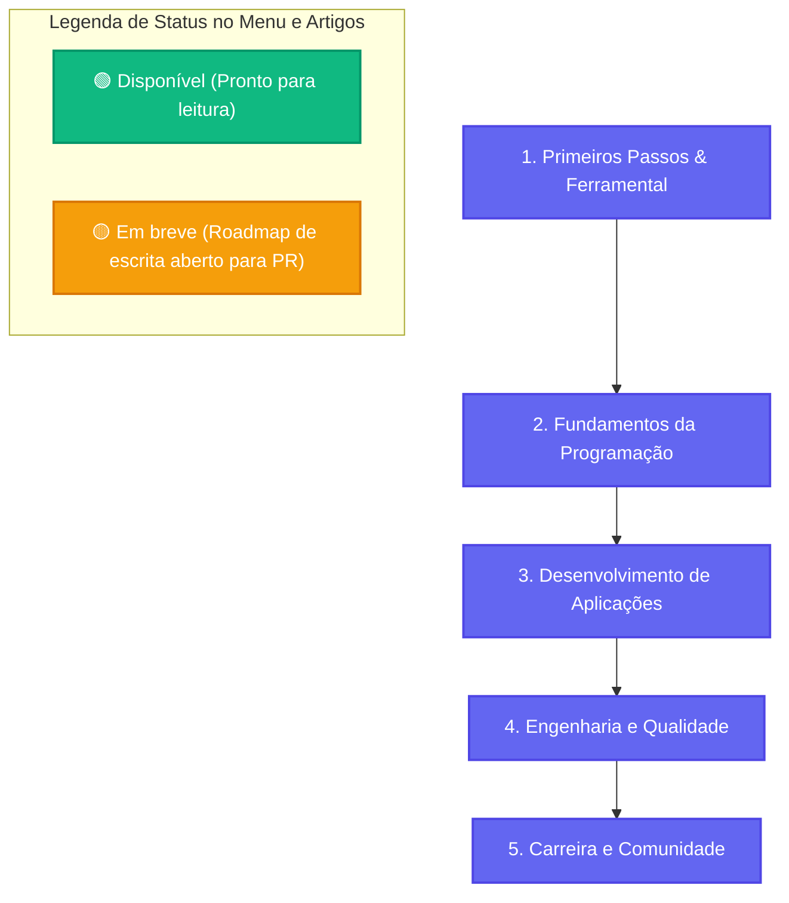
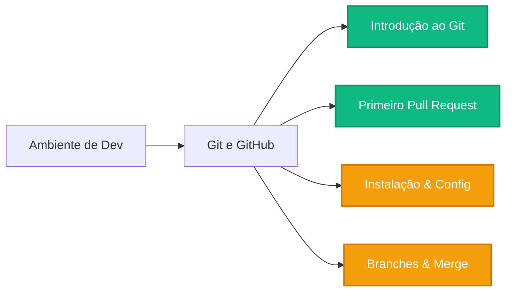
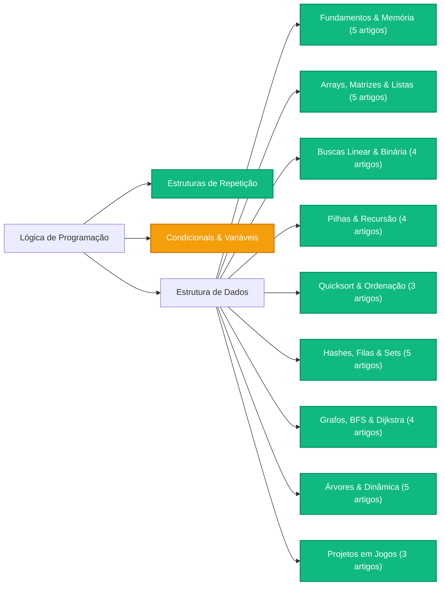
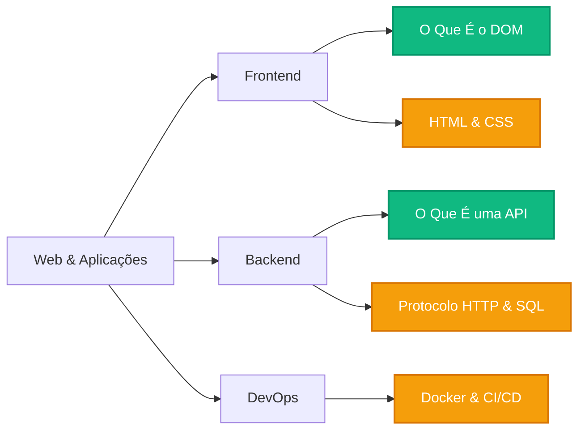
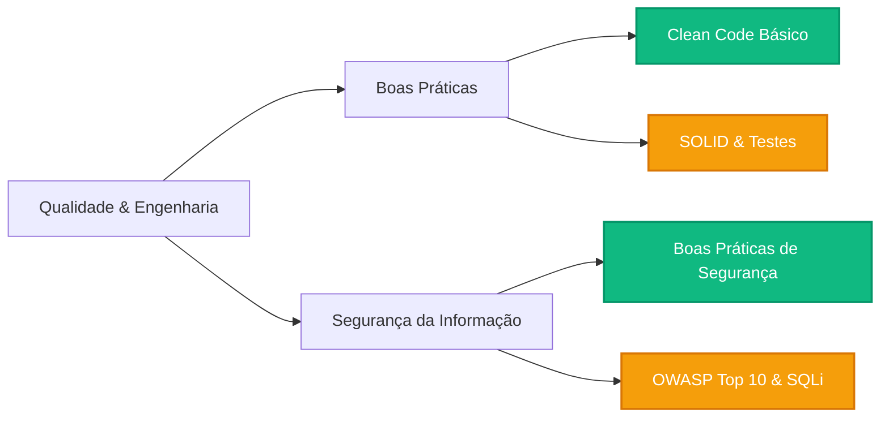

A área de Tecnologia da Informação (TI) é fascinante, mas a quantidade de linguagens, ferramentas e jargões pode ser intimidante no início. Este guia foi criado para ser o seu **ponto de partida e bússola**: um percurso sequencial progressivo com diagramas visuais e indicação clara de tudo o que já está **Disponível** e o que está **Em breve no Roadmap**.

:::tip[Filosofia de Estudos]
Mais importante do que tentar aprender tudo de uma vez é seguir uma sequência lógica e praticar ativamente. Toda a documentação da Dev Wiki é pensada em **Fases** e **Subcategorias** para evitar a sobrecarga de informações.
:::

---

## 🗺️ Visão Geral da Jornada (Roadmap das 5 Fases)

O gráfico a seguir resume a trilha de desenvolvimento recomendada para quem está ingressando na área de tecnologia:



---

## 📌 Como Identificar o Status dos Artigos

Em todo o acervo e na barra lateral de navegação à esquerda, você verá etiquetas padronizadas:

* 🟢 **`Disponível`**: Artigo com conteúdo técnico completo, exemplos de código e referências.
* 🟡 **`Em breve`**: Artigo planejado com escopo definido, aguardando redação pela comunidade aberta.
* 💡 **`Trilha`**: Página de visão geral e mapa daquela área temática.

---

## 🚀 Fase 1: Primeiros Passos & Ferramental

Antes de programar sistemas complexos, todo desenvolvedor precisa dominar a máquina, o terminal e a ferramenta universal de trabalho em equipe: o **Git**.



### [Ambiente de Desenvolvimento](/dev-wiki/ambiente-de-desenvolvimento/)
* **Conceitos fundamentais:**
  * 🟡 *Como Funciona um Computador*
  * 🟡 *Sistemas Operacionais e Sistema de Arquivos*
  * 🟡 *Como Funciona a Internet*
* **Ferramental diário:**
  * 🟡 *Terminal e Linha de Comando*
  * 🟡 *Editores de Código e IDEs*
  * 🟡 *Gerenciadores de Pacotes*

### [Git e GitHub](/dev-wiki/git-e-github/)
* **Fundamentos e configuração:**
  * 🟢 [Introdução ao Versionamento com Git](/dev-wiki/git-e-github/fundamentos-e-configuracao/introducao-ao-versionamento/)
  * 🟡 *Instalação e Configuração do Git*
  * 🟡 *Inspecionando o Histórico*
* **Ramificações e colaboração:**
  * 🟢 [Como Fazer Seu Primeiro Pull Request](/dev-wiki/git-e-github/ramificacoes-e-colaboracao/como-fazer-seu-primeiro-pull-request/)
  * 🟡 *Branches e Merge*
  * 🟡 *Repositórios Remotos*
* **Fluxos avançados:**
  * 🟡 *Resolução de Conflitos*
  * 🟡 *Desfazendo Alterações*
  * 🟡 *Boas Mensagens de Commit*
  * 🟡 *Fluxos de Trabalho com Git*

---

## 🧠 Fase 2: Fundamentos da Programação

Aprender a pensar de forma lógica e manipular dados com eficiência é a habilidade central que sustenta toda a engenharia de software.



### [Lógica de Programação](/dev-wiki/logica-de-programacao/)
* **Fundamentos:** 🟡 *O Que É um Algoritmo* | 🟡 *Variáveis e Tipos* | 🟡 *Operadores* | 🟡 *Entrada e Saída*
* **Controle de fluxo:** 🟡 *Estruturas Condicionais* | 🟢 [Estruturas de Repetição](/dev-wiki/logica-de-programacao/controle-de-fluxo/estruturas-de-repeticao/)
* **Modularização e estruturas:** 🟡 *Funções* | 🟡 *Escopo* | 🟡 *Strings e Listas*
* **Depuração e paradigmas:** 🟡 *Tratamento de Erros* | 🟡 *Depuração* | 🟡 *Paradigmas* | 🟡 *Orientação a Objetos*

### [Estrutura de Dados e Algoritmos](/dev-wiki/estrutura-de-dados/)
* 🟢 **Fundamentos (5 artigos):** Problemas e Soluções, Algoritmos, Refinamentos, Tempo de Execução, Big O.
* 🟢 **Estruturas básicas (5 artigos):** Memória, Arrays, Matrizes, Registros, Listas Encadeadas.
* 🟢 **Buscas (4 artigos):** Pesquisa Simples, Sentinela, Vetor Ordenado, Busca Binária.
* 🟢 **Recursão (4 artigos):** Pilha, Call Stack, Recursão, Dividir para Conquistar.
* 🟢 **Ordenação (3 artigos):** Seleção, Quicksort, Outros Algoritmos.
* 🟢 **Estruturas intermediárias (5 artigos):** Tabelas Hash, Colisões, Filas, Sets, TADs.
* 🟢 **Grafos (4 artigos + 1 roadmap):** Introdução, BFS, Dijkstra, Topológica | 🟡 *DFS*.
* 🟢 **Tópicos avançados (5 artigos + 3 roadmap):** BST, Gulosos, DP, KNN, NP-Completos | 🟡 *Heaps, Árvores Balanceadas, Tries*.
* 🟢 **Projetos práticos (3 artigos):** Aplicação em Jogos, Campo Minado, Flood Fill.

---

## 💻 Fase 3: Desenvolvimento de Aplicações

Aqui você constrói softwares funcionais para a Web conectando telas, regras de negócio e infraestrutura moderna.



### [Frontend](/dev-wiki/frontend/)
* **Fundamentos web:** 🟡 *HTML Semântico* | 🟡 *Formulários* | 🟡 *Fundamentos de CSS*
* **Layout e estilização:** 🟡 *Flexbox* | 🟡 *CSS Grid* | 🟡 *Design Responsivo*
* **JavaScript e navegador:** 🟡 *Fundamentos JS* | 🟢 [O Que É o DOM](/dev-wiki/frontend/javascript-e-navegador/o-que-e-o-dom/) | 🟡 *Eventos* | 🟡 *Fetch API* | 🟡 *Storage*
* **Qualidade e ecossistema:** 🟡 *Acessibilidade (a11y)* | 🟡 *Performance Web* | 🟡 *Vite e Bundlers* | 🟡 *Frameworks*

### [Backend](/dev-wiki/backend/)
* **Fundamentos e redes:** 🟡 *Modelo Cliente-Servidor* | 🟡 *Protocolo HTTP* | 🟢 [O Que É uma API](/dev-wiki/backend/fundamentos-e-redes/o-que-e-api/) | 🟡 *APIs REST*
* **Bancos de dados:** 🟡 *Introdução a Bancos* | 🟡 *SQL Básico* | 🟡 *Modelagem* | 🟡 *NoSQL* | 🟡 *ORMs*
* **Arquitetura e serviços:** 🟡 *Autenticação (JWT)* | 🟡 *Cache* | 🟡 *Filas* | 🟡 *Microsserviços* | 🟡 *GraphQL e gRPC*

### [Infraestrutura e DevOps](/dev-wiki/devops/)
* **Fundamentos e sistemas:** 🟡 *O Que É DevOps* | 🟡 *Linux para Desenvolvedores* | 🟡 *Docker e Contêineres*
* **Automação e nuvem:** 🟡 *Pipelines CI/CD* | 🟡 *Computação em Nuvem* | 🟡 *Deploy Prático*
* **Operação e escala:** 🟡 *Observabilidade (Logs e Métricas)* | 🟡 *Infraestrutura como Código*

---

## 🛡️ Fase 4: Engenharia e Qualidade

Construir código sustentável, seguro e com arquitetura sólida para equipes reais de engenharia.



### [Boas Práticas](/dev-wiki/boas-praticas/)
* **Código limpo:** 🟢 [Clean Code Básico: Legibilidade](/dev-wiki/boas-praticas/codigo-limpo/clean-code-basico/) | 🟡 *Funções Pequenas* | 🟡 *Comentários* | 🟡 *Linters*
* **Princípios e design:** 🟡 *DRY, KISS e YAGNI* | 🟡 *SOLID* | 🟡 *Code Smells* | 🟡 *Padrões de Projeto*
* **Testes e arquitetura:** 🟡 *Testes Automatizados* | 🟡 *TDD* | 🟡 *Code Review* | 🟡 *Arquitetura em Camadas*

### [Segurança da Informação](/dev-wiki/seguranca/)
* **Fundamentos e higiene:** 🟢 [Boas Práticas de Segurança](/dev-wiki/seguranca/fundamentos-e-higiene/boas-praticas-de-seguranca/) | 🟡 *Gestão de Segredos* | 🟡 *Criptografia* | 🟡 *Hashes de Senhas*
* **Vulnerabilidades web:** 🟡 *OWASP Top 10* | 🟡 *SQL Injection* | 🟡 *XSS* | 🟡 *CSRF*
* **Redes e governança:** 🟡 *HTTPS e TLS* | 🟡 *CORS* | 🟡 *Segurança de Dependências* | 🟡 *LGPD*

---

## 🌟 Fase 5: Carreira e Comunidade

Dicas práticas para transformar conhecimento técnico em oportunidades profissionais e crescimento contínuo.

### [Carreira e Comunidade](/dev-wiki/carreira/)
* **Primeiros passos:** 🟡 *Áreas de Atuação em TI* | 🟡 *Como Estudar Programação* | 🟡 *Inglês Técnico*
* **Inserção no mercado:** 🟡 *Montando Seu Portfólio* | 🟡 *Currículo e LinkedIn* | 🟡 *Entrevistas Técnicas*
* **Crescimento e comunidade:** 🟡 *Contribuindo com Open Source* | 🟡 *Soft Skills* | 🟡 *Níveis de Senioridade*

---

## 🤝 Como Contribuir com um Artigo do Roadmap?

Todo artigo marcado com 🟡 **`Em breve`** já tem uma página criada com escopo pronto aguardando a sua escrita:

1. Escolha qualquer artigo com a etiqueta **`Em breve`** no menu lateral.
2. Leia a seção *"O Que Será Abordado"* na página do artigo para entender os tópicos esperados.
3. Crie uma branch no seu repositório:
   ```bash
   git checkout -b docs/escreve-artigo-nome
   ```
4. Escreva a explicação técnica seguindo nosso tom direto ao ponto e linguagem clara.
5. Remova o aviso de "Artigo em progresso", mude a badge para `Disponível` (`variant: success`) e envie seu Pull Request!

Veja o passo a passo completo no guia [Como Fazer Seu Primeiro Pull Request](/dev-wiki/git-e-github/ramificacoes-e-colaboracao/como-fazer-seu-primeiro-pull-request/).

---

## Leituras Recomendadas

* [Roadmap.sh](https://roadmap.sh/) — Guias visuais de trilhas tecnológicas adotados pela comunidade global.
* [freeCodeCamp em Português](https://www.freecodecamp.org/portuguese/news/) — Artigos gratuitos e tutoriais práticos.
* [Primeiros Passos no Open Source](https://opensource.guide/pt/how-to-contribute/) — Cultura, comunicação e boas práticas de colaboração aberta.

:::note[Comunidade e Aprendizado Contínuo]
Este conteúdo foi construído de forma colaborativa pela comunidade. O objetivo deste projeto é compartilhar conhecimento prático, mas não nos consideramos especialistas absolutos nos tópicos — somos apenas pessoas desenvolvedoras aprendendo e se ajudando mutuamente. Encontrou algum erro, imprecisão técnica ou tem uma sugestão de melhoria? [Toda correção é bem-vinda, envie seu Pull Request!](/dev-wiki/git-e-github/ramificacoes-e-colaboracao/como-fazer-seu-primeiro-pull-request/)
:::
