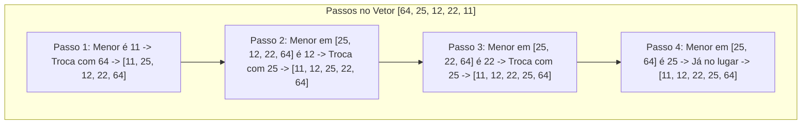

import { Tabs, TabItem } from '@astrojs/starlight/components';

## 1. Visão Geral e Intuição

O **Selection Sort (Ordenação por Seleção)** é um algoritmo clássico de ordenação baseado em comparação. O seu princípio é simples e direto:
1. Percorra todo o vetor para encontrar o **menor elemento**.
2. Troque esse menor elemento com o elemento da primeira posição.
3. Repita o processo para o restante do vetor (da segunda posição em diante), depois da terceira, e assim sucessivamente até que todo o vetor esteja ordenado.

Embora seja conceitualmente fácil de entender e implementar, seu desempenho não é eficiente para grandes volumes de dados, pois executa sempre um número de comparações proporcional a $n^2$, mesmo que o vetor já esteja parcialmente ou totalmente ordenado.

:::tip[Analogia do Mundo Real: Organizando uma Prateleira de Livros por Altura]
Imagine que você tem 10 livros desordenados na mesa e quer colocá-los na estante do mais baixo para o mais alto. Você olha todos os 10 livros, escolhe o mais baixinho de todos e o coloca na primeira vaga da estante. Em seguida, olha os 9 livros restantes, pega o mais baixo deles e coloca na segunda vaga. Você faz isso 10 vezes até organizar toda a fileira.
:::

## 2. Como Funciona a Ordenação por Seleção



### Soma Aritmética e o Custo $O(n^2)$

O número de comparações é dado pela soma da progressão aritmética:
$$
(n - 1) + (n - 2) + \dots + 2 + 1 = \frac{n(n - 1)}{2} = \frac{n^2 - n}{2} \implies O(n^2)
$$

## 3. Análise de Complexidade

| Cenário | Complexidade de Tempo | Espaço Auxiliar | Estabilidade |
| :--- | :---: | :---: | :---: |
| **Melhor Caso** | $O(n^2)$ | $O(1)$ | Não estável por padrão |
| **Caso Médio** | $O(n^2)$ | $O(1)$ | Não estável por padrão |
| **Pior Caso** | $O(n^2)$ | $O(1)$ | Não estável por padrão |

*(Nota: Selection Sort realiza no máximo $O(n)$ trocas de elementos, o que pode ser útil quando a operação de escrita na memória física for excessivamente custosa).*

## 4. Implementações Práticas

<Tabs>
  <TabItem label="Python" icon="seti:python">
  ```python
  def selection_sort(vetor: list[int]) -> list[int]:
      """
      Ordenação por Seleção in-place.
      Tempo: O(n²) em todos os casos | Espaço: O(1)
      """
      n = len(vetor)
      for i in range(n):
          indice_menor = i
          for j in range(i + 1, n):
              if vetor[j] < vetor[indice_menor]:
                  indice_menor = j

          # Troca os elementos de posição (swap)
          vetor[i], vetor[indice_menor] = vetor[indice_menor], vetor[i]

      return vetor

  if __name__ == "__main__":
      dados = [64, 25, 12, 22, 11]
      print(f"Original: {dados}")
      selection_sort(dados)
      print(f"Ordenado: {dados}") # [11, 12, 22, 25, 64]
  ```
  </TabItem>

  <TabItem label="Java" icon="seti:java">
  ```java
  import java.util.Arrays;

  public class OrdenacaoPorSelecao {
      public static void selectionSort(int[] vetor) {
          int n = vetor.length;
          for (int i = 0; i < n - 1; i++) {
              int indiceMenor = i;
              for (int j = i + 1; j < n; j++) {
                  if (vetor[j] < vetor[indiceMenor]) {
                      indiceMenor = j;
                  }
              }
              // Troca
              int temp = vetor[indiceMenor];
              vetor[indiceMenor] = vetor[i];
              vetor[i] = temp;
          }
      }

      public static void main(String[] args) {
          int[] dados = {64, 25, 12, 22, 11};
          selectionSort(dados);
          System.out.println("Ordenado: " + Arrays.toString(dados));
      }
  }
  ```
  </TabItem>
</Tabs>

## 5. Casos de Borda e Armadilhas

- **Instabilidade:** Se houver elementos iguais com posições relativas importantes (ex: registros com chaves iguais), a troca de longa distância pode alterar a ordem original relativa entre eles.
- **Não adaptativo:** Mesmo que o vetor já chegue 100% ordenado, o algoritmo continua executando todas as comparações $O(n^2)$.

## 6. Quando Usar e Trade-offs

- **Use quando:** A coleção for extremamente pequena ($n < 20$) e a simplicidade de código for o único critério, ou quando a memória auxiliar for estritamente proibida ($O(1)$) e operações de escrita em disco forem muito caras.
- **Evite quando:** $n > 100$. Prefira Quicksort, Merge Sort ou Timsort.

## 7. Exercícios Recomendados

1. **Fixação:** Demonstre o estado do vetor `[29, 10, 14, 37, 13]` após as duas primeiras passagens do Selection Sort.
2. **LeetCode 912:** [Sort an Array](https://leetcode.com/problems/sort-an-array/)

## 8. Leituras e Referências

- *Entendendo Algoritmos* — Aditya Bhargava (Capítulo 2: Ordenação por Seleção)
- *Algorithms (4th Edition)* — Robert Sedgewick
