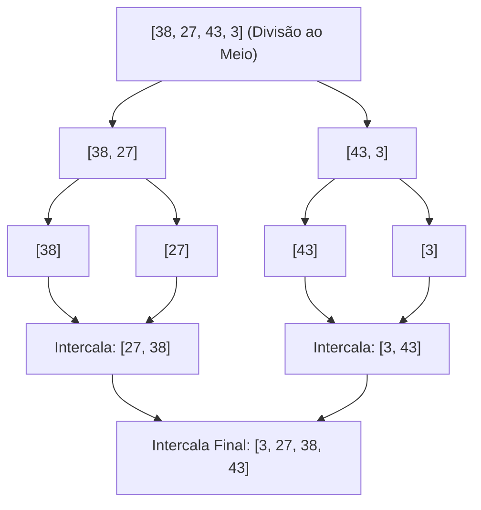

import { Tabs, TabItem } from '@astrojs/starlight/components';

## 1. Visão Geral e Famílias de Ordenação

Além do Selection Sort e Quicksort, o estudo de algoritmos de ordenação conta com um rico conjunto de abordagens clássicas, cada qual com características particulares de **estabilidade**, **adaptatividade** e **consumo de memória auxiliar**:

1. **Bubble Sort (Ordenação por Bolha):** Flutua repetidamente os maiores elementos para o final através de trocas adjacentes. Simples, mas notoriamente ineficiente ($O(n^2)$).
2. **Insertion Sort (Ordenação por Inserção):** Constrói a lista ordenada inserindo um item de cada vez na posição correta. Excepcionalmente rápido para coleções quase ordenadas ou pequenas ($O(n)$ no melhor caso).
3. **Merge Sort (Ordenação por Intercalação):** Divide o vetor ao meio até chegar a blocos unitários e depois os intercala de forma ordenada. Garante tempo $O(n \log n)$ em todos os cenários e é estável, mas consome $O(n)$ de memória extra.

:::tip[Analogia do Mundo Real: Organizando Cartas de Baralho (Insertion Sort)]
Quando você recebe uma mão de cartas em um jogo, segura as cartas na mão esquerda e pega uma carta nova da direita. Você compara a nova carta com as que já estão na mão e a "enfia" (*insert*) exatamente no lugar correto entre as cartas já ordenadas. Isso é o Insertion Sort!
:::

## 2. Quadro Comparativo Definitivo de Ordenação

| Algoritmo | Melhor Caso | Caso Médio | Pior Caso | Memória Auxiliar | Estável? | Adaptativo? |
| :--- | :---: | :---: | :---: | :---: | :---: | :---: |
| **Bubble Sort** | $O(n)$ (com flag) | $O(n^2)$ | $O(n^2)$ | $O(1)$ | Sim | Sim |
| **Selection Sort** | $O(n^2)$ | $O(n^2)$ | $O(n^2)$ | $O(1)$ | Não | Não |
| **Insertion Sort** | **$O(n)$** | $O(n^2)$ | $O(n^2)$ | $O(1)$ | **Sim** | **Sim** |
| **Merge Sort** | **$O(n \log n)$** | **$O(n \log n)$** | **$O(n \log n)$** | $O(n)$ | **Sim** | Não |
| **Quicksort** | $O(n \log n)$ | $O(n \log n)$ | $O(n^2)$ | $O(\log n)$ | Não | Não |
| **Timsort (Padrão Python/Java)** | $O(n)$ | $O(n \log n)$ | $O(n \log n)$ | $O(n)$ | Sim | Sim |

## 3. Como Funciona o Merge Sort (Intercalação)



## 4. Implementações Práticas

<Tabs>
  <TabItem label="Python (Merge Sort)" icon="seti:python">
  ```python
  def merge_sort(vetor: list[int]) -> list[int]:
      """
      Merge sort recursivo com intercalação estável.
      Complexidade: Tempo O(n log n) em todos os casos | Espaço O(n)
      """
      if len(vetor) <= 1:
          return vetor

      meio = len(vetor) // 2
      esquerda = merge_sort(vetor[:meio])
      direita = merge_sort(vetor[meio:])

      return intercalar(esquerda, direita)

  def intercalar(esq: list[int], dir: list[int]) -> list[int]:
      resultado = []
      i = j = 0
      while i < len(esq) and j < len(dir):
          if esq[i] <= dir[j]:
              resultado.append(esq[i])
              i += 1
          else:
              resultado.append(dir[j])
              j += 1
      resultado.extend(esq[i:])
      resultado.extend(dir[j:])
      return resultado

  if __name__ == "__main__":
      dados = [38, 27, 43, 3, 9, 82, 10]
      print(f"Ordenado por Merge Sort: {merge_sort(dados)}")
  ```
  </TabItem>

  <TabItem label="Java (Insertion Sort)" icon="seti:java">
  ```java
  import java.util.Arrays;

  public class OutrosAlgoritmosDeOrdenacao {
      public static void insertionSort(int[] vetor) {
          int n = vetor.length;
          for (int i = 1; i < n; i++) {
              int chave = vetor[i];
              int j = i - 1;

              // Move elementos maiores que a chave uma posição à frente
              while (j >= 0 && vetor[j] > chave) {
                  vetor[j + 1] = vetor[j];
                  j = j - 1;
              }
              vetor[j + 1] = chave;
          }
      }

      public static void main(String[] args) {
          int[] dados = {12, 11, 13, 5, 6};
          insertionSort(dados);
          System.out.println("Insertion Sort: " + Arrays.toString(dados));
      }
  }
  ```
  </TabItem>
</Tabs>

## 5. Casos de Borda e Armadilhas

- **Estabilidade:** Um algoritmo estável mantém a ordem relativa original entre chaves idênticas. Se você ordenar uma lista de pessoas por idade e depois por nome, um algoritmo estável preservará a ordem de idades para nomes repetidos. O Merge Sort e o Insertion Sort são estáveis; Quicksort e Selection Sort não são.

## 6. Quando Usar e Trade-offs

- **Insertion Sort:** O melhor algoritmo do mundo para vetores pequenos ($n < 32$) ou quando os dados já chegam quase todos ordenados (ex: fluxo contínuo de leituras de sensores com poucas correções).
- **Merge Sort:** Escolha mandatória quando você precisa de tempo garantido $O(n \log n)$ sem risco de pior caso e quando a ordenação de **Listas Encadeadas** for requerida (pois o Merge Sort não depende de acessos aleatórios por índice).

## 7. Exercícios Recomendados

1. **Fixação:** Implemente o Bubble Sort com a variável booleana `houve_troca` para alcançar complexidade $O(n)$ no melhor caso de vetor já ordenado.
2. **LeetCode 88:** [Merge Sorted Array](https://leetcode.com/problems/merge-sorted-array/)

## 8. Leituras e Referências

- *Algoritmos: Teoria e Prática* — Thomas H. Cormen et al. (Capítulo 2: Dando a Partida)
- *The Art of Computer Programming, Vol 3* — Donald Knuth
