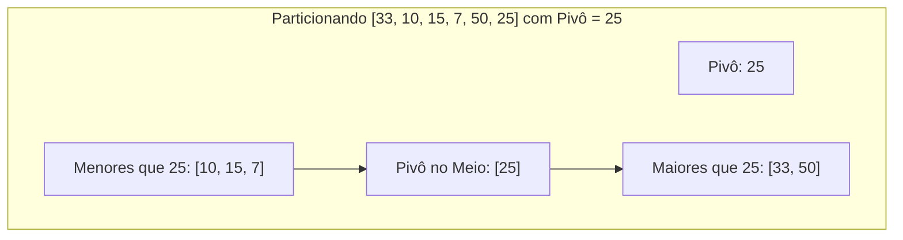

import { Tabs, TabItem } from '@astrojs/starlight/components';

## 1. Visão Geral e Intuição

Inventado por Sir Tony Hoare em 1959, o **Quicksort** é um dos algoritmos de ordenação mais rápidos e amplamente utilizados do mundo. Ele aplica a estratégia de **Dividir para Conquistar** através de um processo chamado **Particionamento**.

O algoritmo funciona escolhendo um elemento do vetor denominado **Pivô (*Pivot*)**. Em seguida, reorganiza o vetor de modo que:
- Todos os elementos menores que o pivô fiquem à sua esquerda.
- Todos os elementos maiores fiquem à sua direita.
- O pivô estará, portanto, em sua posição final correta e definitiva!

Por fim, o Quicksort ordena recursivamente as duas metades restantes (esquerda e direita).

:::tip[Analogia do Mundo Real: Formando a Fila por Altura na Escola]
O professor escolhe um aluno aleatório da turma (o Pivô). Em seguida, dá a ordem: *"Todos os alunos que forem mais baixos que ele vão para o lado esquerdo da quadra; quem for mais alto vai para o lado direito"*. O aluno escolhido fica exatamente no lugar certo. Agora, o professor repete a instrução para o grupo da esquerda e para o grupo da direita separadamente. Rapidamente a turma inteira fica ordenada sem que todos precisem se comparar com todos!
:::

## 2. Como Funciona o Particionamento (Esquema de Lomuto)



Quando as chamadas recursivas atingem os casos-base (vetores vazios ou com 1 único elemento), todo o conjunto está ordenado.

## 3. Análise de Complexidade

| Cenário | Complexidade de Tempo | Espaço Auxiliar | Causa |
| :--- | :---: | :---: | :--- |
| **Melhor Caso** | $O(n \log n)$ | $O(\log n)$ | O pivô sempre divide o vetor em duas metades perfeitamente iguais. |
| **Caso Médio** | $O(n \log n)$ | $O(\log n)$ | Pivôs razoavelmente balanceados ao longo das divisões. |
| **Pior Caso** | $O(n^2)$ | $O(n)$ | O pivô escolhido é sempre o extremo (menor ou maior) em vetor já ordenado. |

*(Nota: Na prática, com escolha de pivô aleatório ou método da "mediana de 3", a probabilidade de ocorrer o pior caso é praticamente nula).*

## 4. Implementações Práticas

<Tabs>
  <TabItem label="Python" icon="seti:python">
  ```python
  def quicksort(vetor: list[int]) -> list[int]:
      """
      Quicksort idiomático e funcional com Dividir para Conquistar.
      Tempo Médio: O(n log n) | Espaço: O(n)
      """
      # 1. Caso-base: 0 ou 1 elemento já estão ordenados
      if len(vetor) <= 1:
          return vetor

      # 2. Escolha do pivô (aqui, o elemento central)
      pivo = vetor[len(vetor) // 2]

      # 3. Particionamento
      menores = [x for x in vetor if x < pivo]
      iguais  = [x for x in vetor if x == pivo]
      maiores = [x for x in vetor if x > pivo]

      # 4. Conquista recursiva e combinação
      return quicksort(menores) + iguais + quicksort(maiores)

  if __name__ == "__main__":
      dados = [10, 5, 2, 3, 9, 8, 7]
      print(f"Original: {dados}")
      print(f"Ordenado: {quicksort(dados)}")
  ```
  </TabItem>

  <TabItem label="Java" icon="seti:java">
  ```java
  import java.util.Arrays;

  public class Quicksort {
      public static void quicksortInPlace(int[] vetor, int baixo, int alto) {
          if (baixo < alto) {
              int indicePivo = particionar(vetor, baixo, alto);
              quicksortInPlace(vetor, baixo, indicePivo - 1);
              quicksortInPlace(vetor, indicePivo + 1, alto);
          }
      }

      private static int particionar(int[] vetor, int baixo, int alto) {
          int pivo = vetor[alto]; // Particionamento Lomuto usando último elemento
          int i = baixo - 1;

          for (int j = baixo; j < alto; j++) {
              if (vetor[j] <= pivo) {
                  i++;
                  trocar(vetor, i, j);
              }
          }
          trocar(vetor, i + 1, alto);
          return i + 1;
      }

      private static void trocar(int[] vetor, int i, int j) {
          int temp = vetor[i];
          vetor[i] = vetor[j];
          vetor[j] = temp;
      }

      public static void main(String[] args) {
          int[] dados = {10, 5, 2, 3, 9, 8, 7};
          quicksortInPlace(dados, 0, dados.length - 1);
          System.out.println("Ordenado in-place: " + Arrays.toString(dados));
      }
  }
  ```
  </TabItem>
</Tabs>

## 5. Casos de Borda e Armadilhas

- **Pior Caso com Vetor Já Ordenado:** Se você sempre escolher o primeiro elemento como pivô e o vetor já estiver ordenado, a árvore terá profundidade $n$ em vez de $\log n$, degradando para $O(n^2)$.
- **Solução:** Escolha o pivô como elemento aleatório (`random`) ou tome a mediana entre o primeiro, o do meio e o último elemento.

## 6. Quando Usar e Trade-offs

- **Use quando:** Precisar da ordenação em memória mais veloz na média para tipos primitivos, com boa localidade de cache de CPU.
- **Evite quando:** Você necessitar de ordenação **estável** (garantia de preservar a ordem relativa de chaves iguais) ou quando o pior caso de $O(n^2)$ for inaceitável em sistemas de tempo real rígido (nesse caso, use **Merge Sort** ou **Heap Sort**).

## 7. Exercícios Recomendados

1. **Fixação:** Implemente a seleção de pivô utilizando a estratégia da "mediana de três" (primeiro, meio e último).
2. **LeetCode 215:** [Kth Largest Element in an Array](https://leetcode.com/problems/kth-largest-element-in-an-array/) (solucionável com Quickselect em tempo médio $O(n)$).

## 8. Leituras e Referências

- *Entendendo Algoritmos* — Aditya Bhargava (Capítulo 4: Quicksort)
- *Introduction to Algorithms (CLRS)* — Capítulo 7: Quicksort
