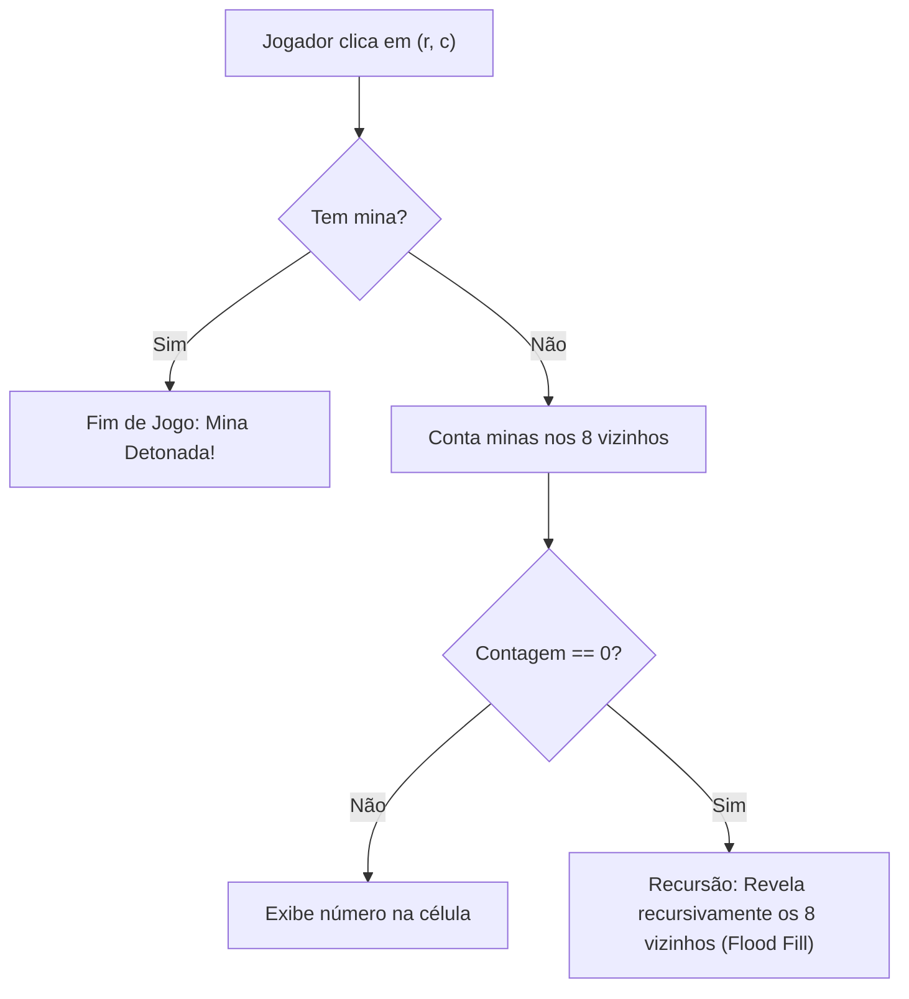

import { Tabs, TabItem } from '@astrojs/starlight/components';

## 1. Visão Geral e Intuição

O **Campo Minado (Minesweeper)** é um dos projetos práticos mais ricos e didáticos para consolidar conhecimentos de matrizes, registros, recursão e algoritmos de busca. O objetivo do jogador é revelar todas as células do tabuleiro sem detonar nenhuma das minas ocultas.

Quando o jogador clica em uma célula:
1. Se for uma **mina**, o jogo termina imediatamente com derrota (*Game Over*).
2. Se houver minas vizinhas nas 8 casas adjacentes (horizontal, vertical e diagonais), a célula exibe o **número de minas vizinhas** (de 1 a 8).
3. Se a célula for completamente vazia (0 minas vizinhas), o jogo dispara um efeito dominó de **revelação em cadeia recursiva (Flood Fill)**, abrindo automaticamente todos os vizinhos vazios contíguos até encontrar células com números!

:::tip[Analogia do Mundo Real: O Radar de Proximidade]
Pense no tabuleiro como um mapa onde cada célula possui um sensor de proximidade passivo. Se nenhum perigo estiver a até 1 metro de distância, o mapa expande o raio seguro automaticamente até delimitar a zona com alertas numéricos de perigo iminente.
:::

## 2. A Estrutura do Tabuleiro e as 8 Direções Adjacentes

Para examinar todos os 8 vizinhos de uma célula $(r, c)$, utilizamos arrays de deslocamento de coordenadas:

```python
# 8 direções: cima, baixo, esquerda, direita e 4 diagonais
DIRECOES = [
    (-1, -1), (-1, 0), (-1, 1),
    ( 0, -1),          ( 0, 1),
    ( 1, -1), ( 1, 0), ( 1, 1)
]
```



## 3. Implementação Prática da Lógica Completa

<Tabs>
  <TabItem label="Python" icon="seti:python">
  ```python
  import random
  from dataclasses import dataclass

  @dataclass
  class CelulaMinada:
      tem_mina: bool = False
      revelada: bool = False
      minas_vizinhas: int = 0

  class CampoMinado:
      DIRECOES = [(-1, -1), (-1, 0), (-1, 1), (0, -1), (0, 1), (1, -1), (1, 0), (1, 1)]

      def __init__(self, linhas: int = 6, colunas: int = 6, total_minas: int = 5):
          self.linhas = linhas
          self.colunas = colunas
          self.total_minas = total_minas
          self.tabuleiro = [[CelulaMinada() for _ in range(colunas)] for _ in range(linhas)]
          self._sortear_minas()
          self._calcular_vizinhos()

      def _sortear_minas(self) -> None:
          posicoes = [(r, c) for r in range(self.linhas) for c in range(self.colunas)]
          sorteadas = random.sample(posicoes, self.total_minas)
          for r, c in sorteadas:
              self.tabuleiro[r][c].tem_mina = True

      def _calcular_vizinhos(self) -> None:
          for r in range(self.linhas):
              for c in range(self.colunas):
                  if self.tabuleiro[r][c].tem_mina:
                      continue
                  contagem = 0
                  for dr, dc in self.DIRECOES:
                      nr, nc = r + dr, c + dc
                      if 0 <= nr < self.linhas and 0 <= nc < self.colunas:
                          if self.tabuleiro[nr][nc].tem_mina:
                              contagem += 1
                  self.tabuleiro[r][c].minas_vizinhas = contagem

      def clicar(self, r: int, c: int) -> bool:
          """Retorna False se pisou em mina (derrota), True se seguro."""
          if not (0 <= r < self.linhas and 0 <= c < self.colunas):
              return True
          celula = self.tabuleiro[r][c]
          if celula.revelada:
              return True

          celula.revelada = True
          if celula.tem_mina:
              return False # Derrota

          # Se não houver minas ao redor, propaga recursivamente
          if celula.minas_vizinhas == 0:
              for dr, dc in self.DIRECOES:
                  self.clicar(r + dr, c + dc)

          return True

      def exibir(self) -> None:
          for linha in self.tabuleiro:
              rep = []
              for cel in linha:
                  if not cel.revelada:
                      rep.append("?")
                  elif cel.tem_mina:
                      rep.append("*")
                  elif cel.minas_vizinhas == 0:
                      rep.append(" ")
                  else:
                      rep.append(str(cel.minas_vizinhas))
              print(" ".join(rep))

  if __name__ == "__main__":
      jogo = CampoMinado(linhas=5, colunas=5, total_minas=3)
      print("Tabuleiro inicial oculto:")
      jogo.exibir()
      print("\nClicando em (0, 0)...")
      seguro = jogo.clicar(0, 0)
      print("Resultado do clique (seguro =", seguro, "):")
      jogo.exibir()
  ```
  </TabItem>

  <TabItem label="Java" icon="seti:java">
  ```java
  public class ConstruindoOCampoMinado {
      public static class Celula {
          public boolean temMina = false;
          public boolean revelada = false;
          public int minasVizinhas = 0;
      }

      public static class JogoCampoMinado {
          private final int linhas = 5, colunas = 5;
          private final Celula[][] grid = new Celula[linhas][colunas];
          private static final int[][] DIRS = {
              {-1,-1},{-1,0},{-1,1},{0,-1},{0,1},{1,-1},{1,0},{1,1}
          };

          public JogoCampoMinado() {
              for (int r = 0; r < linhas; r++) {
                  for (int c = 0; c < colunas; c++) {
                      grid[r][c] = new Celula();
                  }
              }
          }

          public boolean clicar(int r, int c) {
              if (r < 0 || r >= linhas || c < 0 || c >= colunas) return true;
              if (grid[r][c].revelada) return true;

              grid[r][c].revelada = true;
              if (grid[r][c].temMina) return false;

              if (grid[r][c].minasVizinhas == 0) {
                  for (int[] d : DIRS) {
                      clicar(r + d[0], c + d[1]);
                  }
              }
              return true;
          }
      }

      public static void main(String[] args) {
          JogoCampoMinado campo = new JogoCampoMinado();
          System.out.println("Lógica do Campo Minado inicializada!");
      }
  }
  ```
  </TabItem>
</Tabs>

## 4. Casos de Borda e Armadilhas

- **Garantia do Primeiro Clique Seguro:** No Campo Minado clássico moderno, o primeiro clique do jogador nunca pode conter uma mina. Se o jogador clicar em uma mina no lance inicial, o jogo deve mover a mina para outro local e recalcular os vizinhos antes de exibir o tabuleiro.
- **Recursão sem Checagem de `revelada`:** Se você não marcar `celula.revelada = True` antes da chamada recursiva, os vizinhos chamarão um ao outro infinitamente, estourando a Call Stack.

## 5. Exercícios Recomendados

1. **Fixação:** Implemente a condição de vitória do jogo: o jogador vence quando a quantidade de células não reveladas for exatamente igual ao número total de minas.
2. **LeetCode 529:** [Minesweeper](https://leetcode.com/problems/minesweeper/)

## 6. Leituras e Referências

- *The Mathematics of Minesweeper* — Richard Kaye (Provou que a consistência do tabuleiro do Campo Minado é NP-Completa)
- *Game Programming Patterns* — Robert Nystrom
