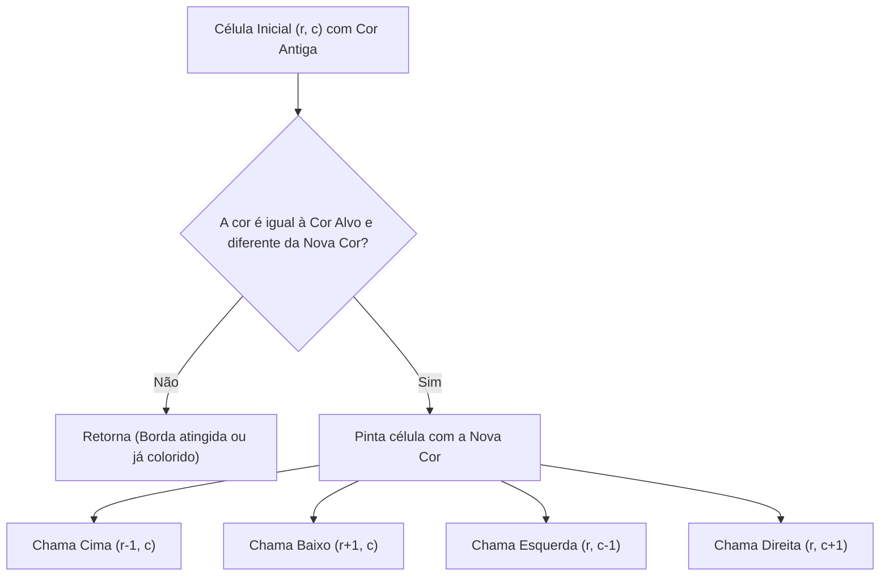

import { Tabs, TabItem } from '@astrojs/starlight/components';

## 1. Visão Geral e Intuição

O algoritmo de **Inundação (Flood Fill)** é a técnica clássica de processamento gráfico que determina e altera a área conectada a um determinado nó em uma matriz multidimensional. É exatamente o algoritmo utilizado pela ferramenta de **Balde de Tinta** de editores como Paint e Photoshop, bem como a mecânica central de quebra-cabeças casuais como o *Jogo da Inundação (Flood-It)*, Candy Crush e a revelação de áreas do Campo Minado.

Dado um ponto inicial na grade $(r, c)$, uma **cor original** e uma **nova cor**, o algoritmo percorre todas as células contíguas que compartilham da mesma cor original e as substitui pela nova cor, expandindo-se pelas 4 direções cardeais (cima, baixo, esquerda, direita).

:::tip[Analogia do Mundo Real: O Café Derramado no Guardanapo]
Se você encostar a ponta de uma caneta tinteiro em um guardanapo de papel absorvente, a tinta se espalha radialmente para todas as fibras secas vizinhas. Ela continua se espalhando até encontrar as bordas do papel ou uma fita adesiva impermeável que bloqueia o avanço.
:::

## 2. Abordagens de Implementação: DFS Recursivo vs. BFS com Fila

O Flood Fill pode ser visto como uma busca em grafos onde cada célula da matriz é um vértice, e há arestas conectando células vizinhas que possuem a mesma cor:



## 3. Análise de Complexidade

| Métrica | Complexidade | Explicação |
| :--- | :---: | :--- |
| **Tempo de Execução** | $O(M \times N)$ | No pior caso (uma imagem inteira de uma só cor), cada um dos pixels é visitado uma vez. |
| **Espaço Auxiliar (DFS)** | $O(M \times N)$ | Pilha de recursão no pior caso de imagem serpenteada. |
| **Espaço Auxiliar (BFS)** | $O(\min(M, N))$ | Tamanho máximo da fila de fronteira (*perímetro*). |

## 4. Implementações Práticas

<Tabs>
  <TabItem label="Python (DFS e BFS)" icon="seti:python">
  ```python
  from collections import deque

  def flood_fill_dfs(imagem: list[list[int]], r: int, c: int, nova_cor: int) -> list[list[int]]:
      """
      Flood Fill utilizando Busca em Profundidade (DFS recursivo).
      """
      cor_original = imagem[r][c]
      if cor_original == nova_cor:
          return imagem

      linhas, colunas = len(imagem), len(imagem[0])

      def preencher(i: int, j: int) -> None:
          if not (0 <= i < linhas and 0 <= j < colunas):
              return
          if imagem[i][j] != cor_original:
              return

          imagem[i][j] = nova_cor
          preencher(i + 1, j) # Baixo
          preencher(i - 1, j) # Cima
          preencher(i, j + 1) # Direita
          preencher(i, j - 1) # Esquerda

      preencher(r, c)
      return imagem

  if __name__ == "__main__":
      grade = [
          [1, 1, 1],
          [1, 1, 0],
          [1, 0, 1]
      ]
      print("Antes da inundação:")
      for l in grade: print(l)

      flood_fill_dfs(grade, r=1, c=1, nova_cor=2)

      print("\nApós inundação com cor 2:")
      for l in grade: print(l)
  ```
  </TabItem>

  <TabItem label="Java (BFS com Fila)" icon="seti:java">
  ```java
  import java.util.ArrayDeque;
  import java.util.Arrays;
  import java.util.Queue;

  public class JogoDaInundacaoFloodfill {
      public static int[][] floodFillBFS(int[][] imagem, int sr, int sc, int novaCor) {
          int corOriginal = imagem[sr][sc];
          if (corOriginal == novaCor) return imagem;

          int linhas = imagem.length;
          int colunas = imagem[0].length;
          Queue<int[]> fila = new ArrayDeque<>();
          fila.offer(new int[]{sr, sc});
          imagem[sr][sc] = novaCor;

          int[][] direcoes = {{1, 0}, {-1, 0}, {0, 1}, {0, -1}};

          while (!fila.isEmpty()) {
              int[] atual = fila.poll();
              int r = atual[0], c = atual[1];

              for (int[] d : direcoes) {
                  int nr = r + d[0], nc = c + d[1];
                  if (nr >= 0 && nr < linhas && nc >= 0 && nc < colunas && imagem[nr][nc] == corOriginal) {
                      imagem[nr][nc] = novaCor;
                      fila.offer(new int[]{nr, nc});
                  }
              }
          }
          return imagem;
      }

      public static void main(String[] args) {
          int[][] tela = {
              {1, 1, 1},
              {1, 1, 0},
              {1, 0, 1}
          };
          floodFillBFS(tela, 1, 1, 2);
          for (int[] linha : tela) {
              System.out.println(Arrays.toString(linha));
          }
      }
  }
  ```
  </TabItem>
</Tabs>

## 5. Casos de Borda e Armadilhas

- **Cor Nova Idêntica à Cor Original:** Se `imagem[r][c] == nova_cor`, a recursão chamará indefinidamente o vizinho sem nunca alterar o critério de parada, gerando `StackOverflowError`. A checagem inicial `if cor_original == nova_cor: return` é mandatória.
- **Tamanho de Imagens em Produção:** Em imagens de alta resolução ($4000 \times 3000$ pixels), a recursão DFS estourará o limite de pilha. Em ferramentas profissionais de pintura, utiliza-se BFS iterativa ou o algoritmo otimizado de **Scanline Flood Fill**.

## 6. Quando Usar e Trade-offs

- **Processamento de Imagens Médicas e Visão Computacional:** Segmentação de órgãos em tomografias computadorizadas ou contagem de células em lâminas microscópicas.
- **Jogos de Tabuleiro:** Contagem de territórios cercados no jogo milenar *Go*.

## 7. Exercícios Recomendados

1. **Fixação:** Implemente a contagem de "ilhas" (número de componentes conectados de terra cercados por água) em uma matriz binária.
2. **LeetCode 733:** [Flood Fill](https://leetcode.com/problems/flood-fill/)
3. **LeetCode 200:** [Number of Islands](https://leetcode.com/problems/number-of-islands/)

## 8. Leituras e Referências

- *Computer Graphics: Principles and Practice* — Foley, van Dam et al.
- *Entendendo Algoritmos* — Aditya Bhargava
