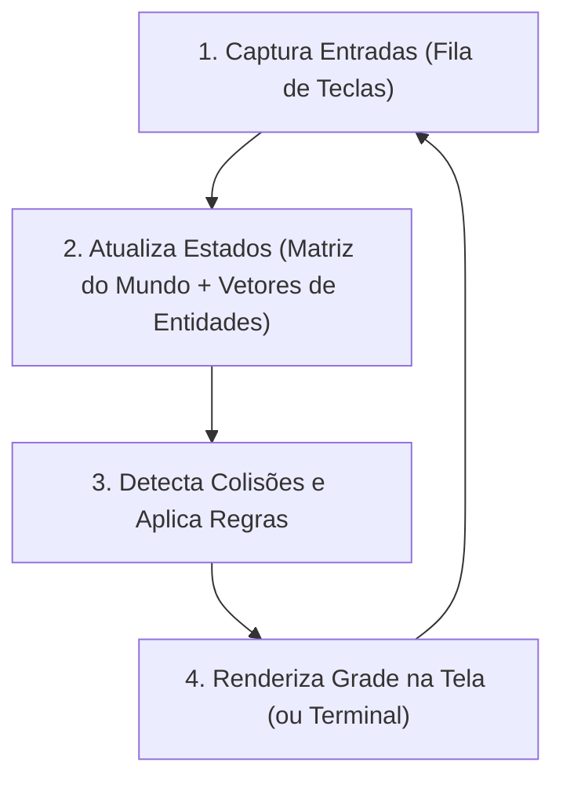

import { Tabs, TabItem } from '@astrojs/starlight/components';

## 1. Visão Geral e Intuição

O desenvolvimento de jogos digitais é um dos campos mais férteis e exigentes para a aplicação prática de **Estruturas de Dados e Algoritmos**. Cada mecânica de um jogo — desde a movimentação de um personagem até a detecção de colisões e inteligência artificial de inimigos — é fundamentada nas estruturas elementares que estudamos:

- **Matrizes 2D:** Representam tabuleiros (Xadrez, Campo Minado, Batalha Naval) e mapas baseados em *tiles* (como no clássico Pac-Man, Pokémon ou Terraria).
- **Vetores e Listas:** Gerenciam inventários de itens, projéteis na tela e listas de entidades ativas.
- **Filas:** Fila de eventos de teclado/gamepad processados pelo *Game Loop*.
- **Grafos e Busca (BFS / A*):** Guiam o algoritmo de *Pathfinding* (busca de caminho) para inimigos perseguirem o jogador contornando obstáculos.

:::tip[Analogia do Mundo Real: O Tabuleiro de Xadrez]
Uma partida de xadrez acontece em um espaço discreto de $8 \times 8$ casas. Para o computador, isso é uma Matriz de inteiros onde cada número codifica uma peça (ex: 1 = Peão, 2 = Cavalo, -1 = Peão Preto). Cada movimento válido é um cálculo aritmético de índices $[linha, coluna]$.
:::

## 2. A Arquitetura do Game Loop e o Estado do Tabuleiro



## 3. Estruturação de Entidades com TADs

Um jogo profissional desacopla a representação dos dados da renderização visual. Criamos um TAD `Tabuleiro` ou `Engine` que expõe métodos de alto nível como:
- `mover_entidade(origem, destino)`
- `posicao_valida(linha, coluna)`
- `esta_ocupado(linha, coluna)`

## 4. Implementação Prática: Tabuleiro Genérico de Grade 2D

<Tabs>
  <TabItem label="Python" icon="seti:python">
  ```python
  from enum import Enum
  from typing import Optional

  class TipoTerreno(Enum):
      GRAMA = "."
      PAREDE = "#"
      AGUA = "~"
      JOGADOR = "@"

  class TabuleiroGrade:
      def __init__(self, linhas: int, colunas: int):
          self.linhas = linhas
          self.colunas = colunas
          # Matriz 2D inicializada com grama
          self.grade: list[list[TipoTerreno]] = [
              [TipoTerreno.GRAMA for _ in range(colunas)] for _ in range(linhas)
          ]

      def dentro_dos_limites(self, r: int, c: int) -> bool:
          return 0 <= r < self.linhas and 0 <= c < self.colunas

      def definir_celula(self, r: int, c: int, tipo: TipoTerreno) -> bool:
          if self.dentro_dos_limites(r, c):
              self.grade[r][c] = tipo
              return True
          return False

      def renderizar_texto(self) -> str:
          return "\n".join(" ".join(celula.value for celula in linha) for linha in self.grade)

  if __name__ == "__main__":
      mapa = TabuleiroGrade(linhas=5, colunas=5)
      mapa.definir_celula(0, 0, TipoTerreno.JOGADOR)
      mapa.definir_celula(2, 2, TipoTerreno.PAREDE)
      mapa.definir_celula(2, 3, TipoTerreno.PAREDE)
      print(mapa.renderizar_texto())
  ```
  </TabItem>

  <TabItem label="Java" icon="seti:java">
  ```java
  public class AplicacaoEmJogos {
      public enum Celula { VAZIO, PAREDE, JOGADOR }

      public static class GradeJogo {
          private final int linhas;
          private final int colunas;
          private final Celula[][] matriz;

          public GradeJogo(int linhas, int colunas) {
              this.linhas = linhas;
              this.colunas = colunas;
              this.matriz = new Celula[linhas][colunas];
              for (int r = 0; r < linhas; r++) {
                  for (int c = 0; c < colunas; c++) {
                      matriz[r][c] = Celula.VAZIO;
                  }
              }
          }

          public boolean moverJogador(int rOrigem, int cOrigem, int rDestino, int cDestino) {
              if (rDestino < 0 || rDestino >= linhas || cDestino < 0 || cDestino >= colunas) return false;
              if (matriz[rDestino][cDestino] == Celula.PAREDE) return false;

              matriz[rOrigem][cOrigem] = Celula.VAZIO;
              matriz[rDestino][cDestino] = Celula.JOGADOR;
              return true;
          }
      }

      public static void main(String[] args) {
          GradeJogo jogo = new GradeJogo(5, 5);
          System.out.println("Grade de jogo inicializada com sucesso!");
      }
  }
  ```
  </TabItem>
</Tabs>

## 5. Casos de Borda e Armadilhas

- **Verificação de Limites de Borda (*Out of Bounds*):** Em matrizes de jogos, consultar o vizinho à esquerda de uma célula na coluna 0 causará erro fatal de índice negativo se não houver um método utilitário `is_valid(r, c)`.
- **Alocação Excessiva no Loop:** Instanciar novos objetos dentro da função `update()` que roda 60 vezes por segundo força coletas frequentes do Garbage Collector, causando travamentos (*stuttering*). Reutilize instâncias (*Object Pooling*).

## 6. Quando Usar e Trade-offs

- Para mundos discretos divididos em blocos ou células, matrizes simples de inteiros proporcionam tempo $O(1)$ de leitura e escrita e extrema simplicidade matemática.

## 7. Exercícios Recomendados

1. **Fixação:** Implemente a verificação de vitória para um jogo da velha 3x3 (verificar linhas, colunas e duas diagonais principais).
2. **LeetCode 1275:** [Find Winner on a Tic Tac Toe Game](https://leetcode.com/problems/find-winner-on-a-tic-tac-toe-game/)

## 8. Leituras e Referências

- *Game Programming Patterns* — Robert Nystrom
- *Killer Game Programming in Java* — Andrew Davison
