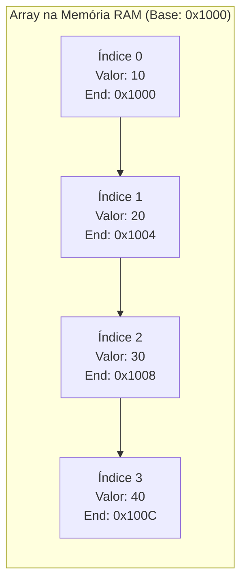

import { Tabs, TabItem } from '@astrojs/starlight/components';

## 1. Visão Geral e Intuição

Um **Array (ou Vetor)** é a estrutura de dados mais elementar da computação. Consiste em uma coleção homogênea (todos os elementos possuem o mesmo tipo de dado) e indexada, armazenada em posições estritamente **contíguas** de memória.

A grande vantagem de um array é o **acesso aleatório imediato ($O(1)$)**: dado um índice numérico qualquer, a CPU calcula o endereço de memória e recupera o valor em tempo constante. No entanto, sua principal desvantagem é a rigidez para inserções e deleções no meio da estrutura, que exigem o deslocamento (*shift*) de múltiplos elementos.

:::tip[Analogia do Mundo Real: Assentos de Cinema]
Pense em uma fileira de cadeiras numeradas de 0 a 9 em uma sala de cinema. Se você tem o bilhete com o assento 4, vai direto até lá sem olhar as outras cadeiras ($O(1)$). Mas se uma pessoa quiser sentar exatamente entre os assentos 2 e 3, todas as pessoas do assento 3 ao 9 terão que se levantar e andar uma cadeira para a direita ($O(n)$).
:::

## 2. Como Funciona na Memória

Como os elementos são gravados um imediatamente após o outro na memória física:



### Mecânica de Inserção e Deleção

- **Inserção no Início:** Requer deslocar todos os $n$ elementos uma casa à frente ($O(n)$).
- **Inserção no Fim:** Se houver capacidade alocada disponível, basta escrever na próxima gaveta ($O(1)$). Se o array estiver lotado, é necessário alocar um novo array (geralmente com o dobro da capacidade) e copiar todos os dados ($O(n)$ amortizado).
- **Deleção no Meio:** Remove o item e desloca todos os sucessores para a esquerda para fechar a lacuna ($O(n)$).

## 3. Análise de Complexidade

| Operação | Melhor Caso | Caso Médio | Pior Caso | Espaço Auxiliar |
| :--- | :---: | :---: | :---: | :---: |
| **Acesso por Índice** | $O(1)$ | $O(1)$ | $O(1)$ | $O(1)$ |
| **Busca por Valor (Não Ordenado)** | $O(1)$ | $O(n)$ | $O(n)$ | $O(1)$ |
| **Inserção no Fim** | $O(1)$ | $O(1)$ amortizado | $O(n)$ (quando redimensiona) | $O(1)$ |
| **Inserção no Início ou Meio** | $O(1)$ | $O(n)$ | $O(n)$ | $O(1)$ |
| **Remoção no Início ou Meio** | $O(1)$ | $O(n)$ | $O(n)$ | $O(1)$ |

## 4. Implementações Práticas

<Tabs>
  <TabItem label="Python" icon="seti:python">
  ```python
  class MeuVetorEstatico:
      def __init__(self, capacidade: int):
          self.capacidade = capacidade
          self.tamanho = 0
          self.dados: list[int | None] = [None] * capacidade

      def obter(self, indice: int) -> int:
          if not (0 <= indice < self.tamanho):
              raise IndexError("Índice fora dos limites válidos.")
          return self.dados[indice]  # type: ignore

      def inserir(self, indice: int, valor: int) -> None:
          if self.tamanho >= self.capacidade:
              raise OverflowError("Vetor com capacidade esgotada.")
          if not (0 <= indice <= self.tamanho):
              raise IndexError("Índice inválido para inserção.")

          # Desloca elementos à direita
          for i in range(self.tamanho, indice, -1):
              self.dados[i] = self.dados[i - 1]

          self.dados[indice] = valor
          self.tamanho += 1

      def remover(self, indice: int) -> int:
          if not (0 <= indice < self.tamanho):
              raise IndexError("Índice fora dos limites.")
          
          valor_removido = self.dados[indice]
          # Desloca elementos para a esquerda
          for i in range(indice, self.tamanho - 1):
              self.dados[i] = self.dados[i + 1]

          self.dados[self.tamanho - 1] = None
          self.tamanho -= 1
          return valor_removido  # type: ignore

  if __name__ == "__main__":
      v = MeuVetorEstatico(capacidade=5)
      v.inserir(0, 100)
      v.inserir(1, 200)
      v.inserir(1, 150)  # [100, 150, 200]
      print(f"Item no índice 1: {v.obter(1)}")  # 150
      v.remover(1)
      print(f"Item no índice 1 após remoção: {v.obter(1)}")  # 200
  ```
  </TabItem>

  <TabItem label="Java" icon="seti:java">
  ```java
  import java.util.Arrays;

  public class ArraysVetores {
      public static class VetorEstatico {
          private final int[] dados;
          private int tamanho;

          public VetorEstatico(int capacidade) {
              this.dados = new int[capacidade];
              this.tamanho = 0;
          }

          public int obter(int indice) {
              if (indice < 0 || indice >= tamanho) {
                  throw new IndexOutOfBoundsException("Índice inválido: " + indice);
              }
              return dados[indice];
          }

          public void inserir(int indice, int valor) {
              if (tamanho >= dados.length) {
                  throw new IllegalStateException("Vetor completamente cheio.");
              }
              if (indice < 0 || indice > tamanho) {
                  throw new IndexOutOfBoundsException("Posição de inserção inválida.");
              }

              // Deslocamento para a direita
              for (int i = tamanho; i > indice; i--) {
                  dados[i] = dados[i - 1];
              }
              dados[indice] = valor;
              tamanho++;
          }

          public int remover(int indice) {
              if (indice < 0 || indice >= tamanho) {
                  throw new IndexOutOfBoundsException("Índice fora dos limites.");
              }
              int removido = dados[indice];
              for (int i = indice; i < tamanho - 1; i++) {
                  dados[i] = dados[i + 1];
              }
              tamanho--;
              return removido;
          }

          public int getTamanho() { return tamanho; }
      }

      public static void main(String[] args) {
          VetorEstatico v = new VetorEstatico(5);
          v.inserir(0, 10);
          v.inserir(1, 30);
          v.inserir(1, 20); // 10, 20, 30
          System.out.println("Posição 1: " + v.obter(1)); // 20
          v.remover(1);
          System.out.println("Posição 1 após remoção: " + v.obter(1)); // 30
      }
  }
  ```
  </TabItem>
</Tabs>

## 5. Casos de Borda e Armadilhas

- **Erro *Off-by-One*:** Tentar ler o índice `len(array)` em vez de `len(array) - 1`.
- **Esgotamento de Limite:** Inserir além da capacidade fixa resulta em estouro de pilha/array (*ArrayIndexOutOfBoundsException*).
- **Arrays Dinâmicos:** Em linguagens como Python (`list`) e Java (`ArrayList`), o redimensionamento é automático, mas acarreta custo temporal temporário ao duplicar o tamanho da memória alocada.

## 6. Quando Usar e Trade-offs

- **Use quando:** O tamanho da coleção for conhecido antecipadamente, acessos por índice forem muito frequentes e a eficiência do cache da CPU for prioridade.
- **Evite quando:** Inserções e remoções constantes no meio da estrutura forem frequentes (prefira Listas Encadeadas).

## 7. Exercícios Recomendados

1. **Fixação:** Implemente um método que inverte os elementos de um vetor *in-place* (sem alocar um segundo vetor auxiliar).
2. **LeetCode 26:** [Remove Duplicates from Sorted Array](https://leetcode.com/problems/remove-duplicates-from-sorted-array/)

## 8. Leituras e Referências

- *Entendendo Algoritmos* — Aditya Bhargava (Capítulo 2: Arrays e Listas Encadeadas)
- *Estruturas de Dados e Seus Algoritmos* — Jayme Luiz Szwarcfiter e Lilian Markenzon
