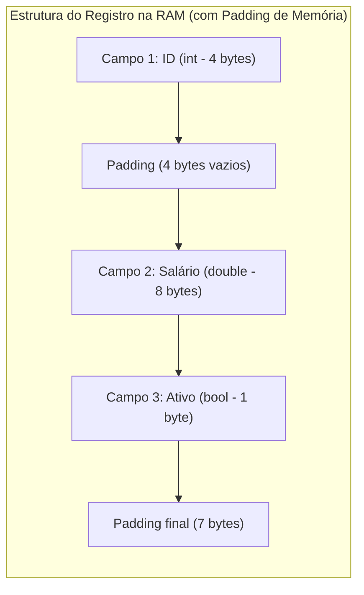

import { Tabs, TabItem } from '@astrojs/starlight/components';

## 1. Visão Geral e Intuição

Enquanto os arrays são coleções homogêneas (todos os itens têm o mesmo tipo), o mundo real é composto por entidades complexas que reúnem informações de tipos distintos. Um **Registro (Record / Struct)** é uma estrutura de dados **heterogênea**, permitindo agrupar variáveis de tipos diferentes sob um mesmo identificador conceitual.

Foi introduzido em linguagens como Cobol e Pascal e evoluiu para as `structs` em C/C++, `records` em Java e `dataclasses` em Python.

:::tip[Analogia do Mundo Real: Ficha Cadastral]
Pense na ficha médica de um paciente. Ela contém o nome (texto), a idade (inteiro), a altura (número com ponto flutuante) e se é doador de órgãos (booleano). Trata-se de um registro único composto por múltiplos campos tipados.
:::

## 2. Como Funciona na Memória e Alinhamento de Bytes

Na memória, os campos de um registro são organizados sequencialmente. No entanto, por exigências de hardware (arquiteturas de 32 ou 64 bits), os processadores acessam palavras de memória alinhadas (múltiplos de 4 ou 8 bytes).

Isso introduz o conceito de **Padding (Preenchimento)**: o compilador insere bytes vazios para manter o alinhamento da CPU.



## 3. Comparativo: Array vs. Registro

| Aspecto | Array | Registro (Record / Struct) |
| :--- | :--- | :--- |
| **Homogeneidade** | Estritamente homogêneo (mesmo tipo) | Heterogêneo (combina múltiplos tipos) |
| **Acesso a Dados** | Por índice numérico (`arr[2]`) | Por nome de campo (`paciente.idade`) |
| **Finalidade** | Coleção enumerada de itens semelhantes | Entidade de domínio / Modelo de dados |
| **Alocação** | Geralmente Heap (dinâmico) ou Stack | Stack (se tipo de valor) ou Heap (se objeto) |

## 4. Implementações Práticas

<Tabs>
  <TabItem label="Python" icon="seti:python">
  ```python
  from dataclasses import dataclass
  from datetime import date

  @dataclass(frozen=True)
  class Aluno:
      """
      Registro imutável utilizando dataclass moderna em Python.
      """
      matricula: int
      nome: str
      coeficiente: float
      ativo: bool

  def calcular_elegibilidade_bolsa(aluno: Aluno) -> bool:
      return aluno.ativo and aluno.coeficiente >= 8.5

  if __name__ == "__main__":
      estudante = Aluno(matricula=202401, nome="Ana Silva", coeficiente=9.2, ativo=True)
      print(f"Aluno: {estudante.nome} | Coeficiente: {estudante.coeficiente}")
      print(f"Elegível para bolsa: {calcular_elegibilidade_bolsa(estudante)}")
  ```
  </TabItem>

  <TabItem label="Java" icon="seti:java">
  ```java
  public class Registros {
      // Record do Java 14+: imutável, conciso, gera equals, hashCode e toString automaticamente
      public record Aluno(int matricula, String nome, double coeficiente, boolean ativo) {
          public boolean isElegivelBolsa() {
              return this.ativo && this.coeficiente >= 8.5;
          }
      }

      public static void main(String[] args) {
          Aluno estudante = new Aluno(202401, "Ana Silva", 9.2, true);
          System.out.println("Aluno: " + estudante.nome() + " | Coeficiente: " + estudante.coeficiente());
          System.out.println("Elegível para bolsa: " + estudante.isElegivelBolsa());
      }
  }
  ```
  </TabItem>
</Tabs>

## 5. Casos de Borda e Armadilhas

- **Mutabilidade Involuntária:** Modificar o estado interno de registros compartilhados entre múltiplas threads pode gerar condições de corrida (*race conditions*). Prefira registros **imutáveis** (`record` em Java ou `frozen=True` em Python).
- **Consumo de Memória Oculto:** O alinhamento de bytes pode inflar o tamanho do registro se a ordem dos campos for desfavorável (ex: alternar `byte`, `long`, `byte`, `long`).

## 6. Quando Usar e Trade-offs

- Registros são a fundação dos **Nós** de listas encadeadas, árvores e grafos (onde um campo guarda a carga útil do dado e outro campo guarda o ponteiro de memória para o próximo nó).

## 7. Exercícios Recomendados

1. **Fixação:** Projete um registro para representar um produto em um e-commerce com SKU, título, preço, estoque e categorias associadas.
2. **Desafio:** Implemente um método que recebe um array de registros de alunos e calcula a média ponderada da turma.

## 8. Leituras e Referências

- *Algorithms + Data Structures = Programs* — Niklaus Wirth
- *Modern Java in Action* — Raoul-Gabriel Urma
