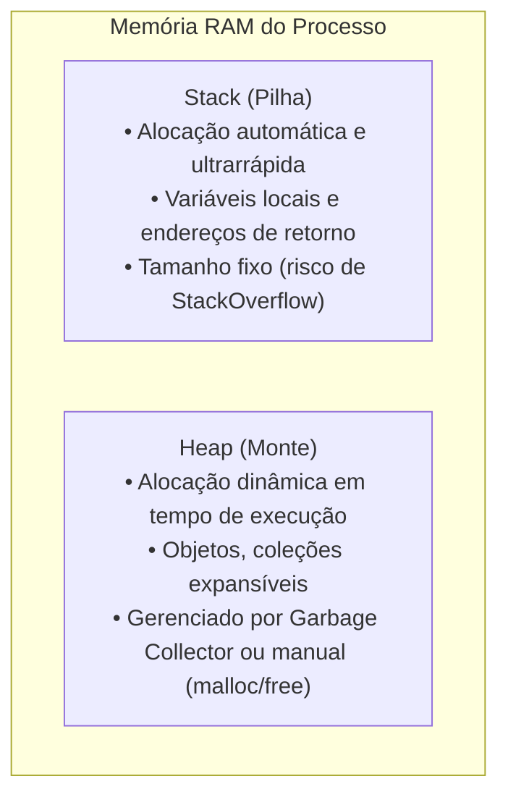

import { Tabs, TabItem } from '@astrojs/starlight/components';

## 1. Visão Geral e Intuição

Para dominar estruturas de dados, é imperativo compreender como o computador armazena informações fisicamente e logicamente na **Memória de Acesso Aleatório (RAM)**. A memória pode ser imaginada como uma gigantesca sequência linear de gavetas numeradas, onde cada gaveta possui um **endereço único** e capacidade para armazenar exatamente 1 byte (8 bits).

Quando um programa solicita memória ao sistema operacional para guardar uma variável, o SO reserva uma ou mais gavetas contíguas ou dispersas, dependendo da estrutura de dados escolhida.

:::tip[Analogia do Mundo Real: O Armário do Vestiário]
Imagine um vestiário de academia com 10.000 armários numerados de `0x0000` a `0x270F`. Cada armário tem espaço para 1 mochila. Se você e 3 amigos chegarem juntos e quiserem guardar as coisas lado a lado, precisam de 4 armários consecutivos livres (como um **Array**). Se o vestiário estiver quase cheio, vocês terão que guardar em armários espalhados e anotar no papel onde cada um está (como uma **Lista Encadeada**).
:::

## 2. A Estrutura da Memória: Stack vs. Heap

A memória alocada para um programa divide-se primordialmente em duas regiões de alta relevância:



### Endereçamento e Tamanho de Tipos Básicos

Em arquiteturas modernas de 64 bits:
- **`byte` / `boolean`:** 1 byte
- **`short`:** 2 bytes
- **`int` / `float`:** 4 bytes
- **`long` / `double` / Ponteiro de Memória:** 8 bytes

Ao acessar um elemento no índice `i` de um array, a CPU calcula o endereço físico em $O(1)$ usando uma fórmula aritmética simples:
$$
\text{Endereço}(i) = \text{Endereço Base} + (i \times \text{Tamanho do Elemento})
$$

## 3. Comparativo de Alocação

| Característica | Stack (Pilha) | Heap (Monte) |
| :--- | :--- | :--- |
| **Velocidade** | Extremamente rápida (ajuste de ponteiro de pilha) | Mais lenta (procura de bloco livre + GC) |
| **Duração** | Dura enquanto o escopo da função estiver ativo | Dura até ser explicitamente liberado ou coletado |
| **Organização** | Contígua, LIFO (Last In, First Out) | Fragmentada, dinâmica |
| **Risco Típico** | *StackOverflowError* (recursão descontrolada) | *OutOfMemoryError* / vazamentos de memória |

## 4. Demonstração Prática de Variáveis e Ponteiros

<Tabs>
  <TabItem label="Python" icon="seti:python">
  ```python
  import sys

  def inspecionar_memoria() -> None:
      """
      Demonstra identificadores de memória (id) e tamanhos de bytes em Python.
      """
      x = 42
      y = 42
      vetor = [1, 2, 3, 4, 5]

      print(f"Endereço de x: {hex(id(x))}")
      print(f"Endereço de y (otimização de inteiros pequenos): {hex(id(y))}")
      print(f"Tamanho em bytes do vetor: {sys.getsizeof(vetor)} bytes")

  if __name__ == "__main__":
      inspecionar_memoria()
  ```
  </TabItem>

  <TabItem label="Java" icon="seti:java">
  ```java
  public class ComoFuncionaAMemoria {
      public static void main(String[] args) {
          // Variáveis primitivas: alocadas diretamente na Stack
          int a = 10;
          double b = 25.5;

          // Objeto: referência na Stack, payload alocado no Heap
          int[] vetor = new int[]{10, 20, 30, 40, 50};

          System.out.println("Hash de identidade do array no Heap: " + 
                  Integer.toHexString(System.identityHashCode(vetor)));
          System.out.println("Valor primitivo a na Stack: " + a);
      }
  }
  ```
  </TabItem>
</Tabs>

## 5. Casos de Borda e Armadilhas

- **Passagem por Valor vs. Passagem por Referência:** Em linguagens de alto nível, variáveis que guardam objetos na verdade guardam o endereço de memória para o Heap. Modificar o objeto interno afeta todas as referências apontadas.
- **Fragmentação de Memória:** Alocações e desalocações contínuas de tamanhos arbitrários podem deixar a RAM fragmentada em blocos pequenos, impedindo a alocação de um array contíguo grande.

## 6. Quando Usar e Trade-offs

- Entender o modelo de memória é indispensável para diagnosticar gargalos de performance (*cache misses*) e escolher corretamente entre **Arrays contíguos** (amigáveis ao cache L1/L2 da CPU) e **Listas Encadeadas** (que geram dispersão de ponteiros na memória).

## 7. Exercícios Recomendados

1. **Fixação:** Se um array de inteiros de 4 bytes começa no endereço hexadecimal `0x1000`, qual é o endereço de memória do elemento de índice 5?
2. **Reflexão:** Por que ler dados sequenciais de um vetor é muito mais rápido na CPU do que percorrer uma lista com nós espalhados na memória?

## 8. Leituras e Referências

- *Entendendo Algoritmos* — Aditya Bhargava (Capítulo 2: Como Funciona a Memória)
- *Computer Systems: A Programmer's Perspective (CS:APP)* — Randal E. Bryant
