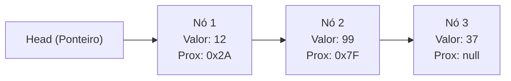

import { Tabs, TabItem } from '@astrojs/starlight/components';

## 1. Visão Geral e Intuição

Uma **Lista Encadeada (Linked List)** é uma coleção linear de elementos chamados **nós (*nodes*)**. Diferente dos arrays, os nós de uma lista encadeada não precisam ficar em posições contíguas na memória RAM: cada nó é alocado individualmente no Heap e guarda dois dados essenciais:
1. O valor ou dado em si (*payload*).
2. O endereço de memória (ponteiro ou referência `next`) para o próximo nó da lista.

O início da lista é controlado por um ponteiro especial chamado **Head (Cabeça)**, e o último nó aponta para `null` / `None`, sinalizando o fim da cadeia.

:::tip[Analogia do Mundo Real: Caça ao Tesouro]
Imagine uma caça ao tesouro. Você recebe a primeira pista (Head). Essa pista indica onde encontrar o bilhete 2 na biblioteca. Ao chegar na biblioteca, o bilhete 2 indica onde está o bilhete 3 no jardim. Os bilhetes estão espalhados pela cidade inteira (memória RAM não contígua), mas você só consegue achar o terceiro se passar pelo primeiro e pelo segundo!
:::

## 2. Como Funciona na Memória



### Inserção Instantânea $O(1)$ na Cabeça

Para inserir um novo nó no início, não é necessário deslocar nenhum elemento existente:
1. Cria-se o novo nó.
2. Faz-se o `novo_no.proximo = head`.
3. Atualiza-se `head = novo_no`.

## 3. Análise Comparativa: Array vs. Lista Encadeada

| Operação | Array (Vetor) | Lista Encadeada Simples |
| :--- | :---: | :---: |
| **Acesso por Índice** | $O(1)$ (Acesso Aleatório) | $O(n)$ (Acesso Sequencial) |
| **Inserção no Início** | $O(n)$ (Exige shift) | $O(1)$ (Apenas ajusta ponteiros) |
| **Inserção no Fim** | $O(1)$ amortizado | $O(n)$ ou $O(1)$ se mantiver ponteiro Tail |
| **Inserção no Meio (conhecendo o nó anterior)** | $O(n)$ | $O(1)$ |
| **Remoção na Cabeça** | $O(n)$ | $O(1)$ |
| **Localidade de Cache da CPU** | Excelente (blocos contíguos) | Ruim (nós espalhados, *cache misses*) |
| **Overhead de Memória** | Mínimo (apenas dados) | Maior (armazena ponteiro em cada nó) |

## 4. Implementações Práticas

<Tabs>
  <TabItem label="Python" icon="seti:python">
  ```python
  from __future__ import annotations
  from dataclasses import dataclass
  from typing import Optional

  @dataclass
  class No:
      valor: int
      proximo: Optional[No] = None

  class ListaEncadeada:
      def __init__(self):
          self.cabeca: Optional[No] = None

      def inserir_no_inicio(self, valor: int) -> None:
          novo_no = No(valor=valor, proximo=self.cabeca)
          self.cabeca = novo_no

      def remover_do_inicio(self) -> Optional[int]:
          if not self.cabeca:
              return None
          removido = self.cabeca.valor
          self.cabeca = self.cabeca.proximo
          return removido

      def listar_valores(self) -> list[int]:
          valores = []
          atual = self.cabeca
          while atual is not None:
              valores.append(atual.valor)
              atual = atual.proximo
          return valores

  if __name__ == "__main__":
      lista = ListaEncadeada()
      lista.inserir_no_inicio(30)
      lista.inserir_no_inicio(20)
      lista.inserir_no_inicio(10)
      print(f"Lista encadeada: {lista.listar_valores()}")  # [10, 20, 30]
      print(f"Removido: {lista.remover_do_inicio()}")      # 10
      print(f"Lista pós remoção: {lista.listar_valores()}") # [20, 30]
  ```
  </TabItem>

  <TabItem label="Java" icon="seti:java">
  ```java
  import java.util.Optional;

  public class ListasEncadeadas {
      public static class No {
          int valor;
          No proximo;
          public No(int valor) { this.valor = valor; }
      }

      public static class ListaSimples {
          private No cabeca;

          public void inserirNoInicio(int valor) {
              No novo = new No(valor);
              novo.proximo = cabeca;
              cabeca = novo;
          }

          public Optional<Integer> removerDoInicio() {
              if (cabeca == null) {
                  return Optional.empty();
              }
              int removido = cabeca.valor;
              cabeca = cabeca.proximo;
              return Optional.of(removido);
          }

          public void imprimir() {
              No atual = cabeca;
              while (atual != null) {
                  System.out.print(atual.valor + " -> ");
                  atual = atual.proximo;
              }
              System.out.println("null");
          }
      }

      public static void main(String[] args) {
          ListaSimples lista = new ListaSimples();
          lista.inserirNoInicio(30);
          lista.inserirNoInicio(20);
          lista.inserirNoInicio(10);
          lista.imprimir(); // 10 -> 20 -> 30 -> null
          lista.removerDoInicio();
          lista.imprimir(); // 20 -> 30 -> null
      }
  }
  ```
  </TabItem>
</Tabs>

## 5. Casos de Borda e Armadilhas

- **Perda da Referência da Cabeça:** Esquecer de guardar a referência do próximo nó antes de reatribuir ponteiros causa perda irreversível da cadeia na memória (vazamento ou coleta precoce pelo GC).
- **Lista Circular Acidental:** Criar um ciclo de ponteiros faz algoritmos de percorrimento entrarem em loop infinito.
- **Null Pointer Exception:** Acessar `.proximo` de um nó que é `null`.

## 6. Quando Usar e Trade-offs

- **Use listas encadeadas:** Quando o número total de elementos for imprevisível e houver grande volume de inserções e remoções prioritariamente no início ou extremidades (ex: base para filas e pilhas).
- **Evite quando:** Você precisar de buscas frequentes por posição/índice numérico.

## 7. Exercícios Recomendados

1. **Fixação:** Implemente a inversão *in-place* de uma lista encadeada simples (alterando a direção dos ponteiros sem criar nós novos).
2. **LeetCode 206:** [Reverse Linked List](https://leetcode.com/problems/reverse-linked-list/)

## 8. Leituras e Referências

- *Entendendo Algoritmos* — Aditya Bhargava (Capítulo 2: Arrays e Listas Encadeadas)
- *Introduction to Algorithms (CLRS)* — Capítulo 10: Estruturas de dados elementares
