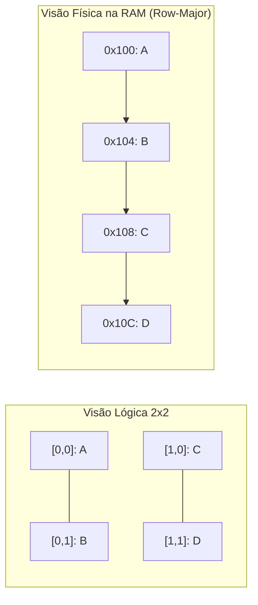

import { Tabs, TabItem } from '@astrojs/starlight/components';

## 1. Visão Geral e Intuição

Uma **Matriz** é uma extensão multidimensional dos arrays, normalmente utilizada para modelar dados tabulares bidimensionais organizados em **linhas** ($i$) e **colunas** ($j$). São a espinha dorsal de renderização de telas, tabuleiros de jogos (xadrez, campo minado), processamento de imagens e álgebra linear para inteligência artificial.

Apesar de pensarmos em matrizes como grades 2D, a memória física do computador é estritamente unidimensional (linear). Logo, a matriz precisa ser "achatada" na memória RAM segundo uma convenção matemática predeterminada.

:::tip[Analogia do Mundo Real: Folha Quadriculada]
Imagine ler um caderno de palavras cruzadas. Seus olhos veem uma grade 2D, mas ao ditar o conteúdo pelo telefone para alguém, você precisa ler linha por linha (da esquerda para a direita, de cima para baixo). O computador faz exatamente isso ao gravar uma matriz na memória RAM sequencial.
:::

## 2. Como Funciona na Memória: Row-Major vs. Column-Major

A CPU aloca matrizes contiguamente na memória usando uma de duas convenções:

1. **Row-Major Order (Ordem por Linha):** Adotada por C, C++, Java e Python. Os elementos da linha 0 são gravados primeiro, seguidos pelos da linha 1, e assim por diante.
   $$
   \text{Endereço}(i, j) = \text{Base} + (i \times \text{TotalColunas} + j) \times \text{TamanhoElemento}
   $$
2. **Column-Major Order (Ordem por Coluna):** Adotada por Fortran, MATLAB e Julia. A coluna 0 é gravada primeiro, depois a coluna 1.



## 3. Análise de Complexidade

| Operação | Complexidade de Tempo | Espaço Auxiliar |
| :--- | :---: | :---: |
| **Acesso Direto `M[i][j]`** | $O(1)$ | $O(1)$ |
| **Percorrer toda a Matriz ($R \times C$)** | $O(R \times C)$ | $O(1)$ |
| **Transposição de Matriz** | $O(R \times C)$ | $O(R \times C)$ ou $O(1)$ se quadrada |
| **Multiplicação Tradicional ($N \times N$)** | $O(N^3)$ | $O(N^2)$ |

## 4. Implementações Práticas

<Tabs>
  <TabItem label="Python" icon="seti:python">
  ```python
  def transpor_matriz(matriz: list[list[int]]) -> list[list[int]]:
      """
      Inverte as linhas e colunas de uma matriz R x C.
      Complexidade: Tempo O(R x C) | Espaço O(R x C)
      """
      if not matriz or not matriz[0]:
          return []

      linhas = len(matriz)
      colunas = len(matriz[0])
      
      transposta = [[0] * linhas for _ in range(colunas)]
      
      for i in range(linhas):
          for j in range(colunas):
              transposta[j][i] = matriz[i][j]

      return transposta

  if __name__ == "__main__":
      grade = [
          [1, 2, 3],
          [4, 5, 6]
      ]
      resultado = transpor_matriz(grade)
      print("Matriz Transposta:")
      for linha in resultado:
          print(linha)
  ```
  </TabItem>

  <TabItem label="Java" icon="seti:java">
  ```java
  public class Matrizes {
      public static int[][] transpor(int[][] matriz) {
          if (matriz.length == 0 || matriz[0].length == 0) {
              return new int[0][0];
          }

          int linhas = matriz.length;
          int colunas = matriz[0].length;
          int[][] transposta = new int[colunas][linhas];

          for (int i = 0; i < linhas; i++) {
              for (int j = 0; j < colunas; j++) {
                  transposta[j][i] = matriz[i][j];
              }
          }
          return transposta;
      }

      public static void main(String[] args) {
          int[][] grade = {
              {1, 2, 3},
              {4, 5, 6}
          };
          int[][] transposta = transpor(grade);

          for (int[] linha : transposta) {
              for (int val : linha) {
                  System.out.print(val + " ");
              }
              System.out.println();
          }
      }
  }
  ```
  </TabItem>
</Tabs>

## 5. Casos de Borda e Armadilhas

- **Cache Misses por Iteração Invertida:** Em linguagens row-major (como C/Java), iterar primeiro pelas colunas e depois pelas linhas (`for j ... for i`) quebra a localidade espacial do cache da CPU, tornando o programa até 10x mais lento do que iterar primeiro pelas linhas (`for i ... for j`).
- **Matrizes Irregulares (*Jagged Arrays*):** Em Java e Python, uma matriz é implementada internamente como um array de referências para outros arrays, permitindo linhas com comprimentos diferentes.

## 6. Quando Usar e Trade-offs

- **Use matrizes densas:** Quando a esmagadora maioria das células possuir valores significativos (imagens, mapas de jogos).
- **Evite para matrizes esparsas:** Se 99% das células forem zero, prefira **Matrizes Esparsas** (representadas via Mapas Hash de coordenadas ou listas de adjacência) para economizar gigabytes de RAM.

## 7. Exercícios Recomendados

1. **Fixação:** Implemente a rotação de 90 graus no sentido horário de uma matriz quadrada $N \times N$.
2. **LeetCode 73:** [Set Matrix Zeroes](https://leetcode.com/problems/set-matrix-zeroes/)

## 8. Leituras e Referências

- *Introdução às Estruturas de Dados* — Waldemar Celes e Renato Cerqueira
- *Algorithms (4th Edition)* — Robert Sedgewick & Kevin Wayne
