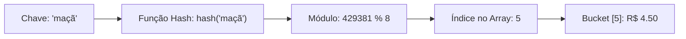

import { Tabs, TabItem } from '@astrojs/starlight/components';

## 1. Visão Geral e Intuição

Uma **Tabela Hash (Hash Table, Mapa ou Dicionário)** é provavelmente a estrutura de dados mais amplamente utilizada na engenharia de software contemporânea. Ela implementa o conceito de mapa associativo de **chave-valor**, permitindo buscar, inserir e remover elementos em tempo médio **constante $O(1)$**.

O segredo dessa velocidade está na **Função Hash (*Hash Function*)**: um algoritmo matemático determinístico que recebe uma chave de qualquer tipo (como uma string `"usuario_123"`) e a converte em um índice numérico inteiro correspondente a uma gaveta de um array interno.

:::tip[Analogia do Mundo Real: A Caixa de Correios de um Prédio]
Imagine um condomínio com 500 apartamentos. Quando uma carta chega endereçada ao "Apartamento 304", o carteiro não precisa bater de porta em porta perguntando de quem é a carta ($O(n)$). Ele vai diretamente na caixinha identificada com o número 304 e deposita a carta em tempo instantâneo ($O(1)$).
:::

## 2. Como Funciona a Função Hash

Uma boa função hash deve atender a três propriedades estritas:
1. **Determinismo:** A mesma chave de entrada deve produzir rigorosamente o mesmo índice hash toda vez que for calculada.
2. **Distribuição Uniforme:** As chaves devem ser espalhadas de maneira homogênea por todos os slots do array interno, minimizando agrupamentos.
3. **Cálculo Eficiente:** A função deve ser rápida para calcular ($O(1)$ proporcional ao tamanho da chave).



## 3. Análise de Complexidade

| Operação | Caso Médio | Pior Caso (Muitas Colisões) | Espaço Auxiliar |
| :--- | :---: | :---: | :---: |
| **Busca por Chave** | **$O(1)$** | $O(n)$ | $O(1)$ |
| **Inserção** | **$O(1)$** | $O(n)$ | $O(1)$ |
| **Remoção** | **$O(1)$** | $O(n)$ | $O(1)$ |

*(Nota: O pior caso $O(n)$ ocorre apenas se a função hash for extremamente mal projetada e mapear todas as chaves para o mesmo slot único).*

## 4. Implementações Práticas

<Tabs>
  <TabItem label="Python" icon="seti:python">
  ```python
  class TabelaHashSimples:
      """
      Tabela Hash didática com tratamento de colisões por encadeamento.
      """
      def __init__(self, capacidade: int = 10):
          self.capacidade = capacidade
          self.buckets: list[list[tuple[str, str]]] = [[] for _ in range(capacidade)]

      def _gerar_indice(self, chave: str) -> int:
          # Função hash simples usando soma de caracteres com módulo
          return sum(ord(c) for c in chave) % self.capacidade

      def inserir(self, chave: str, valor: str) -> None:
          indice = self._gerar_indice(chave)
          bucket = self.buckets[indice]

          for i, (k, _) in enumerate(bucket):
              if k == chave:
                  bucket[i] = (chave, valor) # Atualiza existente
                  return
          bucket.append((chave, valor))

      def buscar(self, chave: str) -> str | None:
          indice = self._gerar_indice(chave)
          for k, valor in self.buckets[indice]:
              if k == chave:
                  return valor
          return None

  if __name__ == "__main__":
      precos = TabelaHashSimples()
      precos.inserir("maçã", "R$ 4.50")
      precos.inserir("banana", "R$ 3.00")
      precos.inserir("leite", "R$ 5.80")

      print("Preço da maçã:", precos.buscar("maçã")) # R$ 4.50
      print("Preço da uva:", precos.buscar("uva"))   # None
  ```
  </TabItem>

  <TabItem label="Java" icon="seti:java">
  ```java
  import java.util.HashMap;
  import java.util.Map;

  public class TabelasHash {
      public static void main(String[] args) {
          // HashMap nativo do Java: O(1) médio
          Map<String, Double> catalogoPrecos = new HashMap<>();

          catalogoPrecos.put("maçã", 4.50);
          catalogoPrecos.put("banana", 3.00);
          catalogoPrecos.put("leite", 5.80);

          System.out.println("Preço maçã: R$ " + catalogoPrecos.get("maçã"));
          System.out.println("Existe abacate? " + catalogoPrecos.containsKey("abacate"));
      }
  }
  ```
  </TabItem>
</Tabs>

## 5. Casos de Borda e Armadilhas

- **Chaves Mutáveis:** Se um objeto for usado como chave em uma tabela hash e algum dos atributos usados no cálculo de `hash()` for modificado posteriormente, a tabela procurará o elemento no bucket errado e o valor ficará "invisível" para sempre.
- **Ataques de Negação de Serviço (HashDoS):** Se um atacante enviar intencionalmente milhares de chaves calculadas para colidirem no mesmo bucket, o tempo de resposta do servidor degrada de $O(1)$ para $O(n^2)$.

## 6. Quando Usar e Trade-offs

- **Use quando:** Você precisar de buscas instantâneas por identificadores únicos (IDs, CPFs, nomes de usuário, URLs, cache DNS).
- **Evite quando:** Você precisar iterar sobre os dados em ordem sequencial ou ordenada (tabelas hash não garantem ordenação de chaves; prefira **Árvores Rubro-Negras** ou `TreeMap`).

## 7. Exercícios Recomendados

1. **Fixação:** Crie uma função que detecta o primeiro caractere que não se repete em uma string utilizando uma tabela hash.
2. **LeetCode 242:** [Valid Anagram](https://leetcode.com/problems/valid-anagram/)

## 8. Leituras e Referências

- *Entendendo Algoritmos* — Aditya Bhargava (Capítulo 5: Tabelas Hash)
- *Introduction to Algorithms (CLRS)* — Capítulo 11: Tabelas Hash
