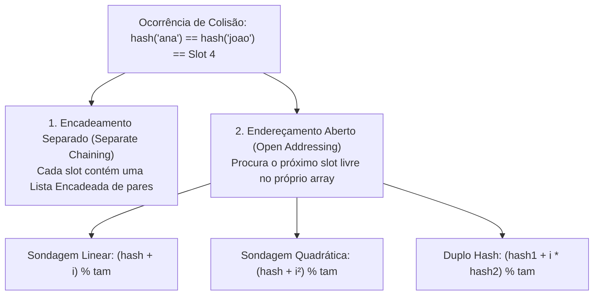

import { Tabs, TabItem } from '@astrojs/starlight/components';

## 1. Visão Geral e Intuição

Por mais sofisticada que seja uma função hash, pelo **Princípio da Casa dos Pombos** (*Pigeonhole Principle*), se tivermos mais chaves potenciais do que slots disponíveis no array interno da tabela, é inevitável que em algum momento duas chaves diferentes produzam exatamente o mesmo índice. Esse evento é denominado **Colisão**.

Para gerenciar colisões sem perder dados e sem degradar a performance, as tabelas hash utilizam estratégias de resolução de colisões e monitoram constantemente o seu **Fator de Carga (*Load Factor*)**.

:::tip[Analogia do Mundo Real: O Estacionamento Lotado]
Pense em um estacionamento numerado. Se você chega e a vaga indicada pelo seu tíquete já está ocupada por outro carro, o manobrista tem duas escolhas:
1. **Encadeamento:** Estacionar o seu carro atrás do outro carro na mesma vaga formando uma filinha.
2. **Endereçamento Aberto:** Mandar você procurar a primeira vaga vazia imediatamente à frente na mesma rua.
:::

## 2. Estratégias de Resolução de Colisão



## 3. O Fator de Carga ($\alpha$) e o Redimensionamento (*Rehashing*)

O **Fator de Carga** ($\alpha$) mede o nível de ocupação da tabela:
$$
\alpha = \frac{\text{Número de Elementos Inseridos } (n)}{\text{Capacidade Total de Slots do Array } (m)}
$$

- Se $\alpha$ for muito baixo (ex: $0.1$), há enorme desperdício de memória RAM ociosa.
- Se $\alpha$ for muito alto (ex: $> 0.8$ em endereçamento aberto ou $> 1.5$ em encadeamento), as colisões aumentam dramaticamente e as buscas degradam para $O(n)$.
- **Padrão da Indústria:** Em Java (`HashMap`) e Python (`dict`), quando $\alpha$ atinge **0.75**, a tabela aloca automaticamente um array com o dobro da capacidade ($2m$) e remapeia todas as chaves (*Rehash*).

## 4. Demonstração Prática de Redimensionamento

<Tabs>
  <TabItem label="Python" icon="seti:python">
  ```python
  class TabelaComRehash:
      def __init__(self, capacidade_inicial: int = 4):
          self.capacidade = capacidade_inicial
          self.tamanho = 0
          self.limite_fator_carga = 0.75
          self.tabela: list[list[tuple[str, int]]] = [[] for _ in range(self.capacidade)]

      def _fator_de_carga(self) -> float:
          return self.tamanho / self.capacidade

      def _redimensionar(self) -> None:
          antiga_tabela = self.tabela
          self.capacidade *= 2
          self.tabela = [[] for _ in range(self.capacidade)]
          self.tamanho = 0

          # Reinsere todos os elementos nos novos buckets
          for bucket in antiga_tabela:
              for chave, valor in bucket:
                  self.inserir(chave, valor)
          print(f"-> Tabela redimensionada para {self.capacidade} slots!")

      def inserir(self, chave: str, valor: int) -> None:
          if self._fator_de_carga() >= self.limite_fator_carga:
              self._redimensionar()

          idx = hash(chave) % self.capacidade
          for i, (k, _) in enumerate(self.tabela[idx]):
              if k == chave:
                  self.tabela[idx][i] = (chave, valor)
                  return

          self.tabela[idx].append((chave, valor))
          self.tamanho += 1

  if __name__ == "__main__":
      t = TabelaComRehash(capacidade_inicial=4)
      t.inserir("um", 1)
      t.inserir("dois", 2)
      t.inserir("tres", 3) # Atinge 3/4 = 0.75 -> Dispara redimensionamento!
      t.inserir("quatro", 4)
  ```
  </TabItem>

  <TabItem label="Java" icon="seti:java">
  ```java
  import java.util.HashMap;

  public class ColisoesEFatorDeCarga {
      public static void main(String[] args) {
          // HashMap configurado com capacidade inicial 16 e load factor 0.75
          HashMap<String, Integer> mapa = new HashMap<>(16, 0.75f);
          
          mapa.put("servidor_1", 8080);
          mapa.put("servidor_2", 8081);
          
          System.out.println("Tamanho atual: " + mapa.size());
      }
  }
  ```
  </TabItem>
</Tabs>

## 5. Casos de Borda e Armadilhas

- **Remoção em Endereçamento Aberto:** Ao remover um item em sondagem linear, não se pode simplesmente limpar a célula com `null`, sob risco de quebrar a cadeia de busca das chaves posteriores. Deve-se marcar a célula com uma sentinela especial de "deletado" (*Tombstone*).
- **Otimização Treeify em Java 8+:** No Java, se um mesmo bucket encadeado ultrapassar 8 elementos colidentes, o `HashMap` converte automaticamente a lista encadeada daquele slot em uma **Árvore Rubro-Negra** ($O(\log n)$), prevenindo ataques HashDoS.

## 6. Quando Usar e Trade-offs

- Ajustar a capacidade inicial antecipadamente (`new HashMap<>(capacidadePrevista)`) é uma boa prática essencial em sistemas de alta performance para evitar o custo computacional de sucessivos rehashes automáticos em runtime.

## 7. Exercícios Recomendados

1. **Fixação:** Se uma tabela hash possui 10 slots e inserimos 7 elementos, qual é o seu fator de carga atual? Se inserirmos mais 1 elemento com limite de 0.75, o que acontece?
2. **LeetCode 705:** [Design HashSet](https://leetcode.com/problems/design-hashset/)

## 8. Leituras e Referências

- *Entendendo Algoritmos* — Aditya Bhargava (Capítulo 5: Colisões e Desempenho)
- *Java HashMap Implementation and Treeify Threshold* — Oracle OpenJDK Documentation
