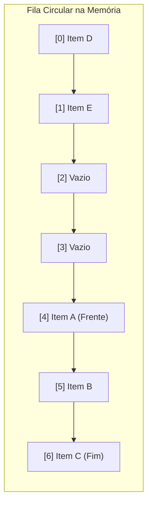

import { Tabs, TabItem } from '@astrojs/starlight/components';

## 1. Visão Geral e Intuição

Uma **Fila (Queue)** é uma estrutura de dados linear que segue estritamente a disciplina **FIFO (First In, First Out — Primeiro a Entrar, Primeiro a Sair)**. O primeiro elemento inserido na fila é obrigatoriamente o primeiro elemento a ser atendido e removido.

Ao contrário da Pilha (onde inserção e remoção ocorrem na mesma ponta), a Fila opera em **duas extremidades opostas**:
- **Traseira / Fim (*Rear / Back / Tail*):** Onde novos elementos entram (**Enqueue**).
- **Frente / Início (*Front / Head*):** Onde elementos são atendidos e saem (**Dequeue**).

:::tip[Analogia do Mundo Real: Fila do Caixa de Supermercado]
A primeira pessoa que chega com o carrinho de compras no caixa do supermercado é a primeira a passar as compras pelo leitor de código de barras. Quem chega depois entra no final da fila. Furar a fila é terminantemente proibido!
:::

## 2. Como Funciona a Fila Circular em Memória

Se implementarmos uma fila em um array estático simples, a cada `dequeue` o início da fila se desloca para a direita, deixando posições vagas e inúteis à esquerda.

Para resolver isso sem ter que mover todos os elementos a cada remoção ($O(n)$), utilizamos o conceito de **Fila Circular (*Circular Buffer*)**, usando a operação de resto da divisão (**Módulo $\%$**):
$$
\text{NovoFim} = (\text{Fim} + 1) \pmod{\text{Capacidade}}
$$



## 3. Análise de Complexidade

| Operação | Complexidade de Tempo | Espaço Auxiliar |
| :--- | :---: | :---: |
| **Enqueue (Enfileirar)** | $O(1)$ | $O(1)$ |
| **Dequeue (Desenfileirar)** | $O(1)$ | $O(1)$ |
| **Front / Peek (Consultar Primeiro)** | $O(1)$ | $O(1)$ |
| **Is Empty / Is Full** | $O(1)$ | $O(1)$ |

## 4. Implementações Práticas

<Tabs>
  <TabItem label="Python" icon="seti:python">
  ```python
  from collections import deque
  from typing import TypeVar, Generic, Optional

  T = TypeVar("T")

  class Fila(Generic[T]):
      """
      Fila eficiente O(1) utilizando deque (duplamente encadeada internamente).
      """
      def __init__(self):
          self._dados: deque[T] = deque()

      def enfileirar(self, item: T) -> None:
          self._dados.append(item)

      def desenfileirar(self) -> Optional[T]:
          return self._dados.popleft() if not self.esta_vazia() else None

      def primeiro(self) -> Optional[T]:
          return self._dados[0] if not self.esta_vazia() else None

      def esta_vazia(self) -> bool:
          return len(self._dados) == 0

      def __len__(self) -> int:
          return len(self._dados)

  if __name__ == "__main__":
      f = Fila[str]()
      f.enfileirar("Cliente A")
      f.enfileirar("Cliente B")
      f.enfileirar("Cliente C")

      print(f"Próximo a ser atendido: {f.primeiro()}")     # Cliente A
      print(f"Atendendo: {f.desenfileirar()}")             # Cliente A
      print(f"Novo próximo da fila: {f.primeiro()}")       # Cliente B
  ```
  </TabItem>

  <TabItem label="Java" icon="seti:java">
  ```java
  import java.util.ArrayDeque;
  import java.util.Queue;

  public class Filas {
      public static void main(String[] args) {
          // ArrayDeque é a implementação de fila mais performática da biblioteca padrão do Java
          Queue<String> filaAtendimento = new ArrayDeque<>();

          filaAtendimento.offer("Cliente A");
          filaAtendimento.offer("Cliente B");
          filaAtendimento.offer("Cliente C");

          System.out.println("Próximo da fila: " + filaAtendimento.peek()); // Cliente A
          System.out.println("Atendido: " + filaAtendimento.poll());        // Cliente A
          System.out.println("Novo próximo: " + filaAtendimento.peek());    // Cliente B
      }
  }
  ```
  </TabItem>
</Tabs>

## 5. Casos de Borda e Armadilhas

- **Usar `list.pop(0)` em Python:** A lista padrão do Python é um array dinâmico. Chamar `pop(0)` força a CPU a deslocar todos os $n-1$ elementos uma posição para a esquerda ($O(n)$), arruinando a performance. Sempre use `collections.deque` ($O(1)$) para filas em Python.
- **Diferença entre `offer`/`poll` e `add`/`remove` em Java:** `add` lança exceção se cheia, enquanto `offer` retorna `false`. `remove` lança exceção se vazia, enquanto `poll` retorna `null`.

## 6. Quando Usar e Aplicações no Mundo Real

- **Sistemas Operacionais:** Escalonador de processos da CPU (*Round-Robin*), buffer de teclado e fila de spool de impressão.
- **Mensageria Assíncrona:** Filas no RabbitMQ, Apache Kafka, AWS SQS e Redis para processar jobs em background.
- **Grafos:** A estrutura central do algoritmo de **Busca em Largura (BFS)**.

## 7. Exercícios Recomendados

1. **Fixação:** Implemente uma Fila Circular com tamanho fixo utilizando um array de inteiros e a operação de módulo `%`.
2. **LeetCode 232:** [Implement Queue using Stacks](https://leetcode.com/problems/implement-queue-using-stacks/)

## 8. Leituras e Referências

- *Entendendo Algoritmos* — Aditya Bhargava (Capítulo 6: Pesquisa em Largura e Filas)
- *Algorithms (4th Edition)* — Robert Sedgewick
