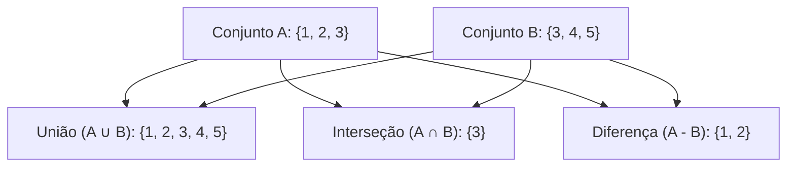

import { Tabs, TabItem } from '@astrojs/starlight/components';

## 1. Visão Geral e Intuição

Um **Conjunto (Set)** é um Tipo Abstrato de Dados modelado a partir do conceito formal de conjunto da matemática clássica:
1. **Unicidade Estrita:** Não permite elementos duplicados. Inserir um item que já existe na coleção é uma operação nula (idempotente).
2. **Sem Ordem Intrínseca Garantida:** (Na maioria das implementações baseadas em hash).
3. **Operações de Teoria dos Conjuntos:** Suporte nativo a União ($\cup$), Interseção ($\cap$), Diferença ($-$) e Subconjunto ($\subset$).

Por baixo dos panos, a grande maioria das linguagens implementa o TAD Conjunto utilizando uma **Tabela Hash** onde os elementos são as chaves e os valores associados são ignorados ou constantes fictícias (ex: `HashSet` em Java utiliza um `HashMap` internamente).

:::tip[Analogia do Mundo Real: A Coleção de Selos Raros]
Se você coleciona selos postais e ganha um selo comemorativo que já possui no álbum, você não cola outro igual na mesma folha: o conjunto continua tendo exatamente um exemplar daquele selo. Além disso, se seu amigo também coleciona, vocês podem comparar os álbuns para descobrir quais selos ambos têm em comum (**Interseção**).
:::

## 2. Operações Fundamentais de Conjuntos



## 3. Análise de Complexidade

| Operação | HashSet (Baseado em Hash) | TreeSet (Baseado em Árvore Rubro-Negra) |
| :--- | :---: | :---: |
| **Inserção (`add`)** | $O(1)$ médio | $O(\log n)$ |
| **Remoção (`remove`)** | $O(1)$ médio | $O(\log n)$ |
| **Contém (`contains`)** | $O(1)$ médio | $O(\log n)$ |
| **Iteração Ordenada** | Não suportado | Suportado nativamente |
| **União / Interseção ($N + M$)** | $O(N + M)$ | $O(N + M)$ |

## 4. Implementações Práticas

<Tabs>
  <TabItem label="Python" icon="seti:python">
  ```python
  def demonstrar_conjuntos() -> None:
      alunos_python = {"Carlos", "Beatriz", "Daniel", "Ana"}
      alunos_java   = {"Eduardo", "Ana", "Carlos", "Fernanda"}

      # Interseção: quem faz ambos os cursos
      ambos = alunos_python & alunos_java
      print("Faz ambos os cursos:", ambos) # {'Carlos', 'Ana'}

      # União: todos os alunos matriculados sem repetição
      todos = alunos_python | alunos_java
      print("Total de alunos únicos:", len(todos)) # 6

      # Diferença: matriculados apenas em Python
      apenas_python = alunos_python - alunos_java
      print("Apenas Python:", apenas_python) # {'Beatriz', 'Daniel'}

  if __name__ == "__main__":
      demonstrar_conjuntos()
  ```
  </TabItem>

  <TabItem label="Java" icon="seti:java">
  ```java
  import java.util.HashSet;
  import java.util.Set;

  public class ConjuntosSets {
      public static void main(String[] args) {
          Set<String> cursoPython = new HashSet<>(Set.of("Carlos", "Beatriz", "Daniel", "Ana"));
          Set<String> cursoJava = new HashSet<>(Set.of("Eduardo", "Ana", "Carlos", "Fernanda"));

          // Interseção
          Set<String> intersecao = new HashSet<>(cursoPython);
          intersecao.retainAll(cursoJava);
          System.out.println("Ambos os cursos: " + intersecao); // [Carlos, Ana]

          // União
          Set<String> uniao = new HashSet<>(cursoPython);
          uniao.addAll(cursoJava);
          System.out.println("Total alunos únicos: " + uniao.size()); // 6
      }
  }
  ```
  </TabItem>
</Tabs>

## 5. Casos de Borda e Armadilhas

- **Objetos sem `equals` e `hashCode` consistentes:** Em Java, se você colocar instâncias de uma classe customizada em um `HashSet` sem sobrescrever `equals()` e `hashCode()`, o conjunto tratará objetos com dados idênticos como elementos diferentes na memória.

## 6. Quando Usar e Trade-offs

- **Use quando:** Você precisar eliminar duplicatas instantaneamente de um fluxo de dados ou verificar a existência de um elemento em $O(1)$ (ex: lista negra de IPs bloqueados, IDs de produtos já visitados).
- **Evite quando:** Você precisar preservar a ordem cronológica exata de inserção (para isso, use `LinkedHashSet`).

## 7. Exercícios Recomendados

1. **Fixação:** Dado um vetor com números repetidos, use um Set para retornar a quantidade de valores distintos presentes.
2. **LeetCode 349:** [Intersection of Two Arrays](https://leetcode.com/problems/intersection-of-two-arrays/)

## 8. Leituras e Referências

- *Effective Java* — Joshua Bloch (Item 11: Sobrescreva sempre hashCode quando sobrescrever equals)
- *Entendendo Algoritmos* — Aditya Bhargava (Capítulo 8: Algoritmos Gulosos e Conjuntos)
