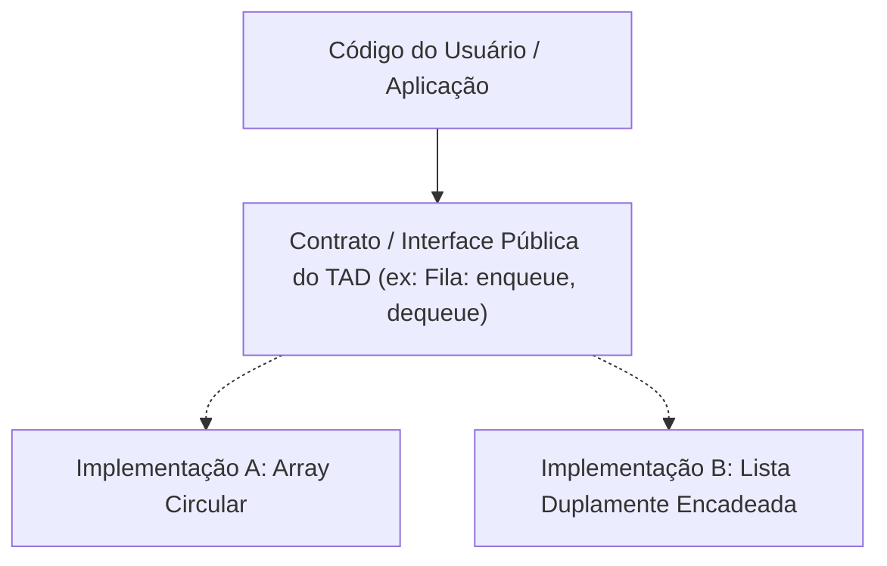

import { Tabs, TabItem } from '@astrojs/starlight/components';

## 1. Visão Geral e Intuição

Um **Tipo Abstrato de Dados (TAD / Abstract Data Type - ADT)** é uma especificação matemática que define um modelo de dados exclusivamente a partir do seu **comportamento externo**:
- Quais operações são permitidas sobre ele?
- Quais parâmetros essas operações recebem e o que retornam?
- Quais invariantes lógicos devem ser mantidos?

Fundamentalmente, um TAD **oculta os detalhes internos de implementação**. Quem utiliza o TAD não precisa (e não deve) saber se ele foi construído por baixo dos panos usando um array fixo, uma lista encadeada dupla ou uma árvore.

:::tip[Analogia do Mundo Real: O Controle Remoto da Televisão]
Para ligar a TV, aumentar o volume ou mudar de canal, você apenas aperta botões no controle remoto (a **Interface do TAD**). Você não precisa entender como os circuitos integrados, os sinais de infravermelho ou os cristais líquidos da tela operam por dentro (**Implementação Concreta**). Se o fabricante da TV trocar a tecnologia do circuito interno, os botões do controle continuam funcionando exatamente do mesmo jeito!
:::

## 2. A Barreira da Abstração



### TADs Clássicos da Ciência da Computação

- **Pilha (Stack):** Operações `push`, `pop`, `peek`.
- **Fila (Queue):** Operações `enqueue`, `dequeue`, `front`.
- **Fila de Prioridade (Priority Queue):** Operações `insert`, `extract_min` ou `extract_max`.
- **Conjunto (Set):** Operações `add`, `remove`, `contains`, `union`.
- **Mapa / Dicionário (Map / Dictionary):** Operações `put`, `get`, `remove`.

## 3. Benefícios Arquiteturais de um TAD

| Benefício | Descrição |
| :--- | :--- |
| **Encapsulamento** | Impede o acesso indevido à memória e protege o estado interno contra corrupção. |
| **Intercambialidade** | Permite trocar a estrutura interna (ex: de array para lista encadeada) sem alterar nenhuma linha do código cliente. |
| **Testabilidade** | Facilita a criação de *mocks* e testes de regressão baseados no contrato formal da interface. |

## 4. Implementações Práticas (Contrato de TAD Fila)

<Tabs>
  <TabItem label="Python" icon="seti:python">
  ```python
  from abc import ABC, abstractmethod
  from typing import TypeVar, Generic, Optional

  T = TypeVar("T")

  class FilaTAD(ABC, Generic[T]):
      """Interface formal (TAD) para uma Fila."""
      
      @abstractmethod
      def enfileirar(self, item: T) -> None:
          pass

      @abstractmethod
      def desenfileirar(self) -> Optional[T]:
          pass

      @abstractmethod
      def primeiro(self) -> Optional[T]:
          pass

      @abstractmethod
      def esta_vazia(self) -> bool:
          pass

  # Implementação concreta do TAD usando lista interna
  class FilaConcreta(FilaTAD[T]):
      def __init__(self):
          self._itens: list[T] = []

      def enfileirar(self, item: T) -> None:
          self._itens.append(item)

      def desenfileirar(self) -> Optional[T]:
          return self._itens.pop(0) if not self.esta_vazia() else None

      def primeiro(self) -> Optional[T]:
          return self._itens[0] if not self.esta_vazia() else None

      def esta_vazia(self) -> bool:
          return len(self._itens) == 0

  if __name__ == "__main__":
      fila: FilaTAD[str] = FilaConcreta()
      fila.enfileirar("Documento 1.pdf")
      fila.enfileirar("Documento 2.pdf")
      print("Primeiro da fila:", fila.primeiro())
      print("Processando:", fila.desenfileirar())
  ```
  </TabItem>

  <TabItem label="Java" icon="seti:java">
  ```java
  import java.util.LinkedList;
  import java.util.Optional;

  public class TiposAbstratosDeDados {
      // 1. Contrato da Interface (TAD)
      public interface FilaTAD<T> {
          void enfileirar(T item);
          Optional<T> desenfileirar();
          Optional<T> primeiro();
          boolean estaVazia();
      }

      // 2. Implementação Concreta desacoplada
      public static class FilaComLista<T> implements FilaTAD<T> {
          private final LinkedList<T> elementos = new LinkedList<>();

          @Override
          public void enfileirar(T item) { elementos.addLast(item); }

          @Override
          public Optional<T> desenfileirar() {
              return elementos.isEmpty() ? Optional.empty() : Optional.of(elementos.removeFirst());
          }

          @Override
          public Optional<T> primeiro() {
              return elementos.isEmpty() ? Optional.empty() : Optional.of(elementos.getFirst());
          }

          @Override
          public boolean estaVazia() { return elementos.isEmpty(); }
      }

      public static void main(String[] args) {
          FilaTAD<String> fila = new FilaComLista<>();
          fila.enfileirar("Doc1.pdf");
          fila.enfileirar("Doc2.pdf");
          System.out.println("Processando: " + fila.desenfileirar().orElse("Vazio"));
      }
  }
  ```
  </TabItem>
</Tabs>

## 5. Casos de Borda e Armadilhas

- **Vazamento de Abstração (*Leaky Abstraction*):** Quando detalhes de desempenho ou exceções de baixo nível vazam pela interface do TAD (ex: expor um erro de índice de array em um método de fila abstrata).
- **Violação do Princípio de Substituição de Liskov (LSP):** Criar implementações do TAD que alteram as pré-condições ou pós-condições acordadas no contrato.

## 6. Quando Usar e Trade-offs

- Projete sempre pensando em interfaces e TADs em sistemas corporativos de médio e grande porte, garantindo flexibilidade para substituir estruturas de dados à medida que o volume de usuários cresce.

## 7. Exercícios Recomendados

1. **Fixação:** Projete a especificação formal do TAD "Baralho" com operações de embaralhar, puxar carta do topo e cortar o baralho.
2. **LeetCode 225:** [Implement Stack using Queues](https://leetcode.com/problems/implement-stack-using-queues/)

## 8. Leituras e Referências

- *Data Structures and Algorithm Analysis in Java* — Mark Allen Weiss
- *Estruturas de Dados e Seus Algoritmos* — Szwarcfiter e Markenzon
