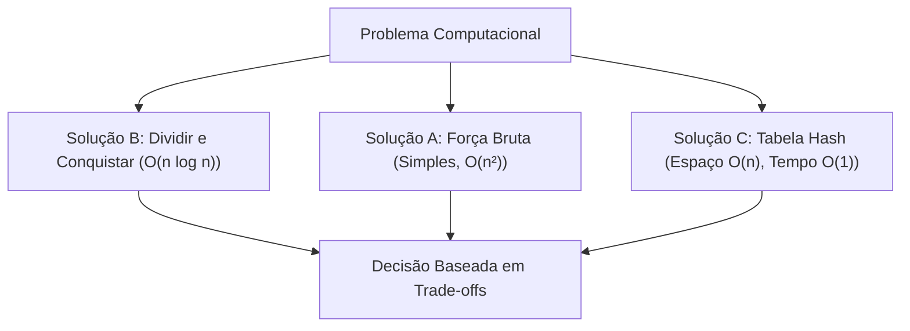

import { Tabs, TabItem, Card, CardGrid } from '@astrojs/starlight/components';

## 1. Visão Geral e Intuição

Na ciência da computação, um **problema computacional** é uma especificação formal de uma relação entre um conjunto de entradas válidas e uma saída desejada. Para um mesmo problema, raramente existe apenas uma solução: diferentes estratégias algorítmicas produzem o mesmo resultado com impactos radicalmente diferentes no uso de recursos (tempo e memória).

:::tip[Analogia do Mundo Real]
Imagine planejar uma rota de viagem entre duas cidades. Você pode escolher a rodovia com pedágio (mais rápida, porém mais cara), a estrada vicinal (gratuita, porém mais demorada) ou a rota cênica (mais longa, porém mais agradável). Todas levam ao destino, mas o custo e as prioridades variam. Na computação, escolher um algoritmo é decidir como balancear tempo de processamento, consumo de memória e simplicidade de manutenção.
:::

## 2. Como Funciona a Análise de Problemas

Ao nos depararmos com um desafio computacional, o processo analítico se divide em:

1. **Definição Clara da Entrada e Saída:** Quais são os tipos, limites e restrições dos dados fornecidos?
2. **Exploração de Soluções Candidatas:**
   - Abordagem de Força Bruta (*Brute Force*): Testa todas as possibilidades. Simples, mas ineficiente.
   - Abordagem Gulosa (*Greedy*): Escolhe a melhor opção local a cada passo.
   - Abordagem de Divisão e Conquista: Divide o problema em subproblemas menores.
   - Programação Dinâmica: Armazena soluções de subproblemas repetidos.
3. **Avaliação de Eficiência:** Comparar os custos computacionais antes de escrever a primeira linha de código.



## 3. Análise Comparativa de Soluções

Considere o problema clássico de encontrar se há dois números em uma lista que somam um valor $K$:

| Abordagem | Complexidade de Tempo | Complexidade de Espaço | Simplicidade |
| :--- | :---: | :---: | :---: |
| Força Bruta (dois loops) | $O(n^2)$ | $O(1)$ | Alta |
| Ordenação + Dois Ponteiros | $O(n \log n)$ | $O(1)$ a $O(n)$ | Média |
| Tabela Hash / Conjunto | $O(n)$ | $O(n)$ | Média |

## 4. Implementações Práticas (Two Sum)

<Tabs>
  <TabItem label="Python" icon="seti:python">
  ```python
  from typing import Optional

  def dois_soma_hash(numeros: list[int], alvo: int) -> Optional[tuple[int, int]]:
      """
      Encontra os índices de dois números que somam o valor alvo.
      Complexidade: Tempo O(n) | Espaço O(n)
      """
      vistos: dict[int, int] = {}
      for indice, valor in enumerate(numeros):
          complemento = alvo - valor
          if complemento in vistos:
              return (vistos[complemento], indice)
          vistos[valor] = indice
      return None

  if __name__ == "__main__":
      dados = [2, 7, 11, 15]
      alvo = 9
      resultado = dois_soma_hash(dados, alvo)
      print(f"Índices encontrados: {resultado}")  # (0, 1)
  ```
  </TabItem>

  <TabItem label="Java" icon="seti:java">
  ```java
  import java.util.HashMap;
  import java.util.Map;
  import java.util.Optional;

  public class ProblemasESolucoes {
      public record Resultado(int indice1, int indice2) {}

      public static Optional<Resultado> doisSomaHash(int[] numeros, int alvo) {
          Map<Integer, Integer> vistos = new HashMap<>();
          for (int i = 0; i < numeros.length; i++) {
              int complemento = alvo - numeros[i];
              if (vistos.containsKey(complemento)) {
                  return Optional.of(new Resultado(vistos.get(complemento), i));
              }
              vistos.put(numeros[i], i);
          }
          return Optional.empty();
      }

      public static void main(String[] args) {
          int[] dados = {2, 7, 11, 15};
          int alvo = 9;
          doisSomaHash(dados, alvo).ifPresent(res ->
              System.out.printf("Índices: %d e %d%n", res.indice1(), res.indice2())
          );
      }
  }
  ```
  </TabItem>
</Tabs>

## 5. Casos de Borda e Armadilhas

- **Tamanho insuficiente:** O vetor tem menos de 2 elementos?
- **Elementos repetidos:** O mesmo elemento pode ser somado consigo mesmo? (ex: alvo 6 e valor 3 presente uma única vez).
- **Inexistência de solução:** O algoritmo deve indicar explicitamente quando não há resposta (usando `None` ou `Optional`).

## 6. Quando Usar e Trade-offs

- **Use soluções em tempo $O(n)$ com espaço extra:** Quando o volume de dados for grande e a latência da resposta for crítica.
- **Use força bruta $O(n^2)$ com espaço $O(1)$:** Apenas para coleções minúsculas ($n < 50$) ou sistemas embarcados com restrições extremas de memória RAM.

## 7. Exercícios Recomendados

1. **Fixação:** Dado um vetor de inteiros, escreva em pseudocódigo duas maneiras distintas de verificar se existem elementos duplicados.
2. **LeetCode 1:** [Two Sum](https://leetcode.com/problems/two-sum/)

## 8. Leituras e Referências

- *Entendendo Algoritmos* — Aditya Bhargava (Capítulo 1: Introdução a Algoritmos)
- *Introduction to Algorithms (CLRS)* — Capítulo 1: O papel dos algoritmos na computação
