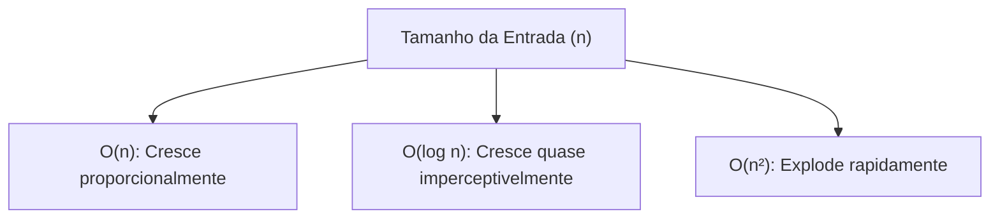

import { Tabs, TabItem } from '@astrojs/starlight/components';

## 1. Visão Geral e Intuição

Por que não medimos a velocidade de um algoritmo com um cronômetro em segundos? Porque o tempo físico (tempo de relógio ou *wall-clock time*) varia drasticamente de acordo com:

- O processador utilizado (ex: CPU de um smartphone vs. supercomputador com overclock).
- A linguagem de programação (ex: C compilado diretamente para código de máquina vs. Python interpretado).
- Os programas concorrentes em execução no sistema operacional.
- O compilador e as diretivas de otimização ativadas.

Portanto, na análise de algoritmos, o **tempo de execução** é medido pelo **número de operações elementares executadas em função do tamanho da entrada ($n$)**.

:::tip[Analogia do Mundo Real]
Se você quiser saber qual carro consome menos combustível, não basta olhar quantos litros ele gastou numa viagem: você precisa saber a relação litros por quilômetro rodado ($L/km$) e como esse consumo se comporta conforme o peso da carga aumenta. Um algoritmo rápido é aquele cujo número de passos cresce suavemente à medida que o volume de dados aumenta.
:::

## 2. Taxa de Crescimento (*Growth Rate*)

O cerne da análise assintótica é entender como o algoritmo reage quando $n$ cresce para valores gigantescos ($n \to \infty$).

Considere duas tarefas:
1. **Busca Simples:** Percorre elemento por elemento. Se dobrarmos a lista de 100 para 200 itens, o tempo de operações dobra.
2. **Busca Binária:** Descarta metade a cada passo. Se a lista aumentar de 100 para 1.000.000 de itens, o número máximo de passos sobe de aproximadamente 7 para apenas 20 operações!



## 3. Comparativo de Crescimento de Operações

Número aproximado de operações necessárias conforme $n$ cresce:

| $n$ | $O(\log n)$ | $O(n)$ | $O(n \log n)$ | $O(n^2)$ | $O(2^n)$ |
| :---: | :---: | :---: | :---: | :---: | :---: |
| **10** | ~3 | 10 | ~33 | 100 | 1.024 |
| **100** | ~7 | 100 | ~664 | 10.000 | $1,26 \times 10^{30}$ |
| **1.000** | ~10 | 1.000 | ~9.965 | 1.000.000 | Inviável |
| **1.000.000** | ~20 | 1.000.000 | ~19.931.568 | $10^{12}$ (1 trilhão) | Impossível no universo |

## 4. Demonstração Prática (Contagem de Operações)

<Tabs>
  <TabItem label="Python" icon="seti:python">
  ```python
  def demonstrar_crescimento(n: int) -> tuple[int, int]:
      """
      Retorna a contagem exata de operações elementares
      para uma rotina linear O(n) e uma rotina quadrática O(n^2).
      """
      operacoes_linear = 0
      for i in range(n):
          operacoes_linear += 1

      operacoes_quadratica = 0
      for i in range(n):
          for j in range(n):
              operacoes_quadratica += 1

      return operacoes_linear, operacoes_quadratica

  if __name__ == "__main__":
      for tamanho in [10, 50, 100]:
          lin, quad = demonstrar_crescimento(tamanho)
          print(f"n = {tamanho:3d} | Linear: {lin:6d} ops | Quadrático: {quad:8d} ops")
  ```
  </TabItem>

  <TabItem label="Java" icon="seti:java">
  ```java
  public class TempoDeExecucao {
      public record Operacoes(long linear, long quadratica) {}

      public static Operacoes contarOperacoes(int n) {
          long opLinear = 0;
          for (int i = 0; i < n; i++) {
              opLinear++;
          }

          long opQuad = 0;
          for (int i = 0; i < n; i++) {
              for (int j = 0; j < n; j++) {
                  opQuad++;
              }
          }

          return new Operacoes(opLinear, opQuad);
      }

      public static void main(String[] args) {
          int[] tamanhos = {10, 50, 100};
          for (int n : tamanhos) {
              Operacoes ops = contarOperacoes(n);
              System.out.printf("n = %3d | Linear: %6d ops | Quadrático: %8d ops%n",
                      n, ops.linear(), ops.quadratica());
          }
      }
  }
  ```
  </TabItem>
</Tabs>

## 5. Casos de Borda e Armadilhas

- **Constantes Ocultas Grandes:** Um algoritmo $O(n)$ com uma constante oculta de $1.000.000 \times n$ pode ser mais lento na prática do que um algoritmo $O(n^2)$ para $n < 1.000$.
- **Benchmarking Ingênuo:** Medir tempo de código em micro-benchmarks sem aquecer a JVM (HotSpot JIT) ou sem isolar ruído do SO leva a conclusões falsas.

## 6. Quando Usar e Trade-offs

- Avalie o tempo assintótico sempre que desenhar a arquitetura de sistemas com grandes volumes de dados.
- Para volumes muito pequenos de dados ($n < 20$), o algoritmo mais simples de codificar quase sempre vence na prática.

## 7. Exercícios Recomendados

1. **Fixação:** Se um algoritmo executa $100$ operações para $n = 10$, quantas operações ele executará para $n = 100$ se a sua complexidade for $O(n^2)$?
2. **Reflexão:** Por que a busca binária com 20 passos consegue pesquisar entre 1 milhão de itens?

## 8. Leituras e Referências

- *Entendendo Algoritmos* — Aditya Bhargava (Capítulo 1: Tempo de Execução)
- *Grokking Algorithms* — Aditya Bhargava
