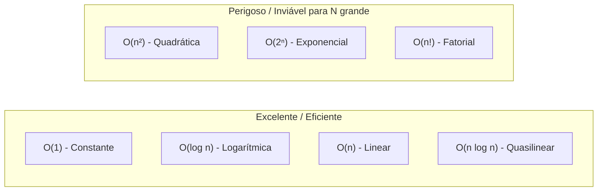

import { Tabs, TabItem } from '@astrojs/starlight/components';

## 1. Visão Geral e Intuição

A **Notação Big O** ($O$) é a linguagem matemática universal empregada por engenheiros de software para descrever o **limite superior assintótico** de um algoritmo. Em termos práticos, ela responde à pergunta: *"No pior cenário possível, como o consumo de tempo ou memória escala à medida que o volume de entrada tende ao infinito?"*

Além do Big $O$, existem duas outras notações correlatas:
- **Big $\Omega$ (Ômega):** Limite inferior (o melhor caso).
- **Big $\Theta$ (Theta):** Limite ajustado estrito (quando o melhor e o pior caso têm a mesma ordem de grandeza).

:::tip[Analogia do Mundo Real]
Imagine que você contratou uma transportadora para entregar uma encomenda. A empresa informa uma garantia contratual: *"Sua entrega levará no máximo 5 dias úteis"*. Ela pode chegar em 1 dia (melhor caso), mas você tem a garantia matemática de que não passará de 5 dias (o teto, ou Big O).
:::

## 2. As Ordens de Complexidade Mais Comuns



### Regras de Simplificação do Big O

1. **Descarte de Constantes:** $O(2n) \to O(n)$, $O(500) \to O(1)$. As constantes multiplicativas não mudam a forma da curva assintótica.
2. **Descarte de Termos Não Dominantes:** Se uma função realiza $n^2 + 5n + 100$ passos, o termo dominante para $n \to \infty$ é $n^2$. Logo, a complexidade é $O(n^2)$.

## 3. Tabela Comparativa de Complexidade

| Notação | Nome Comum | Exemplo Típico | Comentário |
| :--- | :--- | :--- | :--- |
| **$O(1)$** | Constante | Acessar um índice de um array (`arr[5]`) | Instantâneo, independe do tamanho do vetor |
| **$O(\log n)$** | Logarítmica | Busca binária | Extremamente eficiente, dobra a capacidade com 1 passo extra |
| **$O(n)$** | Linear | Percorrer um vetor simples com um loop | Proporcional ao número de itens |
| **$O(n \log n)$** | Log-Linear / Quasilinear | Quicksort (médio), Merge Sort | Padrão ouro para ordenação baseada em comparação |
| **$O(n^2)$** | Quadrática | Dois loops aninhados (Bubble Sort, Selection Sort) | Começa a travar com dezenas de milhares de itens |
| **$O(2^n)$** | Exponencial | Torre de Hanói recursiva, Subconjuntos | Inviável para $n > 40$ |
| **$O(n!)$** | Fatorial | Caixeiro-viajante por força bruta | Inviável até para $n \approx 15$ |

## 4. Exemplos Práticos de Código e suas Classes Big O

<Tabs>
  <TabItem label="Python" icon="seti:python">
  ```python
  # O(1) - Constante
  def obter_primeiro(elementos: list[int]) -> int | None:
      return elementos[0] if elementos else None

  # O(n) - Linear
  def somar_elementos(elementos: list[int]) -> int:
      total = 0
      for item in elementos:
          total += item
      return total

  # O(n^2) - Quadrático
  def imprimir_pares(elementos: list[int]) -> None:
      for a in elementos:
          for b in elementos:
              print(a, b)
  ```
  </TabItem>

  <TabItem label="Java" icon="seti:java">
  ```java
  public class NotacaoBigO {
      // O(1) - Constante
      public static Integer obterPrimeiro(int[] elementos) {
          return elementos.length > 0 ? elementos[0] : null;
      }

      // O(n) - Linear
      public static int somarElementos(int[] elementos) {
          int total = 0;
          for (int item : elementos) {
              total += item;
          }
          return total;
      }

      // O(n^2) - Quadrático
      public static void imprimirPares(int[] elementos) {
          for (int a : elementos) {
              for (int b : elementos) {
                  System.out.println(a + " " + b);
              }
          }
      }
  }
  ```
  </TabItem>
</Tabs>

## 5. Casos de Borda e Armadilhas

- **Confundir pior caso com Big O:** Big O define o teto para uma função de tempo, que pode ser o melhor, o pior ou o caso médio. No entanto, por convenção na indústria, quando falamos "a complexidade do QuickSort é $O(n^2)$", estamos nos referindo ao pior caso.
- **Ignorar complexidade de espaço:** Um algoritmo que roda em $O(n)$ tempo mas gasta $O(n^2)$ memória pode estourar a memória RAM da máquina antes de finalizar.

## 6. Quando Usar e Trade-offs

- Busque sempre soluções $O(1)$, $O(\log n)$ ou $O(n)$ para rotinas críticas de back-end com alta vazão de requisições.
- Aceite soluções $O(n \log n)$ para tarefas que exigem ordenação prévia.
- Evite a qualquer custo soluções $O(n^2)$ ou superiores em endpoints de APIs públicas.

## 7. Exercícios Recomendados

1. **Fixação:** Qual a complexidade de tempo de um loop que percorre um vetor pulando de 2 em 2 elementos? E de um loop que divide $n$ por 2 a cada iteração?
2. **Análise:** Calcule o Big O da soma das matrizes $N \times M$.

## 8. Leituras e Referências

- *Entendendo Algoritmos* — Aditya Bhargava (Capítulo 1: Notação Big O)
- *Algoritmos: Teoria e Prática* — Cormen, Leiserson, Rivest e Stein (Capítulo 3: Crescimento de Funções)
