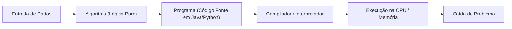

import { Tabs, TabItem } from '@astrojs/starlight/components';

## 1. Visão Geral e Intuição

Compreender a diferença entre um **algoritmo** e um **programa** é a base de todo o estudo da ciência da computação. Um algoritmo é uma sequência finita e bem definida de instruções inequívocas destinadas a resolver um problema ou executar uma tarefa, independente de qualquer linguagem de programação ou hardware.

Um **programa**, por outro lado, é a concretização do algoritmo codificada em uma linguagem de computador específica (como Python, Java ou C++), compilada ou interpretada para ser executada em um processador físico.

:::tip[Analogia do Mundo Real]
O algoritmo é a **receita de bolo** escrita em um caderno: ela dita a proporção de farinha, ovos e tempo de forno. O programa é o **ato de ligar a batedeira, misturar os ingredientes reais e acender o forno específico da sua cozinha**. O algoritmo é abstrato e universal; o programa é concreto e dependente do maquinário.
:::

## 2. Propriedades de um Algoritmo Válido

Para ser considerado um algoritmo correto segundo Donald Knuth, a sequência de passos deve cumprir 5 propriedades essenciais:

1. **Finitude:** O algoritmo deve sempre terminar após um número finito de passos.
2. **Definição / Não ambiguidade:** Cada passo deve ser precisamente definido sem margem para interpretações duplas.
3. **Entrada (*Input*):** Pode receber zero ou mais dados do ambiente externo.
4. **Saída (*Output*):** Deve produzir um ou mais resultados mensuráveis.
5. **Eficácia:** Cada instrução deve ser realizável e suficientemente básica para ser executada em tempo finito por uma máquina ou humano.



## 3. Do Algoritmo ao Programa

| Aspecto | Algoritmo | Programa |
| :--- | :--- | :--- |
| **Natureza** | Conceito lógico, matemático e abstrato | Arquivo de código fonte executável |
| **Linguagem** | Linguagem natural, pseudocódigo, fluxograma | Python, Java, C, Rust, Assembly |
| **Dependência de Hardware** | Nenhuma | Depende de arquitetura (x86, ARM), SO e runtime |
| **Verificação** | Prova matemática de corretude | Testes de unidade, profiling e depuração |

## 4. Implementações Práticas (Algoritmo de Euclides - MDC)

O algoritmo de Euclides para cálculo do Máximo Divisor Comum (MDC) é um dos algoritmos matemáticos mais antigos e elegantes conhecidos.

<Tabs>
  <TabItem label="Python" icon="seti:python">
  ```python
  def mdc_euclides(a: int, b: int) -> int:
      """
      Calcula o Máximo Divisor Comum entre a e b.
      Algoritmo iterativo de Euclides.
      """
      while b != 0:
          a, b = b, a % b
      return abs(a)

  if __name__ == "__main__":
      num1, num2 = 48, 18
      print(f"MDC({num1}, {num2}) = {mdc_euclides(num1, num2)}")  # 6
  ```
  </TabItem>

  <TabItem label="Java" icon="seti:java">
  ```java
  public class AlgoritmosEProgramas {
      public static int mdcEuclides(int a, int b) {
          while (b != 0) {
              int resto = a % b;
              a = b;
              b = resto;
          }
          return Math.abs(a);
      }

      public static void main(String[] args) {
          int num1 = 48;
          int num2 = 18;
          System.out.println("MDC(" + num1 + ", " + num2 + ") = " + mdcEuclides(num1, num2)); // 6
      }
  }
  ```
  </TabItem>
</Tabs>

## 5. Casos de Borda e Armadilhas

- **Loop Infinito:** Algoritmos sem condição de parada clara violam a regra de *finitude*.
- **Divisão por Zero:** No algoritmo de Euclides e em diversas fórmulas numéricas, números nulos devem ser validados na pré-condição.

## 6. Quando Usar e Trade-offs

- Documentar algoritmos em **pseudocódigo** ou diagramas antes de escrever o programa reduz custos de refatoração em mais de 70%.
- Codificar diretamente sem um algoritmo mental claro frequentemente leva a soluções confusas (*spaghetti code*) e erros sutis de lógica.

## 7. Exercícios Recomendados

1. **Fixação:** Escreva o pseudocódigo para determinar se um número inteiro positivo $N$ é primo.
2. **Desafio:** Implemente o cálculo do MDC de forma recursiva e compare com a versão iterativa.

## 8. Leituras e Referências

- *The Art of Computer Programming, Vol 1* — Donald E. Knuth
- *Entendendo Algoritmos* — Aditya Bhargava
