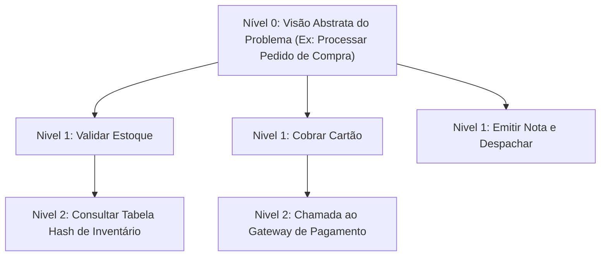

import { Tabs, TabItem } from '@astrojs/starlight/components';

## 1. Visão Geral e Intuição

A metodologia de **Refinamentos Sucessivos** (ou abordagem *Top-Down Stepwise Refinement*), introduzida formalmente pelo pioneiro Niklaus Wirth (criador do Pascal), propõe que problemas complexos não devem ser atacados de uma só vez em nível de código de baixo nível.

Em vez disso, parte-se de uma **visão global abstrata** e desce-se progressivamente em níveis de detalhe cada vez mais finos, modularizando a solução em funções, procedimentos e tipos de dados bem delineados.

:::tip[Analogia do Mundo Real]
Considere a construção de um edifício. O arquiteto não começa assentando tijolos ou cortando canos de PVC. Primeiro, elabora-se a planta baixa e o zoneamento (nível mais alto). Depois, são feitos os projetos estrutural, elétrico e hidráulico. Por fim, os operários executam a montagem de cada tomada e encanamento. Cada camada refina o plano anterior.
:::

## 2. O Ciclo do Refinamento Top-Down



### Princípios Chave do Método

1. **Separação de Preocupações (*Separation of Concerns*):** O nível superior orquestra a lógica sem se preocupar com os detalhes de implementação das sub-rotinas.
2. **Caixa-Preta (*Abstraction Barrier*):** Cada procedimento deve ser entendido puramente por seu contrato (entradas, saídas e efeitos colaterais).
3. **Testabilidade Incremental:** Torna-se viável escrever testes unitários em isolamento para cada sub-módulo antes de montar a solução final.

## 3. Exemplo Prático: Sistema de Caixa Eletrônico (ATM)

Imagine o problema de realizar um saque em caixa eletrônico:

- **Nível 0:** `sacar_dinheiro(conta, valor)`
- **Nível 1:**
  1. `autenticar_cliente(cartao, senha)`
  2. `verificar_saldo_disponivel(conta, valor)`
  3. `dispensar_cedulas(valor)`
  4. `atualizar_extrato(conta, valor)`
- **Nível 2:** Detalhar `dispensar_cedulas(valor)` calculando a quantidade ótima de notas de R$ 100, R$ 50, R$ 20 e R$ 10 (algoritmo guloso).

## 4. Implementações Práticas

<Tabs>
  <TabItem label="Python" icon="seti:python">
  ```python
  from dataclasses import dataclass

  @dataclass
  class Conta:
      saldo: float

  def verificar_saldo(conta: Conta, valor: float) -> bool:
      return conta.saldo >= valor

  def calcular_cedulas(valor: int) -> dict[int, int]:
      cedulas_disponiveis = [100, 50, 20, 10]
      resultado = {}
      restante = valor
      for cedula in cedulas_disponiveis:
          quantidade = restante // cedula
          if quantidade > 0:
              resultado[cedula] = quantidade
              restante %= cedula
      return resultado

  def processar_saque(conta: Conta, valor: int) -> dict[int, int] | None:
      """Orquestrador de alto nível (Refinamento Top-Down)"""
      if not verificar_saldo(conta, float(valor)):
          print("Saldo insuficiente.")
          return None
      
      cedulas = calcular_cedulas(valor)
      conta.saldo -= valor
      return cedulas

  if __name__ == "__main__":
      minha_conta = Conta(saldo=500.0)
      notas = processar_saque(minha_conta, 280)
      print(f"Notas entregues: {notas} | Saldo restante: {minha_conta.saldo}")
  ```
  </TabItem>

  <TabItem label="Java" icon="seti:java">
  ```java
  import java.util.LinkedHashMap;
  import java.util.Map;
  import java.util.Optional;

  public class RefinamentosSucessivos {
      public static class Conta {
          private double saldo;
          public Conta(double saldo) { this.saldo = saldo; }
          public double getSaldo() { return saldo; }
          public void debitar(double valor) { this.saldo -= valor; }
      }

      public static boolean verificarSaldo(Conta conta, double valor) {
          return conta.getSaldo() >= valor;
      }

      public static Map<Integer, Integer> calcularCedulas(int valor) {
          int[] notas = {100, 50, 20, 10};
          Map<Integer, Integer> resultado = new LinkedHashMap<>();
          int restante = valor;

          for (int nota : notas) {
              int qtd = restante / nota;
              if (qtd > 0) {
                  resultado.put(nota, qtd);
                  restante %= nota;
              }
          }
          return resultado;
      }

      public static Optional<Map<Integer, Integer>> processarSaque(Conta conta, int valor) {
          if (!verificarSaldo(conta, valor)) {
              return Optional.empty();
          }
          Map<Integer, Integer> cedulas = calcularCedulas(valor);
          conta.debitar(valor);
          return Optional.of(cedulas);
      }

      public static void main(String[] args) {
          Conta conta = new Conta(500.0);
          processarSaque(conta, 280).ifPresent(notas -> {
              System.out.println("Notas entregues: " + notas);
              System.out.println("Saldo restante: R$ " + conta.getSaldo());
          });
      }
  }
  ```
  </TabItem>
</Tabs>

## 5. Casos de Borda e Armadilhas

- **Supermodularização desnecessária:** Criar funções de uma única linha que apenas repassam chamadas sem agregar clareza semântica.
- **Acoplamento Oculto:** Subfunções que alteram estado global sem declarar isso explicitamente nos parâmetros ou retorno.

## 6. Quando Usar e Trade-offs

- **Use sempre:** Na concepção de qualquer sistema com mais de 100 linhas ou múltiplos fluxos de decisão.
- Facilita enormemente o trabalho em equipe (diferentes desenvolvedores podem implementar submódulos diferentes em paralelo).

## 7. Exercícios Recomendados

1. **Refinamento:** Projete a decomposição Top-Down em 3 níveis para um algoritmo de cadastro e validação de usuários (com validação de CPF, e-mail e hash de senha).

## 8. Leituras e Referências

- *Program Development by Stepwise Refinement* — Niklaus Wirth (CACM, 1971)
- *Clean Code* — Robert C. Martin
