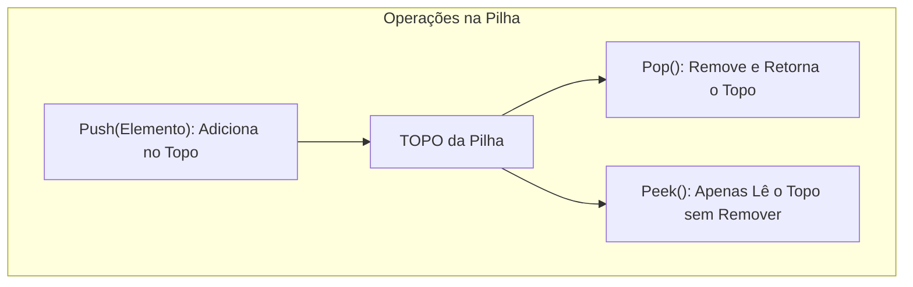

import { Tabs, TabItem } from '@astrojs/starlight/components';

## 1. Visão Geral e Intuição

A **Pilha (Stack)** é uma estrutura de dados linear que opera sob a disciplina rigorosa de **LIFO (Last In, First Out — Último a Entrar, Primeiro a Sair)**. Isso significa que o último elemento inserido na coleção é obrigatoriamente o primeiro elemento a ser removido.

Todas as operações de adição e remoção acontecem exclusivamente em uma extremidade da estrutura, denominada **Topo (*Top*)**.

:::tip[Analogia do Mundo Real: Pilha de Pratos]
Pense em uma pilha de pratos na pia da cozinha. Quando você lava um prato novo, você o coloca em cima de todos os outros (**Push**). Quando alguém vai enxugar um prato, retira primeiro o prato que está no topo (**Pop**). Retirar um prato da base sem mexer nos de cima causaria uma catástrofe!
:::

## 2. Como Funciona na Memória e Operações Fundamentais



As três operações essenciais da pilha são:
- **`push(item)`:** Empilha um novo elemento no topo.
- **`pop()`:** Desempilha e remove o elemento do topo.
- **`peek()` / `top()`:** Inspeciona o elemento do topo sem removê-lo.
- **`is_empty()`:** Verifica se a pilha contém elementos.

## 3. Análise de Complexidade

| Operação | Complexidade de Tempo | Espaço Auxiliar |
| :--- | :---: | :---: |
| **Push** | $O(1)$ | $O(1)$ |
| **Pop** | $O(1)$ | $O(1)$ |
| **Peek / Top** | $O(1)$ | $O(1)$ |
| **Verificar se Vazia** | $O(1)$ | $O(1)$ |
| **Buscar Elemento Interno** | $O(n)$ | $O(1)$ |

## 4. Implementações Práticas

<Tabs>
  <TabItem label="Python" icon="seti:python">
  ```python
  from typing import TypeVar, Generic, Optional

  T = TypeVar("T")

  class Pilha(Generic[T]):
      """
      Implementação de Pilha usando lista dinâmica interna.
      Todas as operações no topo são O(1).
      """
      def __init__(self):
          self._itens: list[T] = []

      def push(self, item: T) -> None:
          self._itens.append(item)

      def pop(self) -> Optional[T]:
          if self.is_empty():
              return None
          return self._itens.pop()

      def peek(self) -> Optional[T]:
          if self.is_empty():
              return None
          return self._itens[-1]

      def is_empty(self) -> bool:
          return len(self._itens) == 0

      def __len__(self) -> int:
          return len(self._itens)

  if __name__ == "__main__":
      p = Pilha[str]()
      p.push("Página 1 (Home)")
      p.push("Página 2 (Perfil)")
      p.push("Página 3 (Configurações)")
      print(f"Página no topo: {p.peek()}") # Página 3
      print(f"Voltando: {p.pop()}")        # Página 3 removida
      print(f"Nova página atual: {p.peek()}") # Página 2
  ```
  </TabItem>

  <TabItem label="Java" icon="seti:java">
  ```java
  import java.util.EmptyStackException;

  public class PilhaStack<T> {
      private static class No<T> {
          T dado;
          No<T> anterior;
          No(T dado, No<T> anterior) {
              this.dado = dado;
              this.anterior = anterior;
          }
      }

      private No<T> topo;
      private int tamanho = 0;

      public void push(T item) {
          topo = new No<>(item, topo);
          tamanho++;
      }

      public T pop() {
          if (isEmpty()) throw new EmptyStackException();
          T dado = topo.dado;
          topo = topo.anterior;
          tamanho--;
          return dado;
      }

      public T peek() {
          if (isEmpty()) throw new EmptyStackException();
          return topo.dado;
      }

      public boolean isEmpty() { return topo == null; }
      public int size() { return tamanho; }

      public static void main(String[] args) {
          PilhaStack<String> pilha = new PilhaStack<>();
          pilha.push("Home");
          pilha.push("Perfil");
          pilha.push("Configurações");
          System.out.println("Topo: " + pilha.peek()); // Configurações
          System.out.println("Pop: " + pilha.pop());   // Configurações
          System.out.println("Novo Topo: " + pilha.peek()); // Perfil
      }
  }
  ```
  </TabItem>
</Tabs>

## 5. Casos de Borda e Armadilhas

- **Stack Underflow:** Chamar `pop()` ou `peek()` em uma pilha vazia. Em linguagens com exceções, isso gera erro ou retorna `None`/`Optional`.
- **Stack Overflow:** Ocorre em pilhas de tamanho estático com alocação em array fixo quando ultrapassam o limite de capacidade.

## 6. Quando Usar e Aplicações no Mundo Real

- **Desfazer / Refazer (Ctrl + Z):** Cada ação do usuário é empilhada; o Ctrl+Z desempilha a ação mais recente.
- **Histórico de Navegador:** O botão "Voltar" do navegador retira a URL mais recente empilhada.
- **Validação de Sintaxe e Parênteses:** Analisadores de compiladores usam pilhas para verificar fechamento de `()`, `[]` e `{}`.

## 7. Exercícios Recomendados

1. **Fixação:** Escreva um algoritmo que recebe uma string com parênteses, colchetes e chaves (ex: `"{[()]}"`) e usa uma pilha para validar se todos estão bem balanceados.
2. **LeetCode 20:** [Valid Parentheses](https://leetcode.com/problems/valid-parentheses/)

## 8. Leituras e Referências

- *Entendendo Algoritmos* — Aditya Bhargava (Capítulo 3: A Pilha)
- *Introduction to Algorithms (CLRS)* — Capítulo 10.1: Pilhas e Filas
