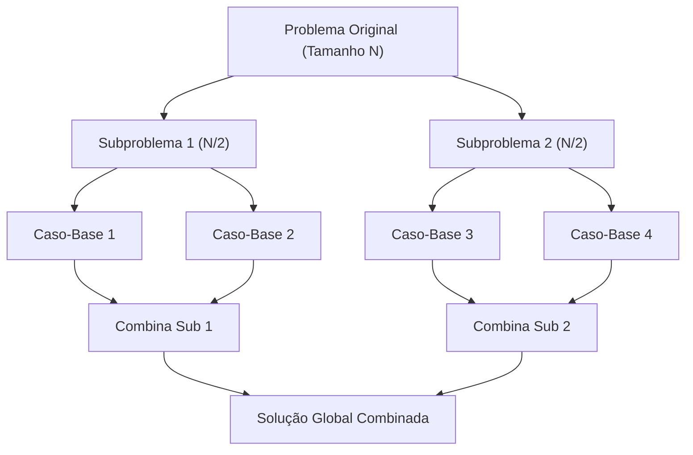

import { Tabs, TabItem } from '@astrojs/starlight/components';

## 1. Visão Geral e Intuição

**Dividir para Conquistar (Divide and Conquer - D&C)** é uma das meta-heurísticas de projeto de algoritmos mais consagradas e bem-sucedidas da computação. Ela não é um algoritmo específico, mas sim uma **estratégia mental** para atacar problemas difíceis.

O processo divide-se rigorosamente em três etapas:
1. **Dividir (*Divide*):** Quebra o problema original em subproblemas menores, que são instâncias menores do mesmo tipo de problema.
2. **Conquistar (*Conquer*):** Resolve os subproblemas recursivamente. Se forem suficientemente pequenos (atingiram o caso-base), resolve-os diretamente.
3. **Combinar (*Combine*):** Junta as soluções dos subproblemas para formar a resposta do problema global.

:::tip[Analogia do Mundo Real: A Partilha de um Terreno em Quadrados Iguais]
Suponha que você tenha um lote de terra retangular de $1680 \times 640$ metros e queira dividi-lo exatamente em lotes quadrados com a maior área possível, sem sobras. Você pode cortar o maior quadrado possível ($640 \times 640$) e repetir o mesmo problema para o pedaço que sobrou ($640 \times 400$). O problema menor dita a solução do terreno inteiro (essência do algoritmo de Euclides e do D&C)!
:::

## 2. A Mecânica da Divisão e Conquista



### O Teorema Mestre (*Master Theorem*)

A complexidade de algoritmos D&C é frequentemente modelada pela equação de recorrência:
$$
T(n) = a T\left(\frac{n}{b}\right) + f(n)
$$
Onde:
- $a$: número de subproblemas gerados na divisão.
- $\frac{n}{b}$: tamanho de cada subproblema.
- $f(n)$: custo de dividir o problema e combinar os resultados.

## 3. Aplicações Típicas de Dividir para Conquistar

| Algoritmo | Etapa de Divisão | Etapa de Conquista | Complexidade Resultante |
| :--- | :--- | :--- | :---: |
| **Pesquisa Binária** | Descarta a metade inadequada | Busca no intervalo restante | $O(\log n)$ |
| **Quicksort** | Particiona ao redor de um pivô | Ordena metades esquerda e direita | $O(n \log n)$ médio |
| **Merge Sort** | Corta o vetor ao meio ($n/2$) | Intercala os dois vetores ordenados | $O(n \log n)$ garantido |
| **Multiplicação de Karatsuba** | Divide números em metades de dígitos | 3 multiplicações menores | $O(n^{1.585})$ |

## 4. Implementações Práticas (Soma e Contagem D&C)

<Tabs>
  <TabItem label="Python" icon="seti:python">
  ```python
  def soma_divisao_e_conquista(vetor: list[int]) -> int:
      """
      Soma todos os elementos usando Dividir para Conquistar.
      Caso-base: vetor vazio -> 0; vetor de 1 item -> item.
      """
      if not vetor:
          return 0
      if len(vetor) == 1:
          return vetor[0]

      # Divide
      meio = len(vetor) // 2
      soma_esquerda = soma_divisao_e_conquista(vetor[:meio])
      soma_direita = soma_divisao_e_conquista(vetor[meio:])

      # Combina
      return soma_esquerda + soma_direita

  def maximo_divisao_e_conquista(vetor: list[int], inicio: int, fim: int) -> int:
      """Encontra o valor máximo dividindo o array ao meio recursivamente."""
      if inicio == fim:
          return vetor[inicio]

      meio = inicio + (fim - inicio) // 2
      max_esq = maximo_divisao_e_conquista(vetor, inicio, meio)
      max_dir = maximo_divisao_e_conquista(vetor, meio + 1, fim)

      return max_esq if max_esq > max_dir else max_dir

  if __name__ == "__main__":
      numeros = [3, 9, 1, 25, 4, 18]
      print(f"Soma total: {soma_divisao_e_conquista(numeros)}") # 60
      print(f"Valor máximo: {maximo_divisao_e_conquista(numeros, 0, len(numeros)-1)}") # 25
  ```
  </TabItem>

  <TabItem label="Java" icon="seti:java">
  ```java
  public class DividirParaConquistar {
      public static int somarDC(int[] vetor, int inicio, int fim) {
          // Caso-base: 1 único elemento
          if (inicio == fim) {
              return vetor[inicio];
          }
          if (inicio > fim) {
              return 0;
          }

          int meio = inicio + (fim - inicio) / 2;
          int somaEsq = somarDC(vetor, inicio, meio);
          int somaDir = somarDC(vetor, meio + 1, fim);

          return somaEsq + somaDir;
      }

      public static void main(String[] args) {
          int[] numeros = {3, 9, 1, 25, 4, 18};
          int total = somarDC(numeros, 0, numeros.length - 1);
          System.out.println("Soma total DC: " + total); // 60
      }
  }
  ```
  </TabItem>
</Tabs>

## 5. Casos de Borda e Armadilhas

- **Subproblemas com Sobreposição:** Se os subproblemas se repetirem muitas vezes (como em Fibonacci ou no problema da Mochila), o Dividir para Conquistar recalculante causará explosão exponencial. Nesses casos, deve-se usar **Programação Dinâmica**.
- **Custo Excessivo na Etapa de Combinação:** Se a combinação custar mais que resolver o problema diretamente, o ganho da divisão é perdido.

## 6. Quando Usar e Trade-offs

- **Use quando:** O problema puder ser naturalmente particionado em subproblemas independentes com casos-base fáceis de resolver. Excelente para paralelização em processadores multi-core (*Fork/Join*).

## 7. Exercícios Recomendados

1. **Fixação:** Implemente um algoritmo D&C para contar o número de itens de uma lista sem utilizar a função `len()`.
2. **LeetCode 53:** [Maximum Subarray](https://leetcode.com/problems/maximum-subarray/) (resolvível com D&C e com Kadane).

## 8. Leituras e Referências

- *Entendendo Algoritmos* — Aditya Bhargava (Capítulo 4: Dividir para Conquistar)
- *Introduction to Algorithms (CLRS)* — Capítulo 4: Dividir para Conquistar
