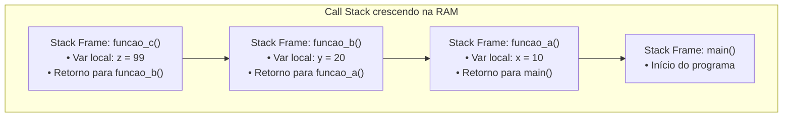

import { Tabs, TabItem } from '@astrojs/starlight/components';

## 1. Visão Geral e Intuição

A **Pilha de Chamada (Call Stack)** é uma estrutura interna fundamental do sistema operacional e da máquina virtual (JVM / Python Runtime). Ela gerencia a execução de qualquer programa, rastreando **qual função está rodando no momento, quais variáveis locais ela possui e para onde o controle deve retornar quando a função terminar**.

Sempre que uma função chama outra função, a execução atual é pausada e um novo bloco de dados — chamado **Stack Frame (ou Registro de Ativação)** — é empilhado no topo da Call Stack. Quando a função retorna, seu frame é desempilhado e o controle volta para o ponto exato da função chamadora.

:::tip[Analogia do Mundo Real: O Bilhete de Post-it]
Imagine que você está lendo um livro (Função Principal). Seu telefone toca (Função Atender Telefone). Você coloca um Post-it na página do livro para lembrar onde parou e atende a ligação. Enquanto fala, a pessoa pede para você conferir um arquivo no computador (Função Abrir Arquivo). Você anota outro bilhete. Quando termina no computador, você descarta o bilhete, volta ao telefone, encerra a chamada, descarta o segundo bilhete e finalmente volta para o livro na página marcada pelo Post-it.
:::

## 2. Anatomia de um Stack Frame na Memória

Cada vez que uma função é invocada, a CPU aloca na região da Stack:
1. Os **argumentos / parâmetros** passados para a função.
2. O **endereço de retorno** (instrução assembly onde o fluxo deve continuar após o `return`).
3. As **variáveis locais** criadas dentro do corpo da função.



## 3. O Fenômeno do Stack Overflow

A região de memória da Stack possui um **tamanho fixo pré-determinado** (geralmente entre 1 MB e 8 MB dependendo da JVM ou do SO). Se uma função chamar a si mesma ou outras funções infinitamente sem atingir um caso de parada, novos stack frames serão empilhados até esgotar completamente o espaço reservado.

O resultado é a temida pane de **Stack Overflow** (`RecursionError` em Python ou `StackOverflowError` em Java).

## 4. Demonstração Prática da Pilha de Execução

<Tabs>
  <TabItem label="Python" icon="seti:python">
  ```python
  import traceback

  def funcao_c() -> None:
      print("-> Dentro de funcao_c:")
      # Imprime a pilha de execução atual
      traceback.print_stack(limit=4)

  def funcao_b() -> None:
      print("Entrando em funcao_b")
      funcao_c()
      print("Saindo de funcao_b")

  def funcao_a() -> None:
      print("Entrando em funcao_a")
      funcao_b()
      print("Saindo de funcao_a")

  if __name__ == "__main__":
      funcao_a()
  ```
  </TabItem>

  <TabItem label="Java" icon="seti:java">
  ```java
  public class PilhaDeChamada {
      public static void funcaoC() {
          System.out.println("-> Dentro de funcaoC. Stack trace:");
          StackTraceElement[] stack = Thread.currentThread().getStackTrace();
          for (int i = 1; i < Math.min(5, stack.length); i++) {
              System.out.println("   " + stack[i].getMethodName() + " (linha " + stack[i].getLineNumber() + ")");
          }
      }

      public static void funcaoB() {
          funcaoC();
      }

      public static void funcaoA() {
          funcaoB();
      }

      public static void main(String[] args) {
          funcaoA();
      }
  }
  ```
  </TabItem>
</Tabs>

## 5. Casos de Borda e Armadilhas

- **Recursão Profunda:** Recursões com profundidade maior que ~1.000 chamadas em Python atingirão o limite padrão (`sys.getrecursionlimit()`).
- **Otimização de Cauda (*Tail Call Optimization - TCO*):** Algumas linguagens funcionais (como Scala, Haskell ou Elixir) reaproveitam o mesmo stack frame se a chamada recursiva for a última instrução da função, evitando estouro de pilha. Porém, Python e Java convencionais não oferecem TCO nativamente.

## 6. Quando Usar e Trade-offs

- Compreender a Call Stack é essencial para depurar exceções (*Stack Traces*), entender como funciona a recursão e decidir quando converter um algoritmo recursivo em iterativo para evitar travamentos em produção.

## 7. Exercícios Recomendados

1. **Fixação:** Trace no papel a evolução da Call Stack (quadro a quadro) para a função recursiva `fatorial(3)`.
2. **Experimento:** Escreva um script em Python que causa intencionalmente um `RecursionError` e verifique qual o número máximo de chamadas permitido.

## 8. Leituras e Referências

- *Entendendo Algoritmos* — Aditya Bhargava (Capítulo 3: A Pilha de Chamada)
- *Computer Systems: A Programmer's Perspective* — Randal E. Bryant
