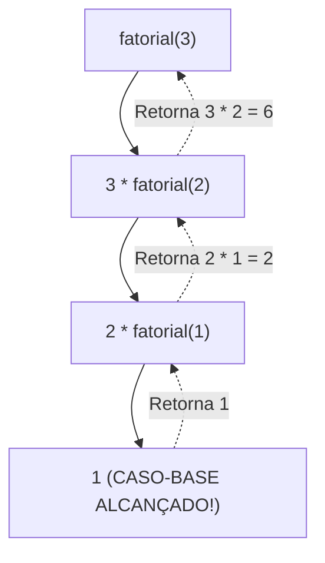

import { Tabs, TabItem } from '@astrojs/starlight/components';

## 1. Visão Geral e Intuição

**Recursão** é uma técnica elegante e poderosa na qual uma função resolve um problema chamando a si própria com uma versão menor ou mais simples da mesma entrada.

Toda função recursiva bem construída é obrigatoriamente dividida em duas partes inegociáveis:
1. **Caso-Base (*Base Case*):** A condição de parada trivial, onde o problema é tão simples que pode ser respondido diretamente sem nenhuma chamada adicional.
2. **Caso Recursivo (*Recursive Case*):** Onde a função invoca a si mesma, garantindo que o argumento seja modificado em direção ao caso-base.

:::tip[Analogia do Mundo Real: Bonecas Russas (Matrioskas)]
Imagine que você recebeu uma grande boneca russa de madeira fechada. Você a abre e encontra outra boneca menor dentro (caso recursivo). Você abre a segunda e encontra outra menor ainda. Você continua abrindo até encontrar a menor bonequinha sólida que não pode mais ser aberta (caso-base). A partir dela, você fecha todas de volta.
:::

## 2. Anatomia de uma Função Recursiva



Se esquecermos o caso-base ou se o caso recursivo não convergir para ele, a função chamará a si mesma indefinidamente até esgotar a memória da Call Stack (*Stack Overflow*).

## 3. Análise de Complexidade: Iterativo vs. Recursivo

| Abordagem | Complexidade de Tempo (Fatorial) | Espaço Auxiliar | Vantagens |
| :--- | :---: | :---: | :--- |
| **Iterativo (Loop `for`)** | $O(n)$ | $O(1)$ | Consome memória constante; sem risco de Stack Overflow. |
| **Recursivo Padrão** | $O(n)$ | $O(n)$ | Código frequentemente mais limpo, expressivo e próximo da definição matemática. |

## 4. Implementações Práticas

<Tabs>
  <TabItem label="Python" icon="seti:python">
  ```python
  def fatorial(n: int) -> int:
      """
      Calcula n! de forma recursiva.
      Tempo: O(n) | Espaço: O(n) na Call Stack
      """
      # 1. Caso-Base
      if n <= 1:
          return 1
      
      # 2. Caso Recursivo (caminha em direção ao caso-base)
      return n * fatorial(n - 1)

  def contagem_regressiva(n: int) -> None:
      if n <= 0:  # Caso-base
          print("Fogo!")
          return
      print(n)
      contagem_regressiva(n - 1)  # Caso recursivo

  if __name__ == "__main__":
      print(f"5! = {fatorial(5)}")  # 120
      contagem_regressiva(3)         # 3, 2, 1, Fogo!
  ```
  </TabItem>

  <TabItem label="Java" icon="seti:java">
  ```java
  public class Recursao {
      public static long fatorial(int n) {
          // 1. Caso-Base
          if (n <= 1) {
              return 1L;
          }
          // 2. Caso Recursivo
          return n * fatorial(n - 1);
      }

      public static void contagemRegressiva(int n) {
          if (n <= 0) {
              System.out.println("Fogo!");
              return;
          }
          System.out.println(n);
          contagemRegressiva(n - 1);
      }

      public static void main(String[] args) {
          System.out.println("5! = " + fatorial(5)); // 120
          contagemRegressiva(3);
      }
  }
  ```
  </TabItem>
</Tabs>

## 5. Casos de Borda e Armadilhas

- **Entrada Negativa:** No fatorial, passar um número negativo sem validação causará recursão infinita (`-1, -2, -3...`).
- **Problema de Fibonacci Ingênuo:** Recursão com ramificação múltipla ingênua (ex: `fib(n-1) + fib(n-2)`) gera uma árvore exponencial $O(2^n)$ com recálculos redundantes, travando para $n > 40$. Deve-se usar memoização ou programação dinâmica.

## 6. Quando Usar e Trade-offs

- **Use quando:** Estiver navegando em estruturas intrinsecamente recursivas, como **Árvores**, **Grafos (DFS)**, diretórios de arquivos em disco e algoritmos de Dividir para Conquistar (como Quicksort e Merge Sort).
- **Evite quando:** Um simples loop `while` ou `for` resolver o problema com clareza e sem o overhead de criação de stack frames.

## 7. Exercícios Recomendados

1. **Fixação:** Escreva uma função recursiva que calcula a soma de todos os elementos de uma lista de inteiros.
2. **LeetCode 509:** [Fibonacci Number](https://leetcode.com/problems/fibonacci-number/)

## 8. Leituras e Referências

- *Entendendo Algoritmos* — Aditya Bhargava (Capítulo 3: Recursão)
- *Structure and Interpretation of Computer Programs (SICP)* — Abelson & Sussman
