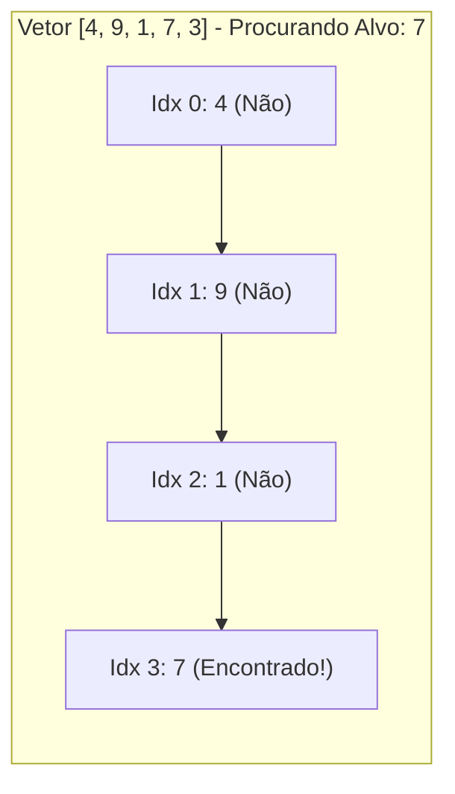

import { Tabs, TabItem } from '@astrojs/starlight/components';

## 1. Visão Geral e Intuição

A **Pesquisa Simples (ou Busca Linear)** é o algoritmo de busca mais elementar e intuitivo que existe. Ele consiste em examinar cada elemento de uma coleção sequencialmente, do primeiro ao último, até encontrar o alvo procurado ou esgotar todos os itens da coleção.

Não impõe **nenhuma pré-condição** aos dados: a lista pode estar completamente desordenada, conter duplicatas ou ser de qualquer tipo comparável.

:::tip[Analogia do Mundo Real: O Chaveiro no Escuro]
Imagine chegar em casa à noite sem luz com um chaveiro contendo 20 chaves não identificadas. Como você não sabe qual é a chave correta, você testa a primeira na fechadura. Se não abrir, testa a segunda, depois a terceira, e assim sucessivamente. No pior caso (a chave correta ser a última ou não estar no chaveiro), você testará todas as 20 chaves.
:::

## 2. Como Funciona a Busca Linear



A cada iteração do loop, duas verificações essenciais são realizadas:
1. Checagem de limite: o índice atual ultrapassou o tamanho do vetor?
2. Comparação de igualdade: o valor na posição atual é igual ao alvo procurado?

## 3. Análise de Complexidade

| Cenário | Passos Necessários | Notação Big O | Explicação |
| :--- | :---: | :---: | :--- |
| **Melhor Caso** | $1$ | $O(1)$ | O elemento procurado é exatamente o primeiro da lista (`arr[0]`). |
| **Caso Médio** | $n / 2$ | $O(n)$ | O elemento está aproximadamente na metade da coleção. |
| **Pior Caso** | $n$ | $O(n)$ | O elemento está na última posição ou não existe na lista. |
| **Espaço Auxiliar** | $1$ | $O(1)$ | Utiliza apenas variáveis de iteração na memória. |

## 4. Implementações Práticas

<Tabs>
  <TabItem label="Python" icon="seti:python">
  ```python
  from typing import Optional

  def busca_linear(vetor: list[int], alvo: int) -> Optional[int]:
      """
      Retorna o índice da primeira ocorrência do alvo ou None se não encontrado.
      Complexidade: Tempo O(n) | Espaço O(1)
      """
      for indice, valor in enumerate(vetor):
          if valor == alvo:
              return indice
      return None

  if __name__ == "__main__":
      dados = [14, 2, 88, 19, 42, 7]
      alvo = 42
      resultado = busca_linear(dados, alvo)
      print(f"Alvo {alvo} encontrado no índice: {resultado}")  # 4
  ```
  </TabItem>

  <TabItem label="Java" icon="seti:java">
  ```java
  import java.util.OptionalInt;

  public class PesquisaSimples {
      public static OptionalInt buscarLinear(int[] vetor, int alvo) {
          for (int i = 0; i < vetor.length; i++) {
              if (vetor[i] == alvo) {
                  return OptionalInt.of(i);
              }
          }
          return OptionalInt.empty();
      }

      public static void main(String[] args) {
          int[] dados = {14, 2, 88, 19, 42, 7};
          int alvo = 42;
          OptionalInt resultado = buscarLinear(dados, alvo);
          resultado.ifPresentOrElse(
              idx -> System.out.println("Alvo encontrado no índice: " + idx),
              () -> System.out.println("Alvo não encontrado.")
          );
      }
  }
  ```
  </TabItem>
</Tabs>

## 5. Casos de Borda e Armadilhas

- **Vetor Vazio:** O algoritmo deve lidar com `len == 0` retornando imediatamente ausência sem lançar exceções.
- **Múltiplas Ocorrências:** A busca linear tradicional para na primeira ocorrência. Se for necessário encontrar todos os índices, deve-se acumular em uma lista.

## 6. Quando Usar e Trade-offs

- **Use quando:** A lista for pequena ($n \le 100$), ou os dados não puderem ser ordenados previamente, ou a busca for realizada uma única vez (não compensa o custo de $O(n \log n)$ para ordenar a lista).
- **Evite quando:** Forem realizadas milhões de buscas repetidas em uma base que poderia ser indexada ou ordenada.

## 7. Exercícios Recomendados

1. **Fixação:** Modifique a busca linear para retornar a **última** ocorrência de um número em um vetor.
2. **LeetCode 387:** [First Unique Character in a String](https://leetcode.com/problems/first-unique-character-in-a-string/)

## 8. Leituras e Referências

- *Entendendo Algoritmos* — Aditya Bhargava (Capítulo 1: Pesquisa Simples)
- *Estruturas de Dados e Algoritmos com JavaScript* — Loiane Groner
