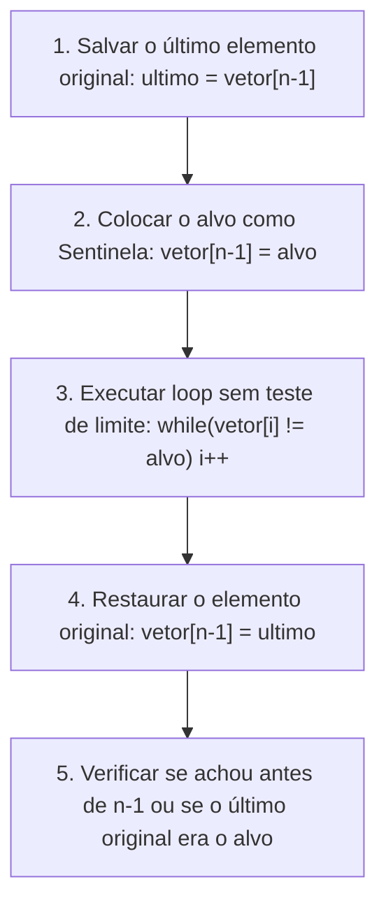

import { Tabs, TabItem } from '@astrojs/starlight/components';

## 1. Visão Geral e Intuição

A **Pesquisa com Sentinela** é uma técnica elegante de otimização de baixo nível para a busca linear. Na busca sequencial padrão, cada volta do loop realiza duas checagens condicionais:
1. `i < tamanho_do_vetor` (para não estourar a memória).
2. `vetor[i] == alvo` (para saber se achou).

A técnica da sentinela consiste em **forçar a presença do elemento procurado na última posição do vetor** (substituindo temporariamente o último elemento ou inserindo um elemento extra no final). Com isso, temos a certeza matemática de que o elemento *sempre* será encontrado, tornando o teste de limite de vetor `i < tamanho` totalmente desnecessário dentro do loop principal!

:::tip[Analogia do Mundo Real: A Bóia no Fim da Piscina]
Imagine nadar de olhos vendados em uma piscina procurando uma moeda caída. Sem uma bóia no final, a cada braçada você precisa tatear a borda com medo de bater a cabeça na parede de concreto. Se alguém colocar uma bóia de espuma macia no final com a moeda, você pode nadar o mais rápido possível sem se preocupar em medir o comprimento da piscina: ao encostar na moeda ou na bóia, você sabe que chegou ao fim.
:::

## 2. Como Funciona a Mecânica da Sentinela



Ao eliminar 50% dos desvios condicionais (*branch predictions*) dentro do loop, o ganho de desempenho em processadores de computação de alto desempenho pode ser expressivo para vetores grandes.

## 3. Análise de Complexidade

| Métrica | Busca Linear Simples | Busca com Sentinela |
| :--- | :---: | :---: |
| **Complexidade Assintótica Big O** | $O(n)$ | $O(n)$ |
| **Comparações por Iteração** | 2 testes (`i < n` e `arr[i] == alvo`) | **1 único teste** (`arr[i] != alvo`) |
| **Espaço Auxiliar** | $O(1)$ | $O(1)$ |

## 4. Implementações Práticas

<Tabs>
  <TabItem label="Python" icon="seti:python">
  ```python
  from typing import Optional

  def busca_com_sentinela(vetor: list[int], alvo: int) -> Optional[int]:
      """
      Busca linear otimizada com sentinela.
      Modifica temporariamente a última posição e depois a restaura.
      """
      n = len(vetor)
      if n == 0:
          return None

      ultimo_original = vetor[-1]
      # Se o último já for o alvo, encerra de imediato
      if ultimo_original == alvo:
          return n - 1

      # Insere a sentinela no final
      vetor[-1] = alvo
      i = 0
      while vetor[i] != alvo:
          i += 1

      # Restaura o valor original
      vetor[-1] = ultimo_original

      # Se parou antes do último índice, encontramos o alvo
      if i < n - 1:
          return i
      return None

  if __name__ == "__main__":
      dados = [23, 12, 9, 74, 5, 18]
      alvo = 74
      print(f"Índice encontrado: {busca_com_sentinela(dados, alvo)}")  # 3
  ```
  </TabItem>

  <TabItem label="Java" icon="seti:java">
  ```java
  import java.util.OptionalInt;

  public class PesquisaComSentinela {
      public static OptionalInt buscarSentinela(int[] vetor, int alvo) {
          int n = vetor.length;
          if (n == 0) return OptionalInt.empty();

          int ultimoOriginal = vetor[n - 1];
          if (ultimoOriginal == alvo) {
              return OptionalInt.of(n - 1);
          }

          // Posiciona a sentinela
          vetor[n - 1] = alvo;
          int i = 0;
          while (vetor[i] != alvo) {
              i++;
          }

          // Restaura valor original
          vetor[n - 1] = ultimoOriginal;

          if (i < n - 1) {
              return OptionalInt.of(i);
          }
          return OptionalInt.empty();
      }

      public static void main(String[] args) {
          int[] dados = {23, 12, 9, 74, 5, 18};
          int alvo = 74;
          OptionalInt idx = buscarSentinela(dados, alvo);
          idx.ifPresent(val -> System.out.println("Índice: " + val)); // 3
      }
  }
  ```
  </TabItem>
</Tabs>

## 5. Casos de Borda e Armadilhas

- **Estruturas Imutáveis:** Não é aplicável em listas de leitura estrita (*read-only*) ou coleções congeladas sem alocar espaço adicional para a sentinela.
- **Multithreading / Concorrência:** Modificar o vetor em um ambiente concorrente para injetar a sentinela pode corromper leituras simultâneas de outras threads.
- **Restauração Obrigatória:** É crucial restaurar o último elemento original mesmo em cenários de exceção (utilizando blocos `try/finally`).

## 6. Quando Usar e Trade-offs

- **Use quando:** Estiver desenvolvendo código crítico para sistemas embarcados, drivers de hardware ou engines de jogos onde cada ciclo de instrução de CPU e desvio condicional impacta na taxa de quadros (FPS).
- **Evite quando:** O código precisar ser concorrente e thread-safe sem travas (*locks*).

## 7. Exercícios Recomendados

1. **Fixação:** Implemente a busca com sentinela alocando uma posição extra no final do vetor em vez de sobrescrever o último elemento.
2. **Benchmark:** Meça o tempo de execução de 10.000 buscas lineares normais versus buscas com sentinela em um vetor com 100.000 elementos.

## 8. Leituras e Referências

- *The Art of Computer Programming, Volume 3: Sorting and Searching* — Donald E. Knuth
- *Programming Pearls* — Jon Bentley
