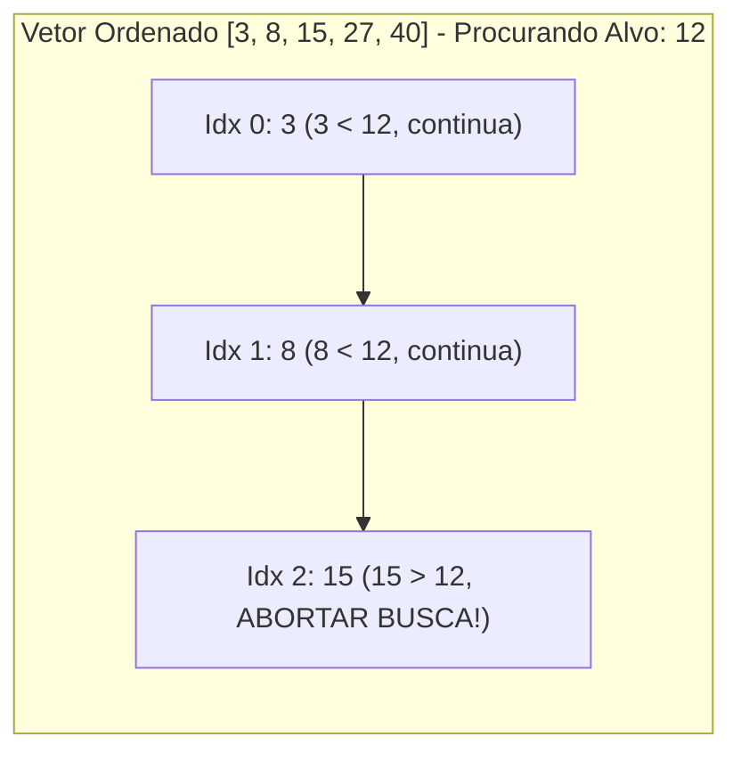

import { Tabs, TabItem } from '@astrojs/starlight/components';

## 1. Visão Geral e Intuição

Quando sabemos com certeza matemática que um vetor está **ordenado** de forma crescente, a busca linear comum ganha uma propriedade valiosa: a **parada antecipada (*early exit*)**.

Na busca linear em vetor desordenado, se o elemento não existir, somos obrigados a percorrer todos os $n$ elementos. Em um vetor ordenado, assim que encontrarmos um elemento estritamente maior que o alvo procurado, temos a garantia absoluta de que o alvo não existirá nas posições subsequentes, podendo abortar a busca imediatamente.

:::tip[Analogia do Mundo Real: O Índice Telefônico]
Se você está folheando uma lista telefônica organizada em ordem alfabética procurando pelo sobrenome "Castro" e de repente vê a página com sobrenomes iniciados por "Dantas", você para de folhear na hora. Você não precisa chegar na letra "Z" para ter certeza de que "Castro" não está lá.
:::

## 2. Como Funciona a Parada Antecipada



Se o alvo não estiver no vetor, o algoritmo percorre em média apenas metade do vetor antes de atingir um número maior, reduzindo o tempo do pior caso de elemento inexistente.

## 3. Análise de Complexidade

| Cenário | Vetor Não Ordenado | Vetor Ordenado (Linear com Parada) |
| :--- | :---: | :---: |
| **Elemento Presente (Médio)** | $n / 2$ passos $\to O(n)$ | $n / 2$ passos $\to O(n)$ |
| **Elemento Ausente (Pior Caso)** | $n$ passos $\to O(n)$ | **$n / 2$ passos em média $\to O(n)$** |
| **Complexidade Assintótica** | $O(n)$ | $O(n)$ (mesmo Big O, porém com constante oculta menor) |

## 4. Implementações Práticas

<Tabs>
  <TabItem label="Python" icon="seti:python">
  ```python
  from typing import Optional

  def busca_ordenada_linear(vetor: list[int], alvo: int) -> Optional[int]:
      """
      Busca linear em vetor ordenado com interrupção antecipada.
      Complexidade: O(n) pior caso, mas aborta assim que vetor[i] > alvo.
      """
      for indice, valor in enumerate(vetor):
          if valor == alvo:
              return indice
          if valor > alvo:
              # Garante que o alvo não existe mais à frente
              break
      return None

  if __name__ == "__main__":
      dados_ordenados = [5, 12, 19, 28, 45, 60, 78]
      alvo = 20
      resultado = busca_ordenada_linear(dados_ordenados, alvo)
      print(f"Alvo {alvo} encontrado no índice: {resultado}")  # None (parou no 28)
  ```
  </TabItem>

  <TabItem label="Java" icon="seti:java">
  ```java
  import java.util.OptionalInt;

  public class BuscaEmVetorOrdenado {
      public static OptionalInt buscarOrdenado(int[] vetor, int alvo) {
          for (int i = 0; i < vetor.length; i++) {
              if (vetor[i] == alvo) {
                  return OptionalInt.of(i);
              }
              if (vetor[i] > alvo) {
                  // Aborta antecipadamente
                  return OptionalInt.empty();
              }
          }
          return OptionalInt.empty();
      }

      public static void main(String[] args) {
          int[] dados = {5, 12, 19, 28, 45, 60, 78};
          int alvo = 20;
          OptionalInt res = buscarOrdenado(dados, alvo);
          System.out.println("Encontrado: " + res.isPresent()); // false
      }
  }
  ```
  </TabItem>
</Tabs>

## 5. Casos de Borda e Armadilhas

- **Falso pressuposto de ordenação:** Se o vetor não estiver estritamente ordenado, o algoritmo falhará silenciosamente, reportando que o elemento inexiste mesmo que ele esteja posicionado mais adiante.
- **Inserção mantendo a ordenação:** Para manter um vetor sempre ordenado durante inserções sucessivas, cada inserção custará $O(n)$ de deslocamento.

## 6. Quando Usar e Trade-offs

- Embora melhore a busca linear, se o vetor já está ordenado e temos acesso aleatório por índices, a **Pesquisa Binária ($O(\log n)$)** é esmagadoramente superior.
- A busca ordenada com parada antecipada é ideal principalmente para **Listas Encadeadas Ordenadas**, onde a pesquisa binária não pode ser aplicada diretamente devido à falta de acesso direto por índice $O(1)$.

## 7. Exercícios Recomendados

1. **Fixação:** Adapte o algoritmo para retornar o índice onde o elemento *deveria* ser inserido para manter a ordem do vetor caso ele não exista.
2. **LeetCode 35:** [Search Insert Position](https://leetcode.com/problems/search-insert-position/)

## 8. Leituras e Referências

- *Data Structures and Algorithms in Java* — Robert Lafore
- *Entendendo Algoritmos* — Aditya Bhargava
