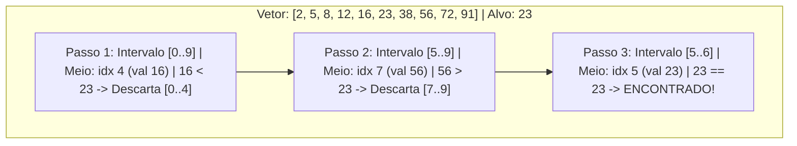

import { Tabs, TabItem } from '@astrojs/starlight/components';

## 1. Visão Geral e Intuição

A **Pesquisa Binária (Binary Search)** é um dos algoritmos fundamentais e mais elegantes de toda a ciência da computação. Ela resolve o problema de localizar a posição de um valor alvo dentro de um **vetor ordenado**, descartando **metade** dos elementos restantes a cada comparação.

Em vez de verificar item por item ($O(n)$), a pesquisa binária consulta o elemento que está exatamente no centro do intervalo de busca. Dependendo se o elemento central for maior ou menor que o alvo, metade do vetor é eliminada instantaneamente.

:::tip[Analogia do Mundo Real: O Jogo da Adivinhação de 1 a 100]
Pense na brincadeira clássica: *"Estou pensando em um número entre 1 e 100. Adivinhe qual é e eu direi se é maior ou menor"*. Se você chutar 50 e a resposta for "É maior!", você acabou de eliminar todos os números de 1 a 50 com um único chute! Seu próximo chute será 75, depois 88... Em no máximo 7 perguntas ($\lceil \log_2 100 \rceil$), você garante a vitória.
:::

## 2. Como Funciona a Pesquisa Binária



### O Poder do Logaritmo: $O(\log n)$

- Para $n = 1.000$ elementos: no máximo $\approx 10$ passos.
- Para $n = 1.000.000$ (1 milhão): no máximo $\approx 20$ passos.
- Para $n = 4.000.000.000$ (toda a população mundial conectada): no máximo $\approx 32$ passos!

## 3. Análise de Complexidade

| Métrica | Complexidade | Explicação |
| :--- | :---: | :--- |
| **Melhor Caso** | $O(1)$ | O alvo está na posição central exata do primeiro chute. |
| **Caso Médio** | $O(\log n)$ | Redução contínua pela metade a cada passo. |
| **Pior Caso** | $O(\log n)$ | O alvo fica no último intervalo unitário ou não existe. |
| **Espaço Auxiliar (Iterativo)** | $O(1)$ | Apenas ponteiros `baixo`, `alto` e `meio`. |
| **Espaço Auxiliar (Recursivo)** | $O(\log n)$ | Devido aos frames empilhados na Call Stack. |

## 4. Implementações Práticas

<Tabs>
  <TabItem label="Python" icon="seti:python">
  ```python
  from typing import Optional

  def pesquisa_binaria(vetor: list[int], alvo: int) -> Optional[int]:
      """
      Busca binária iterativa em vetor ordenado.
      Complexidade: Tempo O(log n) | Espaço O(1)
      """
      baixo = 0
      alto = len(vetor) - 1

      while baixo <= alto:
          # Evita overflow em somas grandes
          meio = baixo + (alto - baixo) // 2
          chute = vetor[meio]

          if chute == alvo:
              return meio
          elif chute > alvo:
              alto = meio - 1
          else:
              baixo = meio + 1

      return None

  if __name__ == "__main__":
      dados = [2, 5, 8, 12, 16, 23, 38, 56, 72, 91]
      alvo = 23
      resultado = pesquisa_binaria(dados, alvo)
      print(f"Alvo {alvo} encontrado no índice: {resultado}")  # 5
  ```
  </TabItem>

  <TabItem label="Java" icon="seti:java">
  ```java
  import java.util.OptionalInt;

  public class PesquisaBinaria {
      public static OptionalInt buscarBinario(int[] vetor, int alvo) {
          int baixo = 0;
          int alto = vetor.length - 1;

          while (baixo <= alto) {
              // Formula clássica contra Integer Overflow: baixo + (alto - baixo) / 2
              int meio = baixo + (alto - baixo) / 2;
              int chute = vetor[meio];

              if (chute == alvo) {
                  return OptionalInt.of(meio);
              }
              if (chute > alvo) {
                  alto = meio - 1;
              } else {
                  baixo = meio + 1;
              }
          }

          return OptionalInt.empty();
      }

      public static void main(String[] args) {
          int[] dados = {2, 5, 8, 12, 16, 23, 38, 56, 72, 91};
          int alvo = 23;
          OptionalInt res = buscarBinario(dados, alvo);
          res.ifPresent(idx -> System.out.println("Índice encontrado: " + idx)); // 5
      }
  }
  ```
  </TabItem>
</Tabs>

## 5. Casos de Borda e Armadilhas

- **Bug Histórico do Integer Overflow:** Fazer `(baixo + alto) / 2` causou falha no Java e C++ por anos quando `baixo + alto` ultrapassava $2^{31}-1$, resultando em número negativo. Sempre use `baixo + (alto - baixo) / 2`.
- **Pré-requisito Estrito:** A pesquisa binária **só funciona se a lista estiver ordenada**. Se a lista for alterada com frequência sem critério de ordem, o custo de ordenação frequente anulará a vantagem da busca.
- **Estrutura com Acesso Aleatório:** Aplicar busca binária em listas encadeadas comuns não atinge $O(\log n)$ porque encontrar o nó do meio leva $O(n)$.

## 6. Quando Usar e Trade-offs

- **Use quando:** Os dados estiverem estáveis (poucas inserções e muitas consultas) e armazenados em memória contígua (arrays).
- **Evite quando:** A coleção for alterada a cada milissegundo e for inviável mantê-la ordenada (nesse cenário, Tabelas Hash com inserção e busca em $O(1)$ são preferíveis).

## 7. Exercícios Recomendados

1. **Fixação:** Implemente a pesquisa binária para encontrar a *primeira ocorrência* de um número em um vetor com elementos repetidos.
2. **LeetCode 704:** [Binary Search](https://leetcode.com/problems/binary-search/)
3. **LeetCode 33:** [Search in Rotated Sorted Array](https://leetcode.com/problems/search-in-rotated-sorted-array/)

## 8. Leituras e Referências

- *Entendendo Algoritmos* — Aditya Bhargava (Capítulo 1: Pesquisa Binária)
- *Extra, Extra - Read All About It: Nearly All Binary Searches and Mergesorts are Broken* — Joshua Bloch (Google Research Blog)
