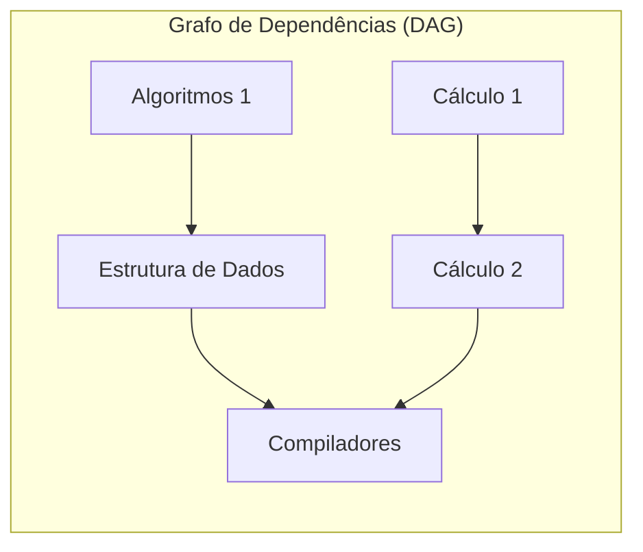

import { Tabs, TabItem } from '@astrojs/starlight/components';

## 1. Visão Geral e Intuição

Uma **Ordenação Topológica (Topological Sort)** é uma ordenação linear de todos os vértices de um grafo direcionado de tal forma que, para toda aresta direcionada $(u \to v)$, o vértice $u$ obrigatoriamente aparece **antes** de $v$ na sequência final.

Essa ordenação é possível **apenas e exclusivamente se o grafo for um DAG (Directed Acyclic Graph — Grafo Direcionado Acíclico)**. Se o grafo contiver qualquer ciclo de dependência circular (ex: $A \to B \to C \to A$), é matematicamente impossível estabelecer uma ordem topológica válida.

:::tip[Analogia do Mundo Real: A Grade Curricular da Faculdade]
Para cursar a disciplina "Compiladores", você precisa primeiro ter cursado "Estrutura de Dados". Para cursar "Estrutura de Dados", precisa ter feito "Algoritmos 1". Você não pode assistir às aulas de uma matéria sem antes concluir todos os seus pré-requisitos! A ordenação topológica é exatamente o plano de estudos que respeita todos os pré-requisitos da grade curricular.
:::

## 2. Como Funciona o Algoritmo de Kahn (Baseado em Grau de Entrada)



### O Algoritmo de Kahn passo a passo:
1. Calcule o **Grau de Entrada (*In-degree*)** de cada vértice (número de arestas que chegam até ele).
2. Adicione em uma fila todos os vértices com grau de entrada igual a $0$ (tarefas sem nenhum pré-requisito pendente).
3. Enquanto a fila não estiver vazia:
   - Retire um vértice $u$ e coloque-o na lista de ordenação final.
   - Para cada vizinho $v$ de $u$, decremente seu grau de entrada em 1.
   - Se o grau de entrada de $v$ chegar a 0, adicione $v$ na fila.
4. Se o total de vértices na ordenação final for menor que $|V|$, o grafo possui um ciclo!

## 3. Análise de Complexidade

| Métrica | Complexidade | Explicação |
| :--- | :---: | :--- |
| **Tempo de Execução** | $O(V + E)$ | Cada nó entra e sai da fila uma vez; cada aresta tem seu grau decrementado uma vez. |
| **Espaço Auxiliar** | $O(V)$ | Para o array/mapa de graus de entrada e a Fila. |

## 4. Implementações Práticas

<Tabs>
  <TabItem label="Python" icon="seti:python">
  ```python
  from collections import deque
  from typing import Optional

  def ordenacao_topologica_kahn(grafo: dict[str, list[str]]) -> Optional[list[str]]:
      """
      Algoritmo de Kahn para ordenação topológica.
      Retorna a lista ordenada ou None se houver ciclo de dependência.
      """
      grau_entrada = {v: 0 for v in grafo}
      for v in grafo:
          for vizinho in grafo[v]:
              grau_entrada[vizinho] = grau_entrada.get(vizinho, 0) + 1

      fila = deque([v for v, grau in grau_entrada.items() if grau == 0])
      ordem = []

      while fila:
          atual = fila.popleft()
          ordem.append(atual)

          for vizinho in grafo.get(atual, []):
              grau_entrada[vizinho] -= 1
              if grau_entrada[vizinho] == 0:
                  fila.append(vizinho)

      # Se a quantidade de nós processados for diferente do total, há um ciclo
      if len(ordem) != len(grau_entrada):
          return None
      return ordem

  if __name__ == "__main__":
      grade_materias = {
          "Algoritmos 1": ["Estrutura de Dados"],
          "Estrutura de Dados": ["Compiladores"],
          "Cálculo 1": ["Cálculo 2"],
          "Cálculo 2": ["Compiladores"],
          "Compiladores": []
      }
      print("Ordem de matrícula viável:", ordenacao_topologica_kahn(grade_materias))
  ```
  </TabItem>

  <TabItem label="Java" icon="seti:java">
  ```java
  import java.util.*;

  public class OrdenacaoTopologica {
      public static Optional<List<String>> ordenarTopologico(Map<String, List<String>> grafo) {
          Map<String, Integer> grauEntrada = new HashMap<>();
          for (String u : grafo.keySet()) {
              grauEntrada.putIfAbsent(u, 0);
              for (String v : grafo.get(u)) {
                  grauEntrada.put(v, grauEntrada.getOrDefault(v, 0) + 1);
              }
          }

          Queue<String> fila = new ArrayDeque<>();
          for (var entry : grauEntrada.entrySet()) {
              if (entry.getValue() == 0) {
                  fila.offer(entry.getKey());
              }
          }

          List<String> resultado = new ArrayList<>();
          while (!fila.isEmpty()) {
              String atual = fila.poll();
              resultado.add(atual);

              for (String vizinho : grafo.getOrDefault(atual, Collections.emptyList())) {
                  grauEntrada.put(vizinho, grauEntrada.get(vizinho) - 1);
                  if (grauEntrada.get(vizinho) == 0) {
                      fila.offer(vizinho);
                  }
              }
          }

          if (resultado.size() != grauEntrada.size()) {
              return Optional.empty(); // Ciclo detectado
          }
          return Optional.of(resultado);
      }

      public static void main(String[] args) {
          Map<String, List<String>> tarefas = Map.of(
              "Acordar", List.of("Tomar Banho"),
              "Tomar Banho", List.of("Tomar Café"),
              "Tomar Café", List.of("Trabalhar"),
              "Trabalhar", List.of()
          );
          ordenarTopologico(tarefas).ifPresent(System.out::println);
      }
  }
  ```
  </TabItem>
</Tabs>

## 5. Casos de Borda e Armadilhas

- **Dependência Cíclica (Deadlock):** No ecossistema de software, se o pacote A depende do pacote B, e o pacote B depende do pacote A, gerenciadores como `npm`, `pip` ou `maven` detectam a ausência de ordem topológica e abortam com erro de dependência circular.
- **Múltiplas Ordens Válidas:** Um DAG pode ter dezenas de sequências topológicas igualmente válidas. O resultado depende de quais nós com grau 0 são processados primeiro.

## 6. Quando Usar e Trade-offs

- **Gerenciadores de Compilação:** `make`, `webpack`, `turbo`, `vite` usam ordenação topológica para saber em qual ordem exata os arquivos de código-fonte devem ser transpilados.
- **Pipelines de CI/CD e ETL:** Orquestradores como Apache Airflow usam DAGs e ordenação topológica para agendar tarefas de dados.

## 7. Exercícios Recomendados

1. **Fixação:** Dado um grafo com 4 nós e as arestas $(A \to B)$, $(B \to C)$, $(C \to D)$ e $(D \to B)$, aplique o algoritmo de Kahn e explique como ele detecta o ciclo.
2. **LeetCode 207:** [Course Schedule](https://leetcode.com/problems/course-schedule/)
3. **LeetCode 210:** [Course Schedule II](https://leetcode.com/problems/course-schedule-ii/)

## 8. Leituras e Referências

- *Entendendo Algoritmos* — Aditya Bhargava (Capítulo 6: Ordenação Topológica)
- *Introduction to Algorithms (CLRS)* — Capítulo 22.4: Ordenação Topológica
