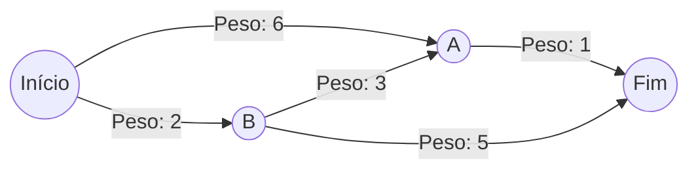

import { Tabs, TabItem } from '@astrojs/starlight/components';

## 1. Visão Geral e Intuição

Enquanto a BFS calcula o menor caminho baseado no menor número de passos (arestas), na vida real as conexões possuem custos desiguais: uma estrada pode ter pedágio, outra ter trânsito intenso ou ter distâncias quilométricas diferentes.

O **Algoritmo de Dijkstra**, concebido por Edsger W. Dijkstra em 1956, encontra o **caminho de menor custo acumulado (menor peso)** a partir de um vértice de origem para todos os outros vértices de um grafo ponderado, sob uma regra fundamental: **todos os pesos das arestas devem ser estritamente não negativos ($\ge 0$)**.

:::tip[Analogia do Mundo Real: O Waze / Google Maps]
Ao solicitar uma rota de carro, o GPS não quer necessariamente a rota com menos curvas ou com menos ruas (que poderia ser a BFS). Ele busca a rota com o menor tempo total em minutos. Passar por 4 avenidas rápidas (peso total: 12 min) é muito melhor do que pegar 2 ruas engarrafadas (peso total: 35 min). O GPS calcula o caminho mais leve!
:::

## 2. Como Funciona o Algoritmo

O algoritmo mantém uma tabela de custos provisórios e um conjunto de nós processados:
1. Encontre o vértice não processado que possui o **menor custo acumulado** atual (utiliza-se uma **Fila de Prioridade / Min-Heap**).
2. Atualize o custo para alcançar os vizinhos desse vértice (operação de **Relaxamento de Aresta**):
   $$
   \text{Se } \text{custo}[u] + \text{peso}(u, v) < \text{custo}[v] \implies \text{custo}[v] = \text{custo}[u] + \text{peso}(u, v)
   $$
3. Marque o vértice atual como processado.
4. Repita até que todos os vértices tenham sido processados.


*(No exemplo acima, o caminho `Início -> B -> A -> Fim` custa $2 + 3 + 1 = 6$, sendo mais rápido que o caminho direto `Início -> A -> Fim` que custa $6 + 1 = 7$).*

## 3. Análise de Complexidade

| Implementação | Tempo de Execução | Espaço Auxiliar |
| :--- | :---: | :---: |
| **Com Matriz / Busca Linear do Menor** | $O(V^2)$ | $O(V)$ |
| **Com Min-Heap / PriorityQueue (Padrão Otimizado)** | **$O((V + E) \log V)$** | $O(V)$ |

## 4. Implementações Práticas

<Tabs>
  <TabItem label="Python" icon="seti:python">
  ```python
  import heapq
  from typing import Optional

  def dijkstra(grafo: dict[str, dict[str, int]], inicio: str, destino: str) -> tuple[int, list[str]]:
      """
      Calcula o menor custo e o caminho utilizando Min-Heap (heapq).
      Não aceita pesos negativos!
      """
      fila_prioridade = [(0, inicio, [inicio])]
      distancias = {inicio: 0}
      visitados = set()

      while fila_prioridade:
          custo_atual, vertice_atual, caminho = heapq.heappop(fila_prioridade)

          if vertice_atual in visitados:
              continue
          visitados.add(vertice_atual)

          if vertice_atual == destino:
              return custo_atual, caminho

          for vizinho, peso in grafo.get(vertice_atual, {}).items():
              if peso < 0:
                  raise ValueError("Dijkstra não aceita arestas com peso negativo!")
              
              novo_custo = custo_atual + peso
              if novo_custo < distancias.get(vizinho, float("inf")):
                  distancias[vizinho] = novo_custo
                  heapq.heappush(fila_prioridade, (novo_custo, vizinho, caminho + [vizinho]))

      return float("inf"), [] # type: ignore

  if __name__ == "__main__":
      mapa = {
          "Início": {"A": 6, "B": 2},
          "B": {"A": 3, "Fim": 5},
          "A": {"Fim": 1},
          "Fim": {}
      }
      custo, rota = dijkstra(mapa, "Início", "Fim")
      print(f"Menor custo: {custo} | Rota: {' -> '.join(rota)}") # Custo 6: Início -> B -> A -> Fim
  ```
  </TabItem>

  <TabItem label="Java" icon="seti:java">
  ```java
  import java.util.*;

  public class AlgoritmoDeDijkstra {
      public record Aresta(String destino, int peso) {}
      private record NoCusto(String nome, int custo) implements Comparable<NoCusto> {
          @Override
          public int compareTo(NoCusto o) {
              return Integer.compare(this.custo, o.custo);
          }
      }

      public static Map<String, Integer> dijkstra(Map<String, List<Aresta>> grafo, String inicio) {
          Map<String, Integer> distancias = new HashMap<>();
          PriorityQueue<NoCusto> pq = new PriorityQueue<>();

          distancias.put(inicio, 0);
          pq.offer(new NoCusto(inicio, 0));

          while (!pq.isEmpty()) {
              NoCusto atual = pq.poll();
              if (atual.custo > distancias.getOrDefault(atual.nome, Integer.MAX_VALUE)) continue;

              for (Aresta vizinho : grafo.getOrDefault(atual.nome, Collections.emptyList())) {
                  int novaDist = atual.custo + vizinho.peso;
                  if (novaDist < distancias.getOrDefault(vizinho.destino, Integer.MAX_VALUE)) {
                      distancias.put(vizinho.destino, novaDist);
                      pq.offer(new NoCusto(vizinho.destino, novaDist));
                  }
              }
          }
          return distancias;
      }

      public static void main(String[] args) {
          Map<String, List<Aresta>> grafo = Map.of(
              "Início", List.of(new Aresta("A", 6), new Aresta("B", 2)),
              "B", List.of(new Aresta("A", 3), new Aresta("Fim", 5)),
              "A", List.of(new Aresta("Fim", 1)),
              "Fim", List.of()
          );
          Map<String, Integer> dists = dijkstra(grafo, "Início");
          System.out.println("Custo até o Fim: " + dists.get("Fim")); // 6
      }
  }
  ```
  </TabItem>
</Tabs>

## 5. Casos de Borda e Armadilhas

- **Pesos Negativos:** Dijkstra assume gananciosamente que, uma vez que um nó foi processado com menor custo, ele nunca poderá ter seu custo reduzido posteriormente. Se existirem arestas com pesos negativos, essa premissa é quebrada e o algoritmo falha! Para pesos negativos, utilize o **Algoritmo de Bellman-Ford**.

## 6. Quando Usar e Trade-offs

- **Use Dijkstra:** Para roteamento em redes IP (protocolo OSPF), rotas de logística de transportes e sistemas de navegação GPS.
- **Evite se:** O grafo não tiver pesos (prefira BFS tradicional, que roda em $O(V+E)$ sem o custo logarítmico da fila de prioridade).

## 7. Exercícios Recomendados

1. **Fixação:** Execute Dijkstra à mão para uma malha rodoviária com 5 cidades e demonstre a tabela de distâncias atualizada a cada iteração.
2. **LeetCode 743:** [Network Delay Time](https://leetcode.com/problems/network-delay-time/)

## 8. Leituras e Referências

- *Entendendo Algoritmos* — Aditya Bhargava (Capítulo 7: Algoritmo de Dijkstra)
- *A Note on Two Problems in Connexion with Graphs* — Edsger W. Dijkstra (1959)
