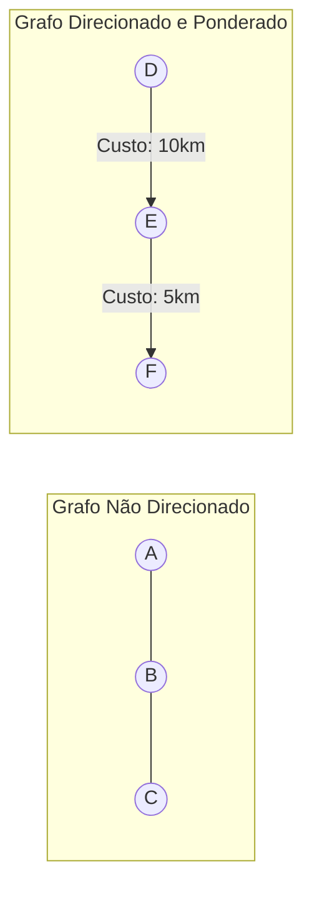

import { Tabs, TabItem } from '@astrojs/starlight/components';

## 1. Visão Geral e Intuição

Um **Grafo $G = (V, E)$** é uma estrutura de dados não linear poderosa composta por dois conjuntos:
- **Vértices ou Nós ($V$):** Representam entidades (pessoas, cidades, roteadores, páginas web).
- **Arestas ($E$):** Representam conexões ou relacionamentos entre esses vértices (amizades, estradas, cabos de rede, hiperlinks).

Os grafos permitem modelar praticamente qualquer tipo de rede ou sistema interconectado do mundo físico e digital.

:::tip[Analogia do Mundo Real: Redes Sociais]
- No **Facebook**, uma amizade é mútua: se você é amigo de alguém, essa pessoa necessariamente é sua amiga. Isso é um **Grafo Não Direcionado**.
- No **Twitter / Instagram**, você pode seguir uma celebridade sem que ela te siga de volta. Essa conexão tem sentido e direção única. Isso é um **Grafo Direcionado (Dígrafo)**.
:::

## 2. Tipos de Grafos e Representações



### Formas de Representação em Memória

1. **Matriz de Adjacência:** Uma matriz $V \times V$ onde $M[u][v] = 1$ (ou o peso da aresta) se houver conexão. Consome memória $O(V^2)$.
2. **Lista de Adjacência:** Um array ou dicionário onde cada vértice aponta para a lista de seus vizinhos imediatos. Consome memória $O(V + E)$ (muito mais eficiente para grafos esparsos).

| Aspecto | Matriz de Adjacência | Lista de Adjacência |
| :--- | :---: | :---: |
| **Espaço em Memória** | $O(V^2)$ | $O(V + E)$ |
| **Verificar se $(u, v)$ são vizinhos** | $O(1)$ | $O(\text{grau}(u))$ |
| **Listar todos os vizinhos de $u$** | $O(V)$ | $O(\text{grau}(u))$ |
| **Melhor para:** | Grafos Densos ($E \approx V^2$) | Grafos Esparsos ($E \ll V^2$) |

## 3. Implementações Práticas (Lista de Adjacência)

<Tabs>
  <TabItem label="Python" icon="seti:python">
  ```python
  class Grafo:
      def __init__(self, direcionado: bool = False):
          self.direcionado = direcionado
          # Lista de adjacência implementada com dicionário de listas
          self.adj: dict[str, list[str]] = {}

      def adicionar_vertice(self, v: str) -> None:
          if v not in self.adj:
              self.adj[v] = []

      def adicionar_aresta(self, u: str, v: str) -> None:
          self.adicionar_vertice(u)
          self.adicionar_vertice(v)
          self.adj[u].append(v)
          if not self.direcionado:
              self.adj[v].append(u)

  if __name__ == "__main__":
      rede = Grafo(direcionado=True)
      rede.adicionar_aresta("Você", "Alice")
      rede.adicionar_aresta("Você", "Bob")
      rede.adicionar_aresta("Alice", "Peggy")

      print("Vizinhos de Você:", rede.adj["Você"]) # ['Alice', 'Bob']
  ```
  </TabItem>

  <TabItem label="Java" icon="seti:java">
  ```java
  import java.util.*;

  public class IntroducaoAGrafos {
      public static class Grafo {
          private final boolean direcionado;
          private final Map<String, List<String>> adj = new HashMap<>();

          public Grafo(boolean direcionado) {
              this.direcionado = direcionado;
          }

          public void adicionarAresta(String u, String v) {
              adj.computeIfAbsent(u, k -> new ArrayList<>()).add(v);
              adj.computeIfAbsent(v, k -> new ArrayList<>());
              if (!direcionado) {
                  adj.get(v).add(u);
              }
          }

          public List<String> getVizinhos(String v) {
              return adj.getOrDefault(v, Collections.emptyList());
          }
      }

      public static void main(String[] args) {
          Grafo rede = new Grafo(true);
          rede.adicionarAresta("Você", "Alice");
          rede.adicionarAresta("Você", "Bob");
          System.out.println("Vizinhos de Você: " + rede.getVizinhos("Você"));
      }
  }
  ```
  </TabItem>
</Tabs>

## 5. Casos de Borda e Armadilhas

- **Ciclos em Grafos:** Um caminho que começa e termina no mesmo vértice. Ao percorrer grafos com ciclos, é indispensável manter um conjunto de `visitados` para evitar recursões ou loops infinitos.
- **Vértices Isolados:** Vértices sem nenhuma aresta devem constar na lista de adjacência com uma lista de vizinhos vazia.

## 6. Quando Usar e Trade-offs

- Em mais de 95% dos problemas do mundo real (como malhas viárias e redes de computadores), o grafo é esparso (cada cidade tem conexão direta com poucas outras). Use **Lista de Adjacência**.

## 7. Exercícios Recomendados

1. **Fixação:** Modele as estações de uma linha de metrô com conexões bidirecionais utilizando uma Lista de Adjacência.
2. **LeetCode 1791:** [Find Center of Star Graph](https://leetcode.com/problems/find-center-of-star-graph/)

## 8. Leituras e Referências

- *Entendendo Algoritmos* — Aditya Bhargava (Capítulo 6: Introdução a Grafos)
- *Introduction to Algorithms (CLRS)* — Capítulo 22: Algoritmos Elementares para Grafos
