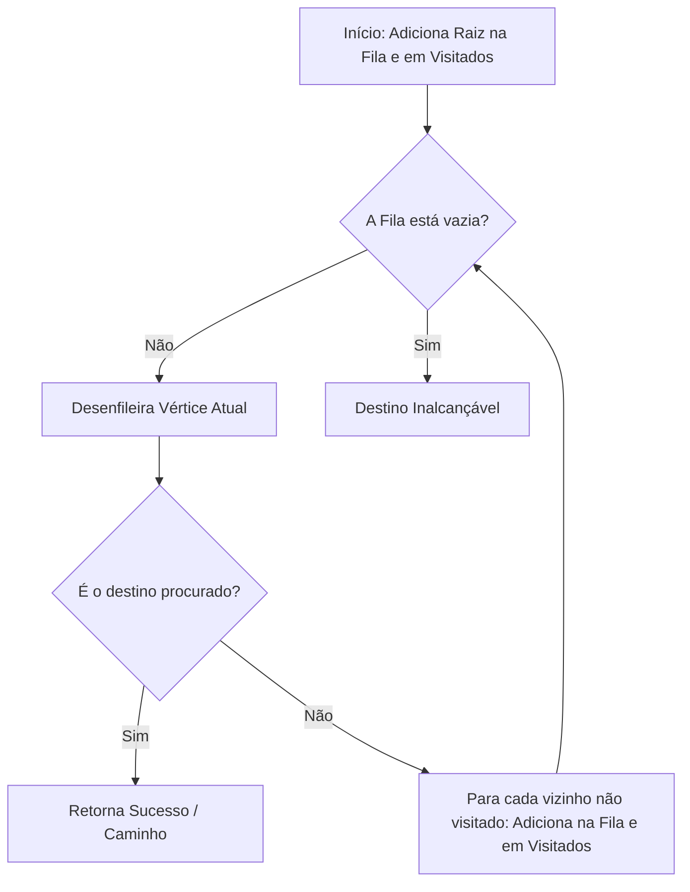

import { Tabs, TabItem } from '@astrojs/starlight/components';

## 1. Visão Geral e Intuição

A **Pesquisa em Largura (Breadth-First Search - BFS)** é um algoritmo de busca fundamental em grafos. Ela responde a duas perguntas cruciais:
1. **Existe um caminho do vértice $A$ até o vértice $B$?**
2. **Qual é o caminho mais curto (menor número de arestas/passos) entre $A$ e $B$?**

A BFS explora o grafo em **ondas concêntricas**: primeiro visita todos os vizinhos de 1º grau (distância 1), depois todos os vizinhos de 2º grau (distância 2), e assim sucessivamente. Para garantir essa ordem de exploração nível por nível, a BFS depende estritamente de uma estrutura de **Fila (FIFO)**.

:::tip[Analogia do Mundo Real: A Teoria dos Seis Graus de Separação]
Se você quer encontrar um contato que trabalha em uma empresa específica, você primeiro pergunta a todos os seus amigos diretos (1º grau). Se nenhum deles trabalhar lá, você pede para cada um deles perguntar aos respectivos amigos (2º grau). Você só procura contatos de 2º grau após ter esgotado todos os de 1º grau!
:::

## 2. A Mecânica da BFS com Fila e Conjunto de Visitados



## 3. Análise de Complexidade

| Métrica | Complexidade | Explicação |
| :--- | :---: | :--- |
| **Tempo de Execução** | $O(V + E)$ | Cada vértice entra na fila no máximo uma vez ($V$) e cada aresta é percorrida uma vez ($E$). |
| **Espaço Auxiliar** | $O(V)$ | Para a Fila e o Conjunto de nós já visitados. |

## 4. Implementações Práticas

<Tabs>
  <TabItem label="Python" icon="seti:python">
  ```python
  from collections import deque
  from typing import Optional

  def bfs_menor_caminho(grafo: dict[str, list[str]], inicio: str, destino: str) -> Optional[list[str]]:
      """
      Encontra o caminho com menor número de passos de início até destino.
      Retorna a lista de nós do caminho ou None se inalcançável.
      """
      fila = deque([(inicio, [inicio])])
      visitados = {inicio}

      while fila:
          vertice_atual, caminho = fila.popleft()

          if vertice_atual == destino:
              return caminho

          for vizinho in grafo.get(vertice_atual, []):
              if vizinho not in visitados:
                  visitados.add(vizinho)
                  fila.append((vizinho, caminho + [vizinho]))

      return None

  if __name__ == "__main__":
      rede = {
          "Você": ["Alice", "Bob", "Claire"],
          "Bob": ["Anuj", "Peggy"],
          "Alice": ["Peggy"],
          "Claire": ["Thom", "Jonny"],
          "Anuj": [],
          "Peggy": [],
          "Thom": [],
          "Jonny": []
      }
      rota = bfs_menor_caminho(rede, "Você", "Thom")
      print("Menor caminho:", " -> ".join(rota) if rota else "Não encontrado")
  ```
  </TabItem>

  <TabItem label="Java" icon="seti:java">
  ```java
  import java.util.*;

  public class PesquisaEmLarguraBFS {
      public static Optional<List<String>> menorCaminhoBFS(Map<String, List<String>> grafo, String inicio, String destino) {
          Queue<String> fila = new ArrayDeque<>();
          Set<String> visitados = new HashSet<>();
          Map<String, String> antecessor = new HashMap<>();

          fila.offer(inicio);
          visitados.add(inicio);

          boolean encontrado = false;
          while (!fila.isEmpty()) {
              String atual = fila.poll();
              if (atual.equals(destino)) {
                  encontrado = true;
                  break;
              }

              for (String vizinho : grafo.getOrDefault(atual, Collections.emptyList())) {
                  if (!visitados.contains(vizinho)) {
                      visitados.add(vizinho);
                      antecessor.put(vizinho, atual);
                      fila.offer(vizinho);
                  }
              }
          }

          if (!encontrado) return Optional.empty();

          // Reconstrói o caminho de trás para frente
          LinkedList<String> caminho = new LinkedList<>();
          String passo = destino;
          while (passo != null) {
              caminho.addFirst(passo);
              passo = antecessor.get(passo);
          }
          return Optional.of(caminho);
      }

      public static void main(String[] args) {
          Map<String, List<String>> rede = Map.of(
              "Você", List.of("Alice", "Bob"),
              "Alice", List.of("Peggy"),
              "Bob", List.of("Thom"),
              "Thom", List.of()
          );
          menorCaminhoBFS(rede, "Você", "Thom")
              .ifPresent(rota -> System.out.println("Caminho: " + String.join(" -> ", rota)));
      }
  }
  ```
  </TabItem>
</Tabs>

## 5. Casos de Borda e Armadilhas

- **Esquecer o Conjunto de Visitados:** Se o grafo tiver ciclos mútuos ($A \to B \to A$), a BFS sem lista de visitados entrará em loop infinito consumindo toda a memória RAM.
- **Arestas com Pesos Diferentes:** A BFS só garante o menor caminho se **todas as arestas tiverem o mesmo custo unitário**. Se as arestas tiverem pesos (quilômetros, tempo de viagem), a BFS falhará e deve-se utilizar o **Algoritmo de Dijkstra**.

## 6. Quando Usar e Trade-offs

- **Use BFS:** Para achar o menor número de conexões (ex: distância social no LinkedIn, menor número de lances em quebra-cabeças, flood fill em jogos).
- **Evite BFS:** Quando a memória for um gargalo crítico em árvores com fator de ramificação imenso (nesse caso, DFS ou A* podem ser mais adequados).

## 7. Exercícios Recomendados

1. **Fixação:** Implemente a verificação de se um grafo não direcionado é bipartido usando coloração com BFS.
2. **LeetCode 102:** [Binary Tree Level Order Traversal](https://leetcode.com/problems/binary-tree-level-order-traversal/)

## 8. Leituras e Referências

- *Entendendo Algoritmos* — Aditya Bhargava (Capítulo 6: Pesquisa em Largura)
- *Introduction to Algorithms (CLRS)* — Capítulo 22.2: Busca em Largura
