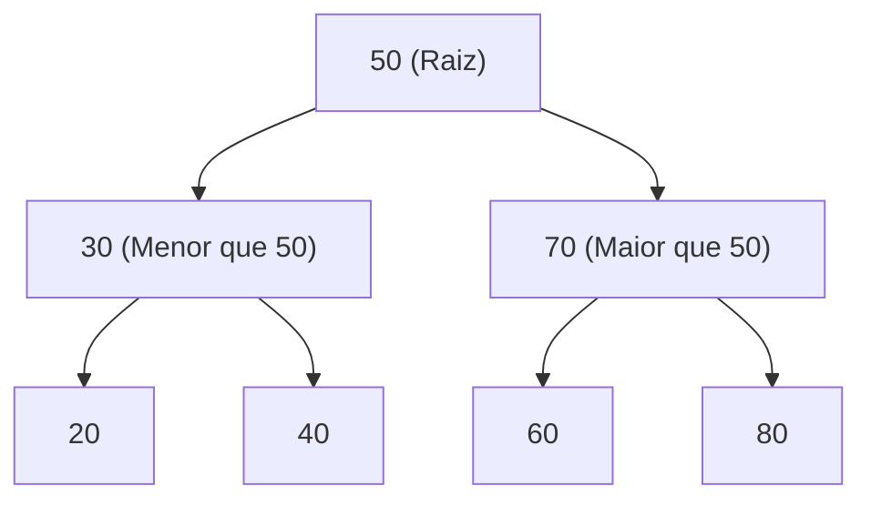

import { Tabs, TabItem } from '@astrojs/starlight/components';

## 1. Visão Geral e Intuição

Uma **Árvore Binária de Busca (Binary Search Tree - BST)** é uma estrutura de dados híbrida e não linear que une as melhores qualidades de dois mundos:
1. A velocidade de **pesquisa logarítmica ($O(\log n)$)** dos vetores ordenados.
2. A flexibilidade e rapidez de **inserção e remoção ($O(\log n)$)** das listas encadeadas (sem a necessidade de fazer *shift* de milhares de elementos contíguos na memória).

Para qualquer nó $N$ na árvore, a **Propriedade Invariante da BST** estabelece que:
- Todos os valores na subárvore **à esquerda** de $N$ são estritamente **menores** que o valor de $N$.
- Todos os valores na subárvore **à direita** de $N$ são estritamente **maiores** que o valor de $N$.

:::tip[Analogia do Mundo Real: Árvore Genealógica e Decisões de Encruzilhada]
Imagine entrar em um labirinto onde em cada bifurcação há uma placa com um número. Se o número que você procura for menor que a placa, você obrigatoriamente vira à esquerda; se for maior, vira à direita. A cada curva, você descarta metade de todos os caminhos restantes do labirinto!
:::

## 2. Anatomia de uma Árvore Binária de Busca



### O Desafio do Balanceamento

- **Árvore Balanceada (Ideal):** A altura da árvore é $\approx \log_2 n$. Todas as operações (busca, inserção, remoção) rodam em $O(\log n)$.
- **Árvore Degenerada (Pior Caso):** Se inserirmos itens já ordenados `[10, 20, 30, 40]`, a árvore se torna uma linha reta unidimensional equivalente a uma lista encadeada, degradando a performance para $O(n)$. Para resolver isso, utilizam-se árvores auto-balanceáveis (como **AVL** ou **Rubro-Negras**).

## 3. Análise de Complexidade

| Operação | Caso Médio (Balanceada) | Pior Caso (Degenerada) | Espaço Auxiliar |
| :--- | :---: | :---: | :---: |
| **Busca** | $O(\log n)$ | $O(n)$ | $O(\log n)$ recursivo / $O(1)$ iterativo |
| **Inserção** | $O(\log n)$ | $O(n)$ | $O(\log n)$ |
| **Remoção** | $O(\log n)$ | $O(n)$ | $O(\log n)$ |
| **Percorrimento Em-Ordem (*In-order*)** | $O(n)$ | $O(n)$ | $O(n)$ |

## 4. Implementações Práticas

<Tabs>
  <TabItem label="Python" icon="seti:python">
  ```python
  from __future__ import annotations
  from dataclasses import dataclass
  from typing import Optional

  @dataclass
  class NoArvore:
      valor: int
      esquerda: Optional[NoArvore] = None
      direita: Optional[NoArvore] = None

  class ArvoreBinariaBusca:
      def __init__(self):
          self.raiz: Optional[NoArvore] = None

      def inserir(self, valor: int) -> None:
          self.raiz = self._inserir_recursivo(self.raiz, valor)

      def _inserir_recursivo(self, no: Optional[NoArvore], valor: int) -> NoArvore:
          if no is None:
              return NoArvore(valor)
          if valor < no.valor:
              no.esquerda = self._inserir_recursivo(no.esquerda, valor)
          elif valor > no.valor:
              no.direita = self._inserir_recursivo(no.direita, valor)
          return no

      def buscar(self, valor: int) -> bool:
          atual = self.raiz
          while atual is not None:
              if valor == atual.valor:
                  return True
              atual = atual.esquerda if valor < atual.valor else atual.direita
          return False

      def em_ordem(self, no: Optional[NoArvore]) -> list[int]:
          """Percorrer em-ordem visita os nós em ordem estritamente crescente."""
          if not no:
              return []
          return self.em_ordem(no.esquerda) + [no.valor] + self.em_ordem(no.direita)

  if __name__ == "__main__":
      bst = ArvoreBinariaBusca()
      for v in [50, 30, 70, 20, 40, 60, 80]:
          bst.inserir(v)

      print("Valores em ordem crescente:", bst.em_ordem(bst.raiz))
      print("Existe 40?", bst.buscar(40)) # True
      print("Existe 99?", bst.buscar(99)) # False
  ```
  </TabItem>

  <TabItem label="Java" icon="seti:java">
  ```java
  public class ArvoresBinariasDeBusca {
      public static class No {
          int valor;
          No esquerda, direita;
          public No(int valor) { this.valor = valor; }
      }

      public static class BST {
          private No raiz;

          public void inserir(int valor) {
              raiz = inserirRecursivo(raiz, valor);
          }

          private No inserirRecursivo(No atual, int valor) {
              if (atual == null) return new No(valor);
              if (valor < atual.valor) {
                  atual.esquerda = inserirRecursivo(atual.esquerda, valor);
              } else if (valor > atual.valor) {
                  atual.direita = inserirRecursivo(atual.direita, valor);
              }
              return atual;
          }

          public boolean buscar(int valor) {
              No atual = raiz;
              while (atual != null) {
                  if (valor == atual.valor) return true;
                  atual = (valor < atual.valor) ? atual.esquerda : atual.direita;
              }
              return false;
          }
      }

      public static void main(String[] args) {
          BST arvore = new BST();
          arvore.inserir(50);
          arvore.inserir(30);
          arvore.inserir(70);
          System.out.println("Existe 70? " + arvore.buscar(70)); // true
      }
  }
  ```
  </TabItem>
</Tabs>

## 5. Casos de Borda e Armadilhas

- **Remoção de Nó com Dois Filhos:** É o caso mais complexo da BST. O nó a ser removido deve ser substituído pelo seu **sucessor em-ordem** (o menor valor da subárvore direita) ou por seu predecessor em-ordem.

## 6. Quando Usar e Trade-offs

- **Use quando:** Você precisar de busca rápida combinada com inserções e remoções dinâmicas e ordenação contínua dos dados (ex: bancos de dados com índices B-Tree, `TreeSet` e `TreeMap`).

## 7. Exercícios Recomendados

1. **Fixação:** Implemente a função de cálculo da altura máxima de uma árvore binária.
2. **LeetCode 98:** [Validate Binary Search Tree](https://leetcode.com/problems/validate-binary-search-tree/)

## 8. Leituras e Referências

- *Entendendo Algoritmos* — Aditya Bhargava (Capítulo 11: Árvores Binárias de Busca)
- *Introduction to Algorithms (CLRS)* — Capítulo 12: Árvores Binárias de Busca
