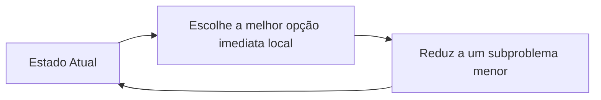

import { Tabs, TabItem } from '@astrojs/starlight/components';

## 1. Visão Geral e Intuição

Um **Algoritmo Guloso (Greedy Algorithm)** resolve problemas de otimização tomando, a cada passo individual, a decisão que parece ser a mais vantajosa e atraente **no momento presente**, sem jamais reconsiderar decisões tomadas anteriormente (sem *backtracking*).

Em muitos problemas práticos, essa abordagem míope e imediata é suficiente para encontrar a **solução ótima global**. Em outros casos mais complexos (como problemas NP-Completos), ela fornece uma **solução aproximada muito boa** em uma fração do tempo que uma busca exaustiva levaria.

:::tip[Analogia do Mundo Real: O Ladrão na Joalheria]
Um assaltante invade uma loja com uma mochila que suporta no máximo 10 kg. Ele vê uma barra de ouro de 10 kg, diamantes de 5 kg e relógios de luxo. A estratégia gulosa imediata é: pegue sempre o item de **maior valor por quilo** até encher a mochila. Ele não perde tempo testando combinações infinitas: agarra imediatamente o mais valioso disponível!
:::

## 2. Propriedades para Sucesso do Algoritmo Guloso

Para que um algoritmo guloso atinja a solução matematicamente perfeita (ótima global), o problema deve exibir duas propriedades formais:
1. **Propriedade da Escolha Gulosa:** Uma solução global ótima pode ser alcançada selecionando sucessivamente opções locais ótimas.
2. **Subestrutura Ótima:** Uma solução ótima para o problema global engloba soluções ótimas para os seus subproblemas.



### Onde os Gulosos Brilham (Soluções Ótimas Garantidas)
- **Algoritmo de Dijkstra:** Caminho mínimo em grafos não negativos.
- **Árvore Geradora Mínima (Algoritmos de Prim e Kruskal).**
- **Codificação de Huffman:** Compressão de dados sem perdas (ZIP, MP3, JPEG).
- **Problema do Troco:** (Para sistemas monetários canônicos convencionais).

## 3. O Problema da Cobertura de Conjuntos (*Set Cover*)

Quando queremos escolher o menor número de estações de rádio para cobrir todos os estados de um país, a solução exata exige testar $2^n$ combinações (exponencial). Um algoritmo guloso escolhe a cada rodada a estação que cobre o maior número de estados ainda não cobertos, rodando em tempo polinomial $O(n^2)$ com uma aproximação extremamente próxima do ideal!

## 4. Implementações Práticas (Problema da Cobertura de Rádios)

<Tabs>
  <TabItem label="Python" icon="seti:python">
  ```python
  def cobertura_estacoes_gulosa(estados_necessarios: set[str], estacoes: dict[str, set[str]]) -> set[str]:
      """
      Algoritmo guloso de aproximação para cobertura de conjuntos.
      """
      estados_restantes = set(estados_necessarios)
      estacoes_escolhidas = set()

      while estados_restantes:
          melhor_estacao = None
          estados_cobertos_melhor = set()

          for estacao, estados in estacoes.items():
              cobertos = estados_restantes & estados # Interseção
              if len(cobertos) > len(estados_cobertos_melhor):
                  melhor_estacao = estacao
                  estados_cobertos_melhor = cobertos

          if melhor_estacao is None:
              break

          estados_restantes -= estados_cobertos_melhor
          estacoes_escolhidas.add(melhor_estacao)

      return estacoes_escolhidas

  if __name__ == "__main__":
      estados = {"SP", "RJ", "MG", "ES", "PR", "SC", "RS"}
      radios = {
          "Rádio Alfa": {"SP", "RJ", "MG"},
          "Rádio Beta": {"PR", "SC", "RS"},
          "Rádio Gama": {"RJ", "ES"},
          "Rádio Delta": {"SP", "PR"},
          "Rádio Epsilon": {"MG", "ES"}
      }
      escolhidas = cobertura_estacoes_gulosa(estados, radios)
      print("Estações gulosas selecionadas:", escolhidas)
  ```
  </TabItem>

  <TabItem label="Java" icon="seti:java">
  ```java
  import java.util.*;

  public class AlgoritmosGulosos {
      public static Set<String> coberturaGulosa(Set<String> estadosNecessarios, Map<String, Set<String>> estacoes) {
          Set<String> restantes = new HashSet<>(estadosNecessarios);
          Set<String> escolhidas = new HashSet<>();

          while (!restantes.isEmpty()) {
              String melhorEstacao = null;
              Set<String> melhorCobertura = new HashSet<>();

              for (var entry : estacoes.entrySet()) {
                  Set<String> cobertos = new HashSet<>(entry.getValue());
                  cobertos.retainAll(restantes);

                  if (cobertos.size() > melhorCobertura.size()) {
                      melhorEstacao = entry.getKey();
                      melhorCobertura = cobertos;
                  }
              }

              if (melhorEstacao == null) break;
              restantes.removeAll(melhorCobertura);
              escolhidas.add(melhorEstacao);
          }
          return escolhidas;
      }

      public static void main(String[] args) {
          Set<String> estados = Set.of("SP", "RJ", "MG", "ES");
          Map<String, Set<String>> radios = Map.of(
              "Alfa", Set.of("SP", "RJ"),
              "Beta", Set.of("MG", "ES"),
              "Gama", Set.of("SP", "MG")
          );
          System.out.println("Estações: " + coberturaGulosa(estados, radios));
      }
  }
  ```
  </TabItem>
</Tabs>

## 5. Casos de Borda e Armadilhas

- **Falha em Problemas Sem Subestrutura Ótima:** No problema da **Mochila 0/1** (onde você não pode fracionar os itens), a estratégia gulosa pode falhar totalmente (ex: pegar um item ligeiramente mais valioso mas muito pesado, impedindo a inclusão de 3 itens médios que juntos valeriam o dobro). Para a Mochila 0/1, é necessário usar **Programação Dinâmica**.

## 6. Quando Usar e Trade-offs

- **Use quando:** O problema admitir a escolha gulosa comprovadamente ótima ou quando o problema for NP-Completo e você precisar de uma resposta rápida e razoavelmente boa em milissegundos.

## 7. Exercícios Recomendados

1. **Fixação:** Implemente o problema do troco com moedas de [50, 25, 10, 5, 1] centavos de forma gulosa.
2. **LeetCode 455:** [Assign Cookies](https://leetcode.com/problems/assign-cookies/)

## 8. Leituras e Referências

- *Entendendo Algoritmos* — Aditya Bhargava (Capítulo 8: Algoritmos Gulosos)
- *Introduction to Algorithms (CLRS)* — Capítulo 16: Algoritmos Gulosos
