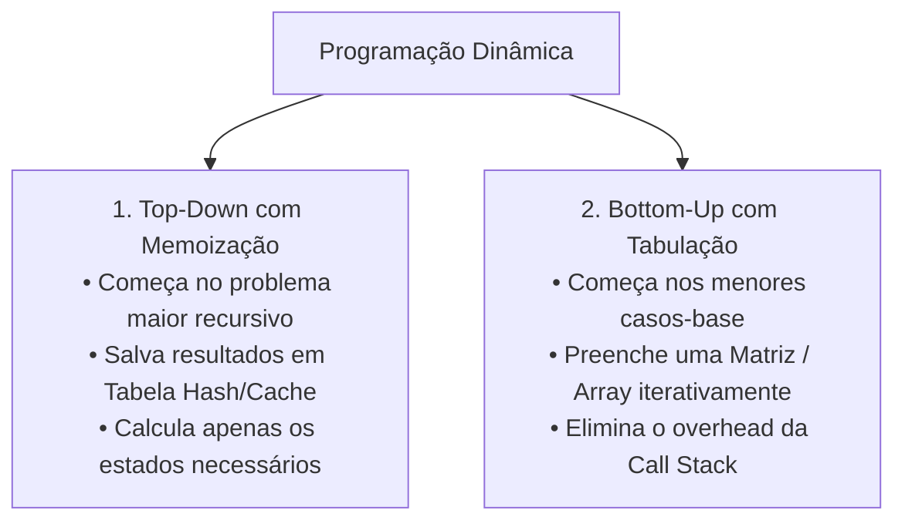

import { Tabs, TabItem } from '@astrojs/starlight/components';

## 1. Visão Geral e Intuição

A **Programação Dinâmica (Dynamic Programming - DP)** é uma das técnicas algorítmicas mais sofisticadas da ciência da computação. Enquanto a técnica de *Dividir para Conquistar* quebra o problema em subproblemas independentes, a Programação Dinâmica entra em ação quando os **subproblemas se sobrepõem (*overlapping subproblems*)** — ou seja, quando o mesmo cálculo menor é requisitado repetidamente milhares de vezes.

Em vez de recalcular o mesmo subproblema repetidas vezes (o que causaria lentidão exponencial $O(2^n)$), a Programação Dinâmica calcula a resposta de cada subproblema **apenas uma vez** e a armazena em uma tabela (em memória RAM), consultando o resultado pré-calculado em $O(1)$ nas etapas seguintes.

:::tip[Analogia do Mundo Real: A Anotação no Papel]
Se eu escrever na lousa `1 + 1 + 1 + 1 + 1` e perguntar quanto dá, você conta mentalmente e responde: `5`. Se eu adicionar outro `+ 1` no final, você não reconta todos os números desde o começo: você lembra que a resposta anterior era 5, soma 1 e diz imediatamente `6`. Você acabou de aplicar programação dinâmica (memoização)!
:::

## 2. As Duas Abordagens Fundamentais



### Problemas Clássicos de Programação Dinâmica
- **Problema da Mochila 0/1 (Knapsack Problem).**
- **Maior Subsequência Comum (Longest Common Subsequence - LCS)** (usado no comando `git diff`).
- **Maior Substring Comum (Longest Common Substring)** (filtros de correção ortográfica e busca em DNA).
- **Distância de Edição (Levenshtein Distance)** (usado em corretores automáticos).
- **Avaliação de Tabuleiro em IAs de Jogos (Damas, Xadrez).**

## 3. O Problema da Mochila: Matriz de Decisão

Se temos itens com pesos e valores específicos e uma capacidade máxima de mochila:

$$
\text{matriz}[i][c] = \max(\text{matriz}[i-1][c], \; \text{valor}[i] + \text{matriz}[i-1][c - \text{peso}[i]])
$$

## 4. Implementações Práticas

<Tabs>
  <TabItem label="Python (Mochila 0/1)" icon="seti:python">
  ```python
  def mochila_01(pesos: list[int], valores: list[int], capacidade: int) -> int:
      """
      Resolve o problema da Mochila 0/1 usando Tabulação Bottom-Up.
      Complexidade: Tempo O(N * C) | Espaço O(N * C)
      """
      n = len(pesos)
      # Tabela (n + 1) x (capacidade + 1)
      dp = [[0] * (capacidade + 1) for _ in range(n + 1)]

      for i in range(1, n + 1):
          peso_item = pesos[i - 1]
          valor_item = valores[i - 1]
          for c in range(1, capacidade + 1):
              if peso_item <= c:
                  # Escolhe o melhor entre não levar ou levar o item atual
                  dp[i][c] = max(dp[i - 1][c], valor_item + dp[i - 1][c - peso_item])
              else:
                  dp[i][c] = dp[i - 1][c]

      return dp[n][capacidade]

  if __name__ == "__main__":
      # Violão (R$ 1500, 1kg), Som (R$ 3000, 4kg), Laptop (R$ 2000, 3kg)
      pesos = [1, 4, 3]
      valores = [1500, 3000, 2000]
      capacidade = 4
      print("Valor máximo na mochila:", mochila_01(pesos, valores, capacidade)) # R$ 3500 (Violão + Laptop)
  ```
  </TabItem>

  <TabItem label="Java (Fibonacci com Memoização)" icon="seti:java">
  ```java
  import java.util.HashMap;
  import java.util.Map;

  public class ProgramacaoDinamica {
      private static final Map<Integer, Long> memo = new HashMap<>();

      // Top-Down com Memoização: O(n) em vez do O(2^n) ingênuo
      public static long fibonacci(int n) {
          if (n <= 1) return n;
          if (memo.containsKey(n)) return memo.get(n);

          long resultado = fibonacci(n - 1) + fibonacci(n - 2);
          memo.put(n, resultado);
          return resultado;
      }

      public static void main(String[] args) {
          System.out.println("Fibonacci(50) calculado instantaneamente: " + fibonacci(50));
      }
  }
  ```
  </TabItem>
</Tabs>

## 5. Casos de Borda e Armadilhas

- **Pesos Não Inteiros:** A tabela de programação dinâmica tradicional para a mochila depende de capacidades discretas inteiras. Se os pesos forem fracionários contínuos, a matriz precisa de discretização ou outra técnica.
- **Consumo de Memória de Matrizes Gigantes:** Se a capacidade for $C = 10^7$, a matriz $N \times C$ ocupará gigabytes de RAM. Nesses casos, pode-se otimizar o espaço usando apenas duas linhas da tabela (linha atual e anterior), reduzindo o espaço para $O(C)$.

## 6. Quando Usar e Trade-offs

- **Use Programação Dinâmica:** Sempre que estiver diante de um problema de otimização combinatória (maximizar valor, minimizar custo) onde a decisão para o item $i$ depende diretamente das respostas ideais dos subitens anteriores.

## 7. Exercícios Recomendados

1. **Fixação:** Implemente o cálculo do maior número de caminhos possíveis para um robô atravessar uma grade $M \times N$ saindo do topo esquerdo até o fundo direito (Unique Paths).
2. **LeetCode 1143:** [Longest Common Subsequence](https://leetcode.com/problems/longest-common-subsequence/)
3. **LeetCode 322:** [Coin Change](https://leetcode.com/problems/coin-change/)

## 8. Leituras e Referências

- *Entendendo Algoritmos* — Aditya Bhargava (Capítulo 9: Programação Dinâmica)
- *Introduction to Algorithms (CLRS)* — Capítulo 15: Programação Dinâmica
