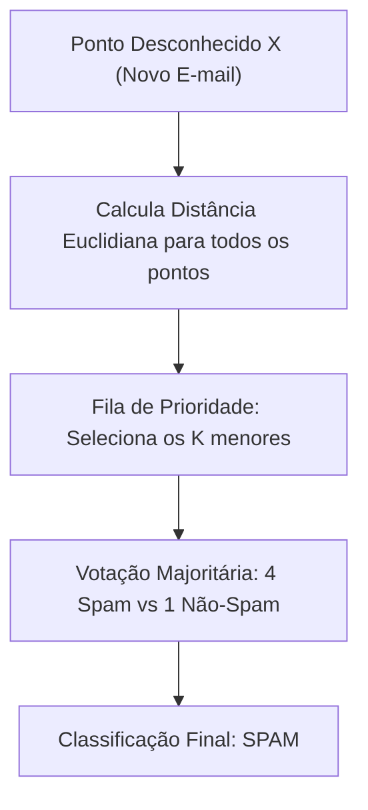

import { Tabs, TabItem } from '@astrojs/starlight/components';

## 1. Visão Geral e Intuição

O algoritmo dos **K-Vizinhos Mais Próximos (K-Nearest Neighbors - KNN)** é uma das técnicas mais intuitivas e elegantes na interseção entre estruturas de dados e **Aprendizado de Máquina (Machine Learning)**.

O princípio central do KNN é a **semelhança por proximidade geométrica**: objetos com características semelhantes tendem a ficar próximos uns dos outros quando mapeados em um espaço de coordenadas multidimensional (*feature space*).

Para classificar um novo dado não identificado:
1. Calcule a distância geométrica (geralmente distância Euclidiana) entre esse novo ponto e todos os pontos já conhecidos e rotulados do banco de dados.
2. Identifique os **$K$ pontos mais próximos**.
3. Realize uma votação majoritária entre esses $K$ vizinhos: o rótulo mais frequente vence (**Classificação**), ou tire a média de seus valores numéricos (**Regressão**).

:::tip[Analogia do Mundo Real: "Diga-me com quem andas..."]
Imagine que você se mudou para um bairro novo e quer saber se ele é calmo ou movimentado. Você consulta as opiniões das $K=5$ pessoas que moram nas 5 casas mais próximas da sua. Se 4 delas disserem que o bairro é calmo e 1 disser que é agitado, você conclui por maioria de votos que o bairro é calmo!
:::

## 2. A Fórmula da Distância Euclidiana

Para pontos em $N$ dimensões ($x_1, x_2, \dots, x_N$):
$$
\text{Distância}(A, B) = \sqrt{(A_1 - B_1)^2 + (A_2 - B_2)^2 + \dots + (A_N - B_N)^2}
$$



## 3. Aplicações Práticas do KNN no Mundo Real

- **Sistemas de Recomendação:** (Ex: recomendação de filmes na Netflix baseada em usuários com perfis de notas similares).
- **Filtros de Spam:** Comparação da frequência de termos de um e-mail novo com e-mails marcados como spam.
- **Reconhecimento Óptico de Caracteres (OCR):** Identificar números manuscritos mapeando pixels de uma imagem $28 \times 28$ em um vetor de 784 dimensões.

## 4. Implementações Práticas

<Tabs>
  <TabItem label="Python" icon="seti:python">
  ```python
  import math
  from collections import Counter

  def distancia_euclidiana(p1: list[float], p2: list[float]) -> float:
      return math.sqrt(sum((a - b) ** 2 for a, b in zip(p1, p2)))

  def classificar_knn(treino_x: list[list[float]], treino_y: list[str], novo_ponto: list[float], k: int = 3) -> str:
      """
      Classificador KNN elementar.
      """
      distancias = []
      for features, rotulo in zip(treino_x, treino_y):
          d = distancia_euclidiana(features, novo_ponto)
          distancias.append((d, rotulo))

      # Ordena pelas menores distâncias
      distancias.sort(key=lambda x: x[0])

      # Pega os K vizinhos mais próximos
      k_vizinhos = [rotulo for _, rotulo in distancias[:k]]

      # Votação majoritária
      voto_majoritario = Counter(k_vizinhos).most_common(1)[0][0]
      return voto_majoritario

  if __name__ == "__main__":
      # Características: [tamanho em cm, peso em gramas]
      dados_frutas = [
          [7.0, 150.0],  # Maçã
          [7.5, 160.0],  # Maçã
          [8.0, 170.0],  # Maçã
          [18.0, 120.0], # Banana
          [20.0, 130.0], # Banana
      ]
      rotulos = ["Maçã", "Maçã", "Maçã", "Banana", "Banana"]

      nova_fruta = [7.2, 155.0]
      resultado = classificar_knn(dados_frutas, rotulos, nova_fruta, k=3)
      print(f"A fruta com características {nova_fruta} foi classificada como: {resultado}")
  ```
  </TabItem>

  <TabItem label="Java" icon="seti:java">
  ```java
  import java.util.*;

  public class KNearestNeighbors {
      public record Ponto(double[] features, String rotulo) {}
      private record PontoDistancia(double distancia, String rotulo) implements Comparable<PontoDistancia> {
          @Override
          public int compareTo(PontoDistancia o) {
              return Double.compare(this.distancia, o.distancia);
          }
      }

      public static double distanciaEuclidiana(double[] a, double[] b) {
          double soma = 0;
          for (int i = 0; i < a.length; i++) {
              soma += Math.pow(a[i] - b[i], 2);
          }
          return Math.sqrt(soma);
      }

      public static String classificarKNN(List<Ponto> base, double[] novoPonto, int k) {
          List<PontoDistancia> listaDist = new ArrayList<>();
          for (Ponto p : base) {
              double d = distanciaEuclidiana(p.features(), novoPonto);
              listaDist.add(new PontoDistancia(d, p.rotulo()));
          }
          Collections.sort(listaDist);

          Map<String, Integer> votos = new HashMap<>();
          for (int i = 0; i < Math.min(k, listaDist.size()); i++) {
              String rotulo = listaDist.get(i).rotulo();
              votos.put(rotulo, votos.getOrDefault(rotulo, 0) + 1);
          }

          return Collections.max(votos.entrySet(), Map.Entry.comparingByValue()).getKey();
      }

      public static void main(String[] args) {
          List<Ponto> base = List.of(
              new Ponto(new double[]{7.0, 150.0}, "Maçã"),
              new Ponto(new double[]{19.0, 125.0}, "Banana")
          );
          System.out.println("Classificação: " + classificarKNN(base, new double[]{7.2, 152.0}, 1));
      }
  }
  ```
  </TabItem>
</Tabs>

## 5. Casos de Borda e Armadilhas

- **A Maldição da Dimensionalidade (*Curse of Dimensionality*):** Conforme o número de atributos ($N$) cresce para centenas ou milhares de dimensões, a distância euclidiana entre todos os pontos converge para números praticamente idênticos, inutilizando a noção de proximidade.
- **Necessidade de Normalização de Escalas:** Se uma dimensão varia de 0 a 1 (ex: nota de avaliação) e outra de 0 a 100.000 (ex: salário em reais), a dimensão do salário distorcerá 99,9% do cálculo da distância se as variáveis não forem previamente normalizadas (ex: Min-Max ou Z-score).

## 6. Quando Usar e Trade-offs

- O KNN é um classificador *Lazy Learner*: o treinamento é instantâneo ($O(1)$), mas a predição é custosa ($O(N \times D)$) porque precisa medir a distância para cada ponto da base de dados. Para acelerar buscas espaciais, utilizam-se estruturas como **k-d Trees** ou **Ball Trees**.

## 7. Exercícios Recomendados

1. **Fixação:** Explique por que o valor de $K$ deve preferencialmente ser um número ímpar ao lidar com problemas de classificação binária (duas classes).
2. **Implementação:** Escreva uma função para normalizar um vetor de características para o intervalo $[0, 1]$.

## 8. Leituras e Referências

- *Entendendo Algoritmos* — Aditya Bhargava (Capítulo 10: K-Vizinhos Mais Próximos)
- *The Elements of Statistical Learning* — Hastie, Tibshirani e Friedman
