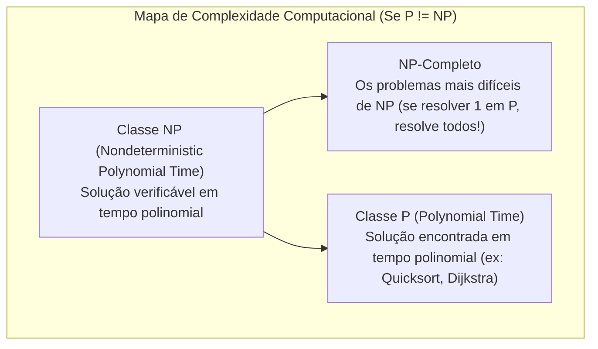

import { Tabs, TabItem } from '@astrojs/starlight/components';

## 1. Visão Geral e Intuição

Na ciência da computação teórica, existe uma classe especial de problemas para os quais **ninguém até hoje conseguiu encontrar um algoritmo rápido (em tempo polinomial $O(n^k)$)**, e ninguém conseguiu provar matematicamente que tal algoritmo é impossível. Esses são os **Problemas NP-Completos**.

Reconhecer que você está diante de um problema NP-Completo é uma das habilidades mais vitais de um engenheiro de software experiente. Isso impede que você desperdice meses tentando desenvolver uma solução perfeita e rápida que pode não existir, direcionando seu esforço para **algoritmos de aproximação, heurísticas gulosas ou soluções probabilísticas**.

:::tip[Analogia do Mundo Real: O Caixeiro-Viajante]
Um vendedor precisa visitar $N$ cidades diferentes e retornar à cidade de origem, percorrendo a menor quilometragem total possível. 
- Para 5 cidades: existem 12 rotas possíveis. Fácil!
- Para 10 cidades: existem mais de 181 mil rotas.
- Para 20 cidades: existem $2,43 \times 10^{18}$ rotas. Um supercomputador testando 1 bilhão de rotas por segundo levaria **77 anos** calculando!
:::

## 2. As Classes de Complexidade: P vs. NP



### Principais Problemas NP-Completos Clássicos

1. **Problema do Caixeiro-Viajante (TSP - Travelling Salesperson Problem).**
2. **Problema da Cobertura de Conjuntos (*Set Covering*).**
3. **Problema da Mochila 0/1 (Versão exata de decisão).**
4. **Problema do Clique Máximo em Grafos.**
5. **Satisfatibilidade Booleana (3-SAT - Teorema de Cook-Levin).**

## 3. Sinais de Alerta: Como Identificar um Problema NP-Completo?

Se o seu problema atender a um ou mais destes critérios, desconfie imediatamente:
- Seu algoritmo fica terrivelmente lento quando a entrada passa de $n = 20$ ou $n = 30$.
- O problema envolve *"todas as combinações de X"* ou *"todos os subconjuntos possíveis"*.
- O problema pode ser reescrito como o Caixeiro-Viajante ou como Cobertura de Conjuntos.
- O problema pede para calcular uma sequência perfeita que visita todos os pontos de um grafo (Caminho Hamiltoniano).

## 4. O que Fazer ao Encontrar um Problema NP-Completo?

Em vez de buscar a solução 100% exata através de força bruta ($O(n!)$ ou $O(2^n)$):
1. **Algoritmos Gulosos / Aproximados:** Encontram uma resposta que fica a $1\%$ ou $5\%$ da solução ótima em tempo $O(n^2)$.
2. **Metaheurísticas:** Algoritmos Genéticos, *Simulated Annealing* e Colônia de Formigas.
3. **Limitação de Escopo ($n$ pequeno):** Se o seu sistema opera com no máximo $n = 12$ elementos, força bruta com *branch and bound* pode ser viável.

## 5. Implementação: Caixeiro-Viajante por Força Bruta vs. Heurística Gulosa

<Tabs>
  <TabItem label="Python" icon="seti:python">
  ```python
  import itertools
  import math

  def tsp_forca_bruta(distancias: list[list[int]]) -> tuple[int, tuple]:
      """
      Solução exata O(n!) - Inviável para n > 12.
      Testa todas as permutações possíveis de cidades.
      """
      n = len(distancias)
      cidades = list(range(1, n)) # Cidade 0 é a base
      menor_distancia = math.inf
      melhor_rota = ()

      for perm in itertools.permutations(cidades):
          rota_atual = (0,) + perm + (0,)
          custo = sum(distancias[rota_atual[i]][rota_atual[i+1]] for i in range(len(rota_atual) - 1))
          if custo < menor_distancia:
              menor_distancia = custo
              melhor_rota = rota_atual

      return int(menor_distancia), melhor_rota

  def tsp_vizinho_mais_proximo_guloso(distancias: list[list[int]]) -> tuple[int, list[int]]:
      """
      Heurística do Vizinho Mais Próximo O(n²).
      Sempre viaja para a cidade vizinha mais próxima ainda não visitada.
      """
      n = len(distancias)
      visitados = {0}
      rota = [0]
      custo_total = 0
      atual = 0

      while len(visitados) < n:
          proxima = min(
              (cidade for cidade in range(n) if cidade not in visitados),
              key=lambda c: distancias[atual][c]
          )
          custo_total += distancias[atual][proxima]
          rota.append(proxima)
          visitados.add(proxima)
          atual = proxima

      # Volta para a base
      custo_total += distancias[atual][0]
      rota.append(0)
      return custo_total, rota

  if __name__ == "__main__":
      matriz = [
          [0, 10, 15, 20],
          [10, 0, 35, 25],
          [15, 35, 0, 30],
          [20, 25, 30, 0]
      ]
      c_exato, r_exato = tsp_forca_bruta(matriz)
      c_guloso, r_guloso = tsp_vizinho_mais_proximo_guloso(matriz)
      print(f"Exato (O(n!)): Custo {c_exato} | Rota {r_exato}")
      print(f"Guloso (O(n²)): Custo {c_guloso} | Rota {r_guloso}")
  ```
  </TabItem>

  <TabItem label="Java" icon="seti:java">
  ```java
  import java.util.*;

  public class ProblemasNPCompletos {
      public static int tspVizinhoMaisProximo(int[][] distancias) {
          int n = distancias.length;
          boolean[] visitados = new boolean[n];
          visitados[0] = true;
          int atual = 0;
          int custoTotal = 0;

          for (int visitadosCount = 1; visitadosCount < n; visitadosCount++) {
              int proximo = -1;
              int menorDist = Integer.MAX_VALUE;

              for (int c = 0; c < n; c++) {
                  if (!visitados[c] && distancias[atual][c] < menorDist) {
                      menorDist = distancias[atual][c];
                      proximo = c;
                  }
              }
              visitados[proximo] = true;
              custoTotal += menorDist;
              atual = proximo;
          }
          custoTotal += distancias[atual][0];
          return custoTotal;
      }

      public static void main(String[] args) {
          int[][] matriz = {
              {0, 10, 15, 20},
              {10, 0, 35, 25},
              {15, 35, 0, 30},
              {20, 25, 30, 0}
          };
          System.out.println("Custo Aproximado (Guloso): " + tspVizinhoMaisProximo(matriz));
      }
  }
  ```
  </TabItem>
</Tabs>

## 6. Leituras e Referências

- *Entendendo Algoritmos* — Aditya Bhargava (Capítulo 8: Problemas NP-Completos)
- *Computers and Intractability: A Guide to the Theory of NP-Completeness* — Michael Garey e David S. Johnson
